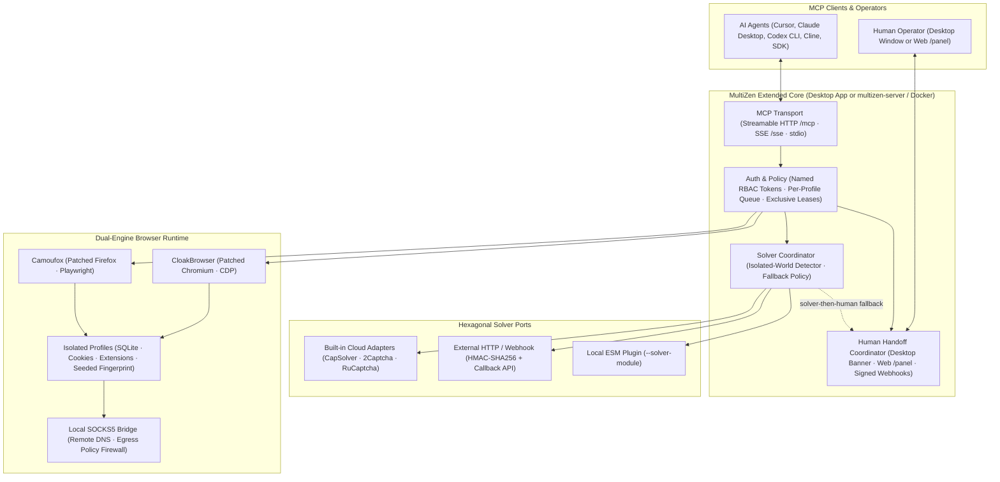

<div align="center">
  

  <h1>MultiZen Extended</h1>

  <p><strong>Multi-engine anti-detect browser &amp; MCP server for AI agents and human operators.</strong></p>

  <p>
    Isolated <strong>CloakBrowser</strong> (Chromium) and <strong>Camoufox</strong> (Firefox) profiles with persistent cookies, coherent hardware fingerprints, per-profile proxies, hexagonal CAPTCHA solver ports, human-in-the-loop handoff, and headless server + Docker support.
  </p>

  <p>
    <strong>English</strong>
    &nbsp;·&nbsp;
    <a href="docs/i18n/README.ru.md">Русский</a>
    &nbsp;·&nbsp;
    <a href="docs/i18n/README.zh-CN.md">简体中文</a>
    &nbsp;·&nbsp;
    <a href="docs/i18n/README.ja.md">日本語</a>
    &nbsp;·&nbsp;
    <a href="docs/i18n/README.es.md">Español</a>
    &nbsp;·&nbsp;
    <a href="docs/i18n/README.ko.md">한국어</a>
  </p>

  <p>
    <a href="https://github.com/kiserufetch/multizen-browser-extended/releases/latest"></a>
    <a href="https://github.com/kiserufetch/multizen-browser-extended/actions/workflows/ci.yml"></a>
    <a href="https://github.com/kiserufetch/multizen-browser-extended/actions/workflows/release.yml"></a>
    <a href="https://github.com/kiserufetch/multizen-browser-extended/releases"></a>
    <a href="https://github.com/kiserufetch/multizen-browser-extended/stargazers"></a>
    <a href="LICENSE"></a>
  </p>

  <p>
    
    
    
    
  </p>

  <p>
    <a href="https://github.com/kiserufetch/multizen-browser-extended/releases/latest"><strong>Download Latest</strong></a>
    &nbsp;·&nbsp;
    <a href="#connect-an-agent-codex-cursor-claude-desktop">MCP Quickstart</a>
    &nbsp;·&nbsp;
    <a href="apps/server/README.md">Server Mode Docs</a>
    &nbsp;·&nbsp;
    <a href="CHANGELOG.md">Changelog</a>
    &nbsp;·&nbsp;
    <a href="https://github.com/kiserufetch/multizen-browser-extended/issues">Issues</a>
    &nbsp;·&nbsp;
    <a href="https://github.com/kiserufetch/multizen-browser-extended/discussions">Discussions</a>
  </p>

  <br/>

  

  <br/><br/>
</div>

## Table of contents

- [What is MultiZen Extended?](#what-is-multizen-extended)
- [Key capabilities](#key-capabilities)
- [Architecture](#architecture)
- [Install (Desktop App)](#install-desktop-app)
- [Connect an agent (Codex, Cursor, Claude Desktop)](#connect-an-agent-codex-cursor-claude-desktop)
- [CAPTCHA & challenge solver ports](#captcha--challenge-solver-ports)
- [Server mode & Docker](#server-mode--docker)
- [Why MultiZen Extended?](#why-multizen-extended)
- [Tech stack & repository layout](#tech-stack--repository-layout)
- [Develop](#develop)
- [Acceptable use](#acceptable-use)
- [License](#license)

---

## What is MultiZen Extended?

**MultiZen Extended** is an open-source, self-hosted browser platform built for both **AI agents** and **human operators**. It manages a local library of isolated browser profiles — each with its own cookies, storage, extensions, proxy, and coherent hardware fingerprint — and runs every profile on your choice of anti-detect engine: **CloakBrowser** (source-patched Chromium) or **Camoufox** (Firefox-based).

A built-in **Model Context Protocol (MCP)** server on `127.0.0.1:7777` exposes **51 browser-drive, profile, solver, and handoff tools** over Streamable HTTP, legacy SSE, or stdio. You can run it as a visual **Electron desktop app** on macOS, Windows, and Linux — or deploy the exact same drivers and MCP server headlessly with zero GUI via **`multizen-server`** on bare metal or in **Docker**.

When an agent reaches a 2FA prompt, login wall, or CAPTCHA, MultiZen Extended can either route the challenge through a pluggable **CAPTCHA solver port** (CapSolver, 2Captcha, RuCaptcha, HTTP webhook, or local ESM plugin) or hand control seamlessly to a human operator — directly in the desktop window or remotely in the `/panel` live web view. Once resolved, the agent resumes right where it left off with all cookies and sessions intact.

---

## Key capabilities

| Capability | Details |
| --- | --- |
| **Dual Anti-Detect Engines** | Pick **CloakBrowser** (source-patched Chromium with C++-level canvas/WebGL/audio spoofing & WebRTC leak prevention) or **Camoufox** (Firefox-based, deterministic per-profile seed, non-Chrome TLS/JS fingerprint) per profile. |
| **High-Entropy Coherent Personas** | Expanded Windows, Mac (Apple Silicon M2–M4 & Intel), and Linux desktop/laptop hardware catalogs with reconciled UA/Client Hints/WebGL/screen profiles, rotatable fingerprint seeds, `probe_fingerprint` drift diagnostics, and strict-pin launch timezone policy (with opt-in `alignTimezoneToProxy` / `strictGeoCoherence`). |
| **51 Production MCP Tools** | Full profile CRUD, ref-addressed ARIA/DOM interaction (`click_ref` / `type_ref`) across tabs and cross-origin iframes, realistic synthetic keyboard/pointer events, downloads & uploads, JS dialog policies, exclusive profile leases, per-profile call queues, typed retryable errors, and optional raw CDP passthrough (`cdp_send` / `cdp_send_no_safety`). |
| **Hexagonal Solver Ports** | Pluggable CAPTCHA & challenge solver subsystem with built-in **CapSolver**, **2Captcha**, **RuCaptcha**, signed **HTTP/Webhook**, and local **ESM plugin** adapters. Stealth isolated-world detection for Turnstile, reCAPTCHA v2/v3/Enterprise, hCaptcha, GeeTest, Arkose FunCaptcha, and DataDome — configurable live over MCP. |
| **Human Handoff & Web `/panel`** | Escalate 2FA, logins, or unsolved challenges via `request_human` / `wait_for_human`. Operators intervene in the desktop window or remotely in `/panel` (live view up to 5 FPS, mouse, wheel, keyboard, tab switching, JS dialogs, file pickers, signed webhooks) while agent writes pause with `HUMAN_IN_CONTROL`. |
| **Headless Server & Hardened Docker** | `multizen-server` runs the full MCP server and both browser drivers with no Electron. Supports `headed`, `xvfb`, and `headless` display modes, named RBAC tokens (`read`, `act`, `profile-admin`, `raw`, `operator`), connection-level SOCKS5 egress firewall (`block-private`), AES-256-GCM encrypted proxy passwords, crash reaper, seccomp Chromium sandbox, and PipeWire audio + Linux desktop fonts in the image. |
| **Proxy + Local SOCKS5 Bridge** | Per-profile HTTP or SOCKS5 proxy with a local SOCKS5 bridge so DNS resolution stays remote. Built-in proxy tester with latency readout, multi-format paste parser, and automatic geo-persona alignment. |
| **Desktop Ergonomics & Extensions** | Grid/list views, emoji avatars, tags, per-profile start URLs, shared deduplicated MV3 extension store with Chrome Web Store companion button, encrypted `.mzar` profile export/import, live MCP activity feed, and built-in GitHub Releases auto-updater. |
| **100% Self-Hosted & Open Source** | Profiles live locally in plain SQLite and standard browser data directories. No cloud account, no license server, telemetry off by default, MIT license. |

---

## Architecture



---

## Install (Desktop App)

Pre-built installers for macOS, Windows, and Linux are published on the [GitHub Releases page](https://github.com/kiserufetch/multizen-browser-extended/releases/latest).

### macOS (Apple Silicon & Intel)

Download the DMG matching your architecture from [Releases](https://github.com/kiserufetch/multizen-browser-extended/releases/latest):

- **Apple Silicon (M1–M4):** [`MultiZen-mac-arm64.dmg`](https://github.com/kiserufetch/multizen-browser-extended/releases/latest/download/MultiZen-mac-arm64.dmg)
- **Intel (x64):** [`MultiZen-mac-x64.dmg`](https://github.com/kiserufetch/multizen-browser-extended/releases/latest/download/MultiZen-mac-x64.dmg)

Open the DMG, drag **MultiZen** to `Applications`, and strip the macOS Gatekeeper quarantine flag once (builds are ad-hoc signed without paid Apple notarization):

```sh
xattr -cr /Applications/MultiZen.app
```

### Windows (x64)

Download and run [`MultiZen-win-x64.exe`](https://github.com/kiserufetch/multizen-browser-extended/releases/latest/download/MultiZen-win-x64.exe).

Windows SmartScreen may flag unsigned open-source installers on first download — click **More info**, then **Run anyway**.

### Linux (x86_64 AppImage)

```sh
curl -LO https://github.com/kiserufetch/multizen-browser-extended/releases/latest/download/MultiZen-linux-x86_64.AppImage
chmod +x MultiZen-linux-x86_64.AppImage
./MultiZen-linux-x86_64.AppImage
```

Some distributions require `libfuse2` (`sudo apt install libfuse2t64` on Ubuntu 24.04+).

<details>
<summary><strong>Linux sandbox setup (Ubuntu 24.04+ &amp; restricted user namespaces)</strong></summary>

On Ubuntu 24.04+ and other kernels that restrict unprivileged user namespaces, Chromium's sandbox is blocked by default. On the first affected launch, MultiZen Extended offers a one-time **secure setup** that installs a narrow AppArmor profile (`/etc/apparmor.d/multizen-cloakbrowser`) permitting the sandbox solely for the bundled engine (one password prompt). You can also run or re-run it from **Settings**, or inspect the exact `apparmor_parser` command there to install it manually. If declined, the desktop app falls back to launching without the sandbox so profiles remain usable. To force sandbox-off explicitly on desktop, launch the AppImage with `--no-sandbox`.

</details>

<details>
<summary><strong>First-run onboarding preview</strong></summary>

<br/>

<div align="center">
  
</div>

</details>

---

## Connect an agent (Codex, Cursor, Claude Desktop)

When running, the MCP server listens on `127.0.0.1:7777`, exposing the modern **Streamable HTTP** endpoint at `http://127.0.0.1:7777/mcp` (plus legacy HTTP+SSE at `/sse`).

Authentication uses a **bearer token** generated on first start and displayed in **MCP → Connect an agent** (also written to `mcp-token` in the desktop data directory, or minted per-agent via `multizen-server token create`). The desktop MCP panel includes a one-click **Copy for LLM** button with your token pre-filled.

**Codex CLI** (`~/.codex/config.toml`):

```toml
[mcp_servers.multizen]
url = "http://127.0.0.1:7777/mcp"
http_headers = { Authorization = "Bearer <token>" }
```

**Cursor** (`~/.cursor/mcp.json`), **Cline**, **Continue**, and other JSON URL clients:

```json
{
  "mcpServers": {
    "multizen": {
      "url": "http://127.0.0.1:7777/mcp",
      "headers": { "Authorization": "Bearer <token>" }
    }
  }
}
```

**Claude Desktop** (`~/Library/Application Support/Claude/claude_desktop_config.json` on macOS, `%APPDATA%\Claude\claude_desktop_config.json` on Windows) — bridge via [`mcp-remote`](https://www.npmjs.com/package/mcp-remote) (or `multizen-server stdio --connect`):

```json
{
  "mcpServers": {
    "multizen": {
      "command": "npx",
      "args": ["mcp-remote", "http://127.0.0.1:7777/mcp", "--header", "Authorization: Bearer <token>"]
    }
  }
}
```

Restart your MCP client. Your agent now has access to the complete surface of **51 tools:**

| Category | Tools |
| --- | --- |
| **Profiles & Personas** | `list_profiles`, `create_profile`, `update_profile`, `delete_profile`, `launch_profile`, `close_profile`, `list_fingerprint_options` |
| **Reading a Page** | `extract`, `screenshot` |
| **Acting on a Page** | `navigate`, `click`, `type`, `click_ref`, `type_ref`, `press_key`, `hover`, `select_option`, `scroll`, `evaluate_js` |
| **Tabs** | `list_tabs`, `new_tab`, `activate_tab`, `close_tab` |
| **Cookies** | `get_cookies`, `set_cookies` |
| **Waits** | `wait_for_load`, `wait_for_navigation`, `wait_for_selector` |
| **Files & Downloads** | `upload_file`, `list_downloads`, `get_download`, `delete_download` |
| **JavaScript Dialogs** | `set_dialog_policy`, `list_dialogs`, `handle_dialog` |
| **Human Handoff** | `request_human`, `get_human_status`, `wait_for_human`, `resume_human` |
| **CAPTCHA Solver Ports** | `configure_solver`, `get_solver_balance`, `detect_captcha`, `solve_captcha`, `get_solver_status`, `cancel_solver` |
| **Exclusive Leases** | `acquire_profile`, `renew_profile`, `release_profile` |
| **Diagnostics & Raw CDP** | `probe_fingerprint`, `cdp_send`, `cdp_send_no_safety` |

<details>
<summary><strong>Engine, ref, error, and concurrency notes for MCP clients</strong></summary>

- **Full profile provisioning:** `create_profile` and `update_profile` accept `engine` (`cloakbrowser` or `camoufox`), `display_mode` (`headed`, `headless`, or `xvfb`), `proxy`, `alignTimezoneToProxy` / `strictGeoCoherence`, and high-level `fingerprint` knobs (`device`, `localeId`, `timezone`, `screen`, `hardwareConcurrency`, `deviceMemory`, `seed`). Use `list_fingerprint_options` to enumerate valid device families and locale groups.
- **Engine pinning:** `create_profile` without `engine` inherits the default engine and pins it to the profile. Switching engines via `update_profile` requires `close_profile` first; each engine maintains its own separate cookie/storage directory.
- **Camoufox specifics:** Camoufox has no CDP, so `cdp_send` and `cdp_send_no_safety` return `UNSUPPORTED_ON_ENGINE`. Refs and all page tools work identically across both engines: `extract` returns an `ariaSnapshot` with nested iframes and refs like `p3.e7`, and `evaluate_js` runs in an isolated world. Camoufox pins OS, locale, screen, available window area, hardware concurrency, GPU vendor, and deterministic noise from the profile's seed.
- **Typed errors:** Every failure carries a stable `code` (`PROFILE_NOT_RUNNING`, `STALE_REF`, `DIALOG_OPEN`, `INPUT_NOT_DELIVERED`, `HUMAN_IN_CONTROL`, `EGRESS_BLOCKED`, `PROFILE_LEASED`, `TIMEOUT`, ...), a boolean `retryable`, a recovery `hint`, and optional `details.retry_after_ms`.
- **Active tab & serialization:** Page tools follow the active tab (`list_tabs`, `new_tab`, `activate_tab`). Operations on the same profile are automatically serialized across all connected clients; use `acquire_profile` / `renew_profile` / `release_profile` when an agent needs an exclusive multi-step lease.

</details>

---

## CAPTCHA & challenge solver ports

MultiZen Extended implements a **hexagonal Ports & Adapters architecture** for challenge detection and resolution — zero vendor lock-in, full stealth isolation, and automatic human fallback.

| Adapter | Type | Highlights |
| --- | --- | --- |
| `capsolver` | Built-in Cloud (REST v2) | Automatic proxy/proxyless task mapping, persona User-Agent coherence, live balance check. |
| `2captcha` | Built-in Cloud (REST v2) | Full REST API v2 (`createTask` / `getTaskResult` / `getBalance`), custom base URL support. |
| `rucaptcha` | Built-in Cloud (REST v2) | Native RuCaptcha REST v2 integration with automatic proxy/proxyless handling. |
| `webhook` | External HTTP / Webhook | HMAC-SHA256 signed dispatch (`X-MultiZen-Signature`) + single-task ephemeral bearer token + interactive callback routes `/solver/v1/tasks/:taskId/{frame,extract,input,action,apply-token,cookies,evaluate-isolated,evaluate-main,settle}`. |
| `module` | Local ESM Plugin | Load any custom local module (`--solver-module`) exporting `createSolverPort(ctx)`. |
| `none` | Human-only | Routes all `request_human(kind: "captcha")` escalations directly to an operator. |

**Key design guarantees:**

- **Stealth isolated-world detection:** Built-in detector inspects frames in an isolated world (without polluting `window.*` or enabling noisy CDP domains) for **Cloudflare Turnstile / WAF**, **reCAPTCHA v2/v3 (Standard & Enterprise)**, **hCaptcha**, **GeeTest v3/v4**, **Arkose FunCaptcha**, and **DataDome**.
- **Zero-preconfig MCP self-service:** Agents can configure or hot-swap solvers globally or per-profile at runtime via `configure_solver`, check credit via `get_solver_balance`, run `detect_captcha` / `solve_captcha`, inspect `get_solver_status`, or cancel and escalate to a human via `cancel_solver(handoff_to_human: true)`.
- **Transparent `request_human` interception:** Calling `request_human(kind: "captcha")` invokes the active solver first and suppresses premature human notifications; under `solver-then-human` (default), unsupported challenges or errors fall back seamlessly to the desktop banner or web `/panel`.
- **Safe proxy exposure (`ProxyExposureMode`):** Defaults to `"bridge"` (passes the profile's local SOCKS5 bridge `socks5://127.0.0.1:<port>` + effective `FingerprintConfig` without exposing upstream proxy credentials). Set `"raw"` only when an external solver explicitly needs upstream proxy credentials, or `"none"` for proxyless solving.

See [`docs/captcha-solver-ports-spec.md`](docs/captcha-solver-ports-spec.md) for the complete protocol and adapter contract.

---

## Server mode & Docker

`multizen-server` delivers the exact same 51 MCP tools and both browser engines with **no Electron and no GUI required** — ideal for Linux VMs, Windows servers, CI pipelines, and containerized agent fleets.

### Quickstart from source (Node 22+, Corepack)

```sh
git clone https://github.com/kiserufetch/multizen-browser-extended.git
cd multizen-browser-extended
corepack yarn install
corepack yarn workspace @multizen/server build
node apps/server/bin/multizen-server.cjs serve --headless
```

In a second terminal, mint a least-privilege token for your agent (printed once):

```sh
node apps/server/bin/multizen-server.cjs token create --name agent --tools read,act,profile-admin
```

### Quickstart with Docker Compose

The container runs as non-root (`node`) with all Linux capabilities dropped, a custom Chromium seccomp profile (`docker/seccomp-chromium.json`), Xvfb virtual displays, a PipeWire silent sound server, and Linux desktop fonts pre-installed:

```sh
docker compose up -d
docker compose logs -f multizen     # wait for "listening" (first start downloads the engine into the volume)
docker compose exec multizen node /app/dist/cli.js token create --name agent --tools read,act,profile-admin
```

> [!NOTE]
> The Docker image intentionally ships without pre-bundled browser binaries so the engine is downloaded into the persistent volume on first boot. Connect agents using tokens from `token create` — reserve `owner-token` in the data directory strictly for administrators, as it includes `raw` (which can bypass egress rules) and `operator`.

### What `multizen-server` adds

- **Display modes:** `headed`, `xvfb` (private X server per profile on Linux), and `headless` (`--headless=new` / `headless: true`), configurable per server, profile, or launch.
- **Named RBAC tokens:** Fine-grained tool groups (`read`, `act`, `profile-admin`, `raw`, `operator`), individual tool allowlists, per-profile scoping, expiration, and sub-second revocation.
- **Remote access & TLS:** Loopback by default; remote binds enforce `--allow-remote`, TLS certificates (or reverse proxy + `--public-url`), strict `Host`/`Origin` validation against DNS rebinding, and login rate limiting.
- **Connection-level egress firewall:** `--egress-policy block-private` (default) blocks RFC 1918, loopback, link-local, CGNAT, and cloud metadata IPs/hostnames (including IPv4-mapped IPv6, NAT64, redirects, `fetch`, WebSockets, and DNS rebinding) right inside the local SOCKS5 bridge.
- **Remote human handoff (`/panel`):** Live interactive browser stream (up to 5 FPS) behind an `operator`-token login with signed webhook notifications (`--handoff-webhook`).
- **Operational hardening:** AES-256-GCM encrypted proxy passwords (`secrets rotate`), in-flight body & socket quotas, crash reaper (`run/state.json`), `stdio --connect` keepalive relay, and `.mzar` profile export/import CLI.

> [!IMPORTANT]
> **Detection baselines:** Measured parity with the desktop holds on **Windows** hosts (both headed and headless). On **Linux** (including Docker), font, audio, device, and WebGL differences remain observable across both engines — run Windows personas on Windows hosts and let Linux servers use Linux personas (preferring `xvfb` over `headless`). Full reproducible measurements are in [`docs/detection-baselines/README.md`](docs/detection-baselines/README.md).

Full CLI flags, environment variables, security model, reverse-proxy config, and troubleshooting: **[`apps/server/README.md`](apps/server/README.md)**.

*Engine licensing note:* Use MultiZen Extended freely for your own agents and infrastructure; offering CloakBrowser-backed automation as a hosted third-party SaaS requires an OEM/SaaS license from CloakHQ.

---

## Why MultiZen Extended?

| Feature | MultiZen Extended | Cloud Browsers *(Browserbase / Hyperbrowser)* | Commercial Anti-Detect *(GoLogin / AdsPower / Multilogin)* |
| --- | :---: | :---: | :---: |
| **Native MCP server (51 tools)** | Yes | Yes | Profile CRUD only |
| **Dual engines (Chromium + Firefox)** | Yes *(CloakBrowser + Camoufox)* | Chromium only | Varies |
| **C++-level anti-detect spoofing** | Yes | Partial | Yes |
| **Pluggable CAPTCHA solver ports** | Yes *(Cloud + Webhook + ESM)* | Managed / proprietary | Third-party extensions |
| **Human handoff (Desktop + Web `/panel`)** | Yes | Live view URL | Manual desktop only |
| **Headless server & hardened Docker** | Yes | Cloud-only | No |
| **RBAC tokens & egress firewall** | Yes | Platform-managed | No |
| **Persistent local profiles & cookies** | Yes *(SQLite + disk)* | Per-session / billed | Cloud-synced |
| **Pay per browser-hour / seat** | **No (Free)** | Yes | Yes |
| **100% self-hosted & open source** | **Yes (MIT)** | SDK only | No |

---

## Tech stack & repository layout

| Layer | Technology |
| --- | --- |
| **Desktop shell** | Electron 33, React 19, Tailwind CSS v4, TypeScript (strict), `electron-vite`, `electron-builder` |
| **Browser engines** | CloakBrowser (patched Chromium via CDP / `chrome-remote-interface`) & Camoufox (patched Firefox via `playwright-core`) |
| **MCP server** | `@modelcontextprotocol/sdk` over Streamable HTTP (`/mcp`), legacy SSE (`/sse`), and `stdio` |
| **Headless server** | Node.js 22+, esbuild, Docker + custom Chromium seccomp profile + Xvfb + PipeWire |
| **Storage & security** | `better-sqlite3` with idempotent migrations, AES-256-GCM credential encryption, encrypted `.mzar` archives |
| **Build & CI** | Yarn 4 workspaces (Corepack), GitHub Actions validation + 4-target release matrix (macOS arm64/x64, Windows x64, Linux x64) |

<details>
<summary><strong>Repository layout</strong></summary>

```text
apps/
  desktop/                Electron + React + Tailwind GUI & main process
  server/                 multizen-server: headless CLI, HTTP/stdio MCP, /panel, RBAC & egress policy
packages/
  browser-runtime/        Dual-engine drivers, engine downloader, display modes, SOCKS5 bridge, solver adapters
  mcp-server/             51-tool MCP server, per-profile queues, leases, handoff & solver coordinators
  cdp-driver/             Typed Chrome DevTools Protocol client with timeout & safety guards
  profile-manager/        SQLite profile store, expanded fingerprint generator, entropy checks, .mzar archives
  settings-store/         App-level persistent settings & encrypted secrets
  types/                  Shared TypeScript contracts (profiles, fingerprints, MCP, solver ports)
docker/                   Server Dockerfile, seccomp-chromium.json, PipeWire & Xvfb session entrypoint
scripts/
  detection-baseline/     Reproducible CreepJS, rebrowser-bot-detector, JA4/H2, WebRTC & font benchmark suite
docs/
  i18n/                   Localized READMEs (RU, ZH-CN, JA, ES, KO)
  detection-baselines/    Recorded Windows & Linux detection matrices and diffs
  captcha-solver-ports-spec.md
.github/
  workflows/              ci.yml (typecheck, unit suites, Docker build) & release.yml (tag-triggered multi-OS matrix)
```

</details>

---

## Develop

Requires **Node.js 22+** and **Yarn 4** via Corepack.

```sh
git clone https://github.com/kiserufetch/multizen-browser-extended.git
cd multizen-browser-extended
corepack enable
yarn install

yarn dev                        # Launch the Electron desktop app in dev mode
yarn server:dev                 # Run multizen-server with real browsers from source
yarn mcp:dev                    # Run the MCP server on a mock driver for protocol tests
yarn typecheck                  # Strict TypeScript check across all workspaces
yarn test:unit                  # Run all workspace unit test suites
yarn test:fingerprint           # Validate fingerprint generation & coherence
yarn test:fingerprint-entropy   # Verify hardware/OS pool entropy thresholds
yarn build                      # Full workspace build
```

---

## Acceptable use

A multi-profile anti-detect browser is a dual-use tool. **MultiZen Extended** is intended for legitimate workflows: cross-region and multi-role QA testing, authorized agency operations, market and price research, multi-store e-commerce operations, AI-assisted sales engineering, and managing personal accounts you legitimately own.

It must **not** be used for platform Terms of Service violations, unauthorized access, credential stuffing, mass account farming, ban evasion, or fraud. Operators and developers are solely responsible for complying with applicable laws and the terms of the services they interact with.

---

## License

Released under the **[MIT License](LICENSE)**.

<div align="center">
  <br/>
  <sub>
    Originally forked from the open-source MultiZen project and independently extended.<br/>
    If MultiZen Extended saves you time, consider giving the repository a ⭐ on <a href="https://github.com/kiserufetch/multizen-browser-extended">GitHub</a>.
  </sub>
</div>
