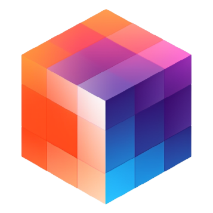
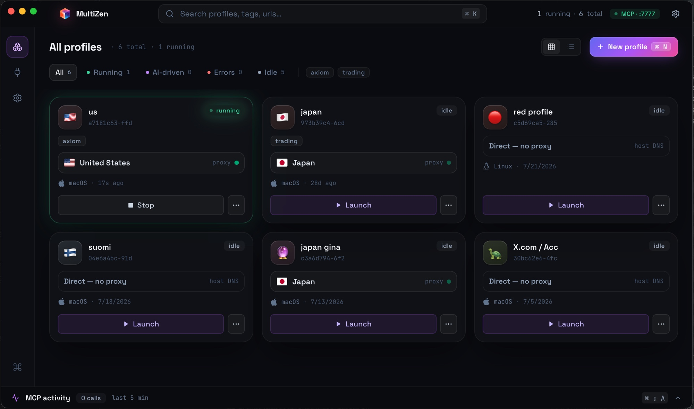
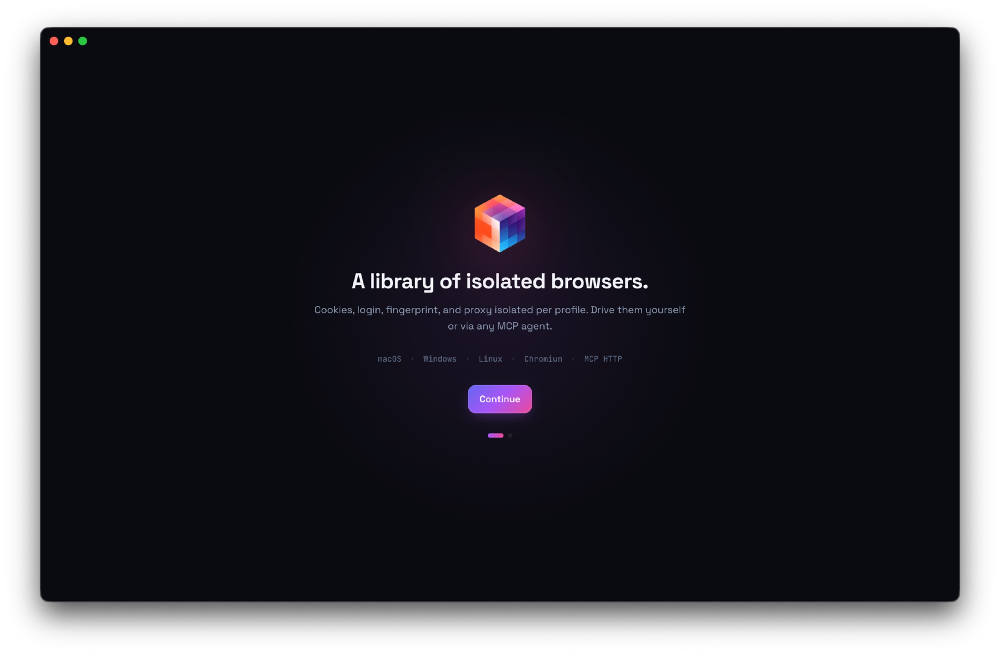

<div align="center">
  

  <h1>MultiZen</h1>

  <p><strong>A browser library for AI agents and human operators.</strong></p>

  <p>
    Local Chromium profiles with their own cookies, fingerprint, and proxy.<br/>
    Drive them through MCP from Cursor, Claude Desktop, or any MCP client.
  </p>

  <p>
    <a href="https://github.com/multizenteam/multizen-browser/releases/latest"></a>
    <a href="https://github.com/multizenteam/multizen-browser/blob/master/LICENSE"></a>
    <a href="https://github.com/multizenteam/multizen-browser/actions/workflows/release.yml"></a>
    <a href="https://github.com/multizenteam/multizen-browser/releases"></a>
    <a href="https://github.com/multizenteam/multizen-browser/stargazers"></a>
    <a href="https://discord.gg/pd6MhzPbJ3"></a>
  </p>

  <p>
    <a href="https://getmultizen.com"><strong>getmultizen.com</strong></a>
    &nbsp;·&nbsp;
    <a href="https://github.com/multizenteam/multizen-browser/releases/latest">Download</a>
    &nbsp;·&nbsp;
    <a href="https://discord.gg/pd6MhzPbJ3">Discord</a>
  </p>

  <p>
    <sub>PROXY PARTNER</sub>
    <br/>
    <a href="https://dashboard.thordata.com/register?invitation_code=E8XWP3FP">
      <picture>
        <source media="(prefers-color-scheme: dark)" srcset=".github/assets/thordata-logo-dark.svg" />
        
      </picture>
    </a>
    <br/>
    <sub>Residential + ISP proxies · 10% off with <code>MULTIZEN10</code></sub>
  </p>

  <br/>

  

  <br/><br/>
</div>

## About this fork

This repository is a fork of [`multizenteam/multizen-browser`](https://github.com/multizenteam/multizen-browser).

<!-- FORK-BASE: update this version whenever you pull changes from upstream -->
**Based on upstream release:** `v0.4.2` (upstream `master` through `794bbf4`)

**Fork app version:** `0.10.0` (independent semver from upstream).

Fork-specific work (see [`CHANGELOG.md`](CHANGELOG.md)) includes:

- Expanded fingerprint device catalogs (extra Mac M2–M4 SKUs, Linux laptops) and higher entropy thresholds
- Strict-pin launch timezone policy with opt-in `alignTimezoneToProxy` / `strictGeoCoherence`
- MCP extras: always-on `cdp_send` / `cdp_send_no_safety`, `probe_fingerprint`, `click_ref` / `type_ref`, human handoff (`request_human` / `get_human_status` / `wait_for_human` / `resume_human`), session-stable multi-client HTTP transport
- [`multizen-server`](apps/server/README.md): the desktop's tools and drivers with no Electron, plus display modes including headless, Docker, tokens and an egress policy
- Release CI typecheck gate before the multi-OS build matrix

Sync notes: [`docs/upstream-merge-v0.4.2.md`](docs/upstream-merge-v0.4.2.md) (latest), [`docs/upstream-merge-2026-10-06.md`](docs/upstream-merge-2026-10-06.md), [`docs/upstream-merge-v0.3.1.md`](docs/upstream-merge-v0.3.1.md), [`docs/upstream-merge-v0.3.0.md`](docs/upstream-merge-v0.3.0.md). Whenever you merge again from the original repository, update the **Based on upstream release** line above.

## What it is

MultiZen is a desktop app that runs a library of isolated browser profiles. Each profile has its own cookies, login state, fingerprint, and proxy, and runs on your choice of engine — CloakBrowser (Chromium) or Camoufox (Firefox). A local MCP server on `127.0.0.1:7777` exposes browser-drive tools (navigate, click, type, extract, screenshot, evaluate JS, cookies, tabs, waits) to any MCP client. The same server also runs with no desktop app, on a Linux box or in Docker: see [Server mode](#server-mode).

The result: your AI agent in Cursor or Claude Desktop can complete real authenticated workflows. When it hits a 2FA prompt or CAPTCHA, you step in through the same browser window. When you are done, the agent picks up where it left off. Cookies and session state survive between launches, so logins and context carry over across AI sessions.

## Install

### macOS

The cleanest path. Homebrew handles the Gatekeeper quarantine for you:

```sh
brew tap multizenteam/multizen
brew install --cask multizen
```

Or grab the DMG straight from the [releases page](https://github.com/multizenteam/multizen-browser/releases/latest) and run this once after install to bypass the unsigned-app warning:

```sh
xattr -cr /Applications/MultiZen.app
```

### Linux

```sh
curl -LO https://github.com/multizenteam/multizen-browser/releases/latest/download/MultiZen-linux-x86_64.AppImage
chmod +x MultiZen-linux-x86_64.AppImage
./MultiZen-linux-x86_64.AppImage
```

Some distros need `libfuse2` (`apt install libfuse2t64` on Ubuntu 24.04+).

On Ubuntu 24.04+ (and other kernels that restrict unprivileged user namespaces) the browser's sandbox is blocked by default. On the first affected launch MultiZen offers a one-time **secure setup**: it installs a small AppArmor profile that re-permits the sandbox for just this browser (one password prompt). The sandbox then stays on with no warning banner. You can also run or re-run it later from Settings. If you decline or it can't run, MultiZen launches the browser without the sandbox so it still works.

Prefer to do it by hand? Settings shows the exact command; it writes `/etc/apparmor.d/multizen-cloakbrowser` and loads it with `apparmor_parser`. To force sandbox-off regardless, launch the AppImage with `--no-sandbox`.

### Windows

Download [MultiZen-win-x64.exe](https://github.com/multizenteam/multizen-browser/releases/latest/download/MultiZen-win-x64.exe). SmartScreen may flag the installer as unrecognized on first download. Click **More info**, then **Run anyway**.

### One-liner installer

For macOS and Linux:

```sh
curl -sSL https://getmultizen.com/install.sh | bash
```

## How it works

```
+----------------------+         +-----------------------+
|  Cursor / Claude     |  MCP    |  MultiZen Desktop App |
|  Desktop / Cline     | <-----> |  127.0.0.1:7777       |
+----------------------+         +-----------+-----------+
                                             |
                                             | spawn / drive (CDP)
                                             v
                              +--------------+--------------+
                              |  Profile A  |  Profile B  | ...
                              |  cookies    |  cookies    |
                              |  proxy LU   |  proxy US   |
                              |  Win 145    |  macOS 145  |
                              +-------------+--------------+
                                            |
                                            v
                                  patched Chromium binary
                                  (canvas, WebGL, audio
                                   spoofed at C++ level;
                                   WebRTC IP leak-prevented)
```

Each profile is a real Chromium window with persistent state on disk. The MCP server speaks the standard Anthropic Model Context Protocol over Streamable HTTP (plus legacy SSE) so it works with any client. Browser-drive tools call into Chrome DevTools Protocol under the hood.

## Features

|  | What it does |
| --- | --- |
| **MCP server** | Native localhost endpoint. Works with Cursor, Claude Desktop, Cline, Continue, anything else that speaks MCP. |
| **Per-profile engine** | Choose each profile's browser: **CloakBrowser** (Chromium) or **Camoufox** (Firefox-based, for a genuinely non-Chrome TLS/JS fingerprint). |
| **Anti-detect Chromium** | Source-patched browser engine (CloakBrowser). Canvas, WebGL, and audio spoofed at C++ level instead of JS injection; WebRTC IP leak-prevented via Chromium's proxied-UDP policy. |
| **Persistent state** | Cookies, login, IndexedDB, localStorage stay per-profile across launches and across AI sessions. |
| **Human handoff** | AI gets stuck on 2FA or CAPTCHA, you take over in the same browser window, the agent continues when you are done. |
| **Cross-platform persona** | Run a Windows persona on a Mac host (or vice versa). C++ patches keep the fingerprint coherent across V8, Blink, and CSS feature signatures. |
| **Proxy + persona alignment** | Per-profile HTTP or SOCKS5 proxy with a local SOCKS5 bridge so DNS resolution stays remote. Auto-aligns timezone, locale, and `navigator.geolocation` to the proxy egress IP. |
| **Display modes** | Each profile opens in a window (`headed`), with none (`headless`, the engine's own), or on a private virtual display (`xvfb`, Linux). |
| **Server mode** | The same tools with no GUI, in Docker or on a bare server: named tokens with permissions, a browser-side egress policy, and a web panel for human handoff. |
| **Self-hosted** | Profiles live on your disk in plain SQLite plus Chromium user-data-dir format. No account, no license server; anonymous telemetry is opt-in and off by default. |
| **Open source** | MIT for the entire app, MCP server, and CDP driver. Patched Chromium engine is also open source. |

## Onboarding

<div align="center">
  
</div>

## Connect an agent (Codex, Cursor, Claude Desktop)

After installing, the MCP server starts on `127.0.0.1:7777`. It serves the current
**Streamable HTTP** transport at `http://127.0.0.1:7777/mcp` (plus a legacy HTTP+SSE
endpoint at `/sse` for older clients).

The server requires a **bearer token** — it is generated on first run and shown in
the app under **MCP → Connect an agent** (also written to the `mcp-token` file in
the app data directory). Every client config below must send it as
`Authorization: Bearer <token>`. Replace `<token>` with your own. The app's MCP
panel has a **Copy for LLM** button that hands the whole setup (token included) to
a coding agent if you'd rather not edit config files by hand.

**Codex CLI** (`~/.codex/config.toml`) — connects to Streamable HTTP directly:

```toml
[mcp_servers.multizen]
url = "http://127.0.0.1:7777/mcp"
http_headers = { Authorization = "Bearer <token>" }
```

**JSON URL clients — Cursor** (`~/.cursor/mcp.json`), Cline, Continue:

```json
{
  "mcpServers": {
    "multizen": {
      "url": "http://127.0.0.1:7777/mcp",
      "headers": { "Authorization": "Bearer <token>" }
    }
  }
}
```

**Claude Desktop** (`~/Library/Application Support/Claude/claude_desktop_config.json` on macOS)
— its config has no `url` field, so bridge the endpoint through
[`mcp-remote`](https://www.npmjs.com/package/mcp-remote) (needs Node):

```json
{
  "mcpServers": {
    "multizen": {
      "command": "npx",
      "args": ["mcp-remote", "http://127.0.0.1:7777/mcp", "--header", "Authorization: Bearer <token>"]
    }
  }
}
```

Restart your client. The agent now has the full tool set, 44 tools:

- **Profiles:** `list_profiles`, `create_profile`, `update_profile`, `delete_profile`, `launch_profile`, `close_profile`, `list_fingerprint_options`
- **Reading a page:** `extract`, `screenshot`
- **Acting on a page:** `navigate`, `click`, `type`, `click_ref`, `type_ref`, `press_key`, `hover`, `select_option`, `scroll`, `evaluate_js`
- **Tabs:** `list_tabs`, `new_tab`, `activate_tab`, `close_tab`
- **Cookies:** `get_cookies`, `set_cookies`
- **Waits:** `wait_for_load`, `wait_for_navigation`, `wait_for_selector`
- **Files:** `upload_file`, `list_downloads`, `get_download`
- **JavaScript dialogs:** `set_dialog_policy`, `list_dialogs`, `handle_dialog`
- **Human handoff:** `request_human`, `get_human_status`, `wait_for_human`, `resume_human`
- **Exclusive use:** `acquire_profile`, `renew_profile`, `release_profile`
- **Diagnostics and raw access:** `probe_fingerprint`, `cdp_send`, `cdp_send_no_safety`

Profile management is full CRUD: `create_profile` / `update_profile` accept an optional `engine` (`cloakbrowser` or `camoufox`), `display_mode` (`headed`, `headless` or `xvfb`), `proxy` and high-level `fingerprint` (device, locale, timezone, screen), and `list_fingerprint_options` enumerates the valid device families and locale groups.

Errors carry a stable `code` (`PROFILE_NOT_RUNNING`, `STALE_REF`, `DIALOG_OPEN`, `INPUT_NOT_DELIVERED`, ...), `retryable` and a `hint`. Page tools act on the profile's one active tab: `list_tabs` shows it, `new_tab` and `activate_tab` change it. Tool calls on one profile run one at a time, across all clients.

Engine notes for MCP clients:

- `create_profile` without `engine` uses the app's default engine (Settings → Default engine for new profiles) and stores it on the profile, so changing the default later doesn't move the profile.
- `update_profile` refuses an engine change while the profile is running. Call `close_profile` first. Each engine keeps its own browser state, so after a switch the profile has that engine's cookies and logins, which may be none.
- `list_profiles` reports each profile's engine, its saved display mode and the one it runs in.
- On Camoufox, `cdp_send` and `cdp_send_no_safety` return `UNSUPPORTED_ON_ENGINE`, because Camoufox has no CDP. This is intended. Refs and every page tool work on both engines: `extract` there gives `ariaSnapshot` text with refs like `p3.e7`. `evaluate_js` runs in an isolated world, so it doesn't see the page's own globals. Of the `fingerprint` knobs, Camoufox uses the device's OS, the locale, the screen and the timezone. It generates its own Firefox UA, hardware and WebGL.

## Server mode

`multizen-server` is the same MCP server and the same browser drivers with no Electron. It needs no display and can run on a machine you only reach over the network.

From source (Node 22+, Corepack):

```sh
corepack yarn install
corepack yarn workspace @multizen/server build
node apps/server/bin/multizen-server.js serve --headless
```

Or in Docker, where browsers run under Xvfb by default, as a non-root user with the Chromium sandbox on and no way to turn it off:

```sh
docker compose up -d
docker compose exec multizen cat /data/owner-token
```

The first start downloads the engine, into the data directory or the volume: the image holds none, because CloakBrowser's licence forbids redistributing it. Then connect any MCP client to `http://127.0.0.1:7777/mcp` as above, with the token from `owner-token`.

What a server adds to the desktop's tool set:

- **Display modes.** `--headless` allows no windows at all. `--display-mode` sets the default, and each profile or launch can name its own.
- **Tokens.** `token create` makes named tokens with tool groups (`read`, `act`, `profile-admin`, `raw`, `operator`) and a list of profiles. A revoke stops one within a second.
- **Remote access.** A bind beyond loopback needs `--allow-remote` and TLS, or a reverse proxy on loopback with `--public-url`.
- **Egress policy.** Browsers stay off private addresses, this machine's ports and cloud metadata, checked per connection. A token with the `raw` group can defeat it, and doesn't get it unless asked.
- **Handoff over the network.** A person takes over at `/panel` with a live view and input, and until they resume, the agent's page actions get `HUMAN_IN_CONTROL`. `--handoff-webhook` tells your endpoint.

Everything else, from flags to troubleshooting, is in [`apps/server/README.md`](apps/server/README.md).

Use it for your own agents on your own infrastructure: anything offered to third parties needs an OEM or SaaS licence from CloakHQ.

## Stack

| Layer | Tech |
| --- | --- |
| Desktop shell | Electron 33 |
| Renderer | React 19, Tailwind v4, TypeScript strict |
| Main process | TypeScript ESM, electron-vite, native MCP SDK |
| MCP server | `@modelcontextprotocol/sdk` over Streamable HTTP + SSE |
| Profile storage | better-sqlite3 with idempotent migrations |
| Browser driver | chrome-remote-interface over CDP (Chromium); playwright-core (Firefox) |
| Server | Node 22, esbuild, Docker with a seccomp profile for the Chromium sandbox |
| Browser engine | CloakBrowser (patched Chromium) or Camoufox (Firefox), per profile |
| Build | Yarn 4 workspaces, electron-vite, electron-builder |
| CI | GitHub Actions matrix on macOS, Windows, Linux |

## Develop

```sh
git clone https://github.com/multizenteam/multizen-browser
cd multizen-browser
yarn install
yarn dev            # launch the desktop app in dev mode
yarn mcp:dev        # the MCP server on a mock driver, for protocol tests
yarn server:dev     # multizen-server with real browsers, from source
yarn typecheck      # strict TS across all workspaces
yarn build          # full release build (mac/win/linux per OS)
```

Requires Node 22+ and Yarn 4 (via Corepack).

## Repo layout

```
apps/
  desktop/                Electron + React + Tailwind GUI + main process
  server/                 multizen-server: the same tools with no Electron
packages/
  browser-runtime/        Drivers, engine downloads, display modes, the SOCKS5 bridge
  mcp-server/             MCP server exposing the browser-drive tools
  cdp-driver/             Thin wrapper around chrome-remote-interface
  profile-manager/        SQLite profile CRUD + encrypted local storage
  settings-store/         App-level settings persistence
  types/                  Shared TypeScript types
docker/                   The server's image and its seccomp profile
scripts/
  detection-baseline/     What pages and servers can see of a browser here
.github/
  workflows/release.yml   Matrix build, tag-triggered
```

## Roadmap

Things landing in upcoming releases.

- **Behavioral injection**: humanized mouse paths, keystroke timing, scroll jitter applied at the CDP input layer.
- **Per-profile cloud sync** (opt-in, end-to-end encrypted): so the same profile follows you across laptops.
- **Team workspaces**: shared profile pool with audit log.

## Why MultiZen vs the alternatives

| | MultiZen | Browserbase / Hyperbrowser | GoLogin / AdsPower / Multilogin |
| --- | :---: | :---: | :---: |
| Native MCP server | yes | yes | profile CRUD only |
| Drives the browser through MCP | yes | yes | no |
| Anti-detect at C++ level | yes | partial | yes |
| Persistent login across sessions | yes | per-session | yes |
| Self-hosted | yes | no | no |
| Manual GUI for operators | yes | no | yes |
| Pay per browser-hour | no | yes | varies |
| Open source core | yes | SDK only | no |

## Acceptable use

Building a multi-account browser is dual-use. We support QA testing across roles and regions, agency workflows you are authorized to run, market research, multi-marketplace e-commerce ops, AI-driven sales engineering, and personal accounts you legitimately own. We do not support platform ToS violations, mass account farming, ban evasion, or fraud. Full policy at [getmultizen.com/acceptable-use](https://getmultizen.com/acceptable-use).

## License

[MIT](LICENSE). Use it however you want.

<div align="center">
  <br/>
  <sub>
    Built in transit by <a href="https://github.com/oboshto">@oboshto</a>.<br/>
    Star this repo if MultiZen is useful, it helps a lot.
  </sub>
</div>
