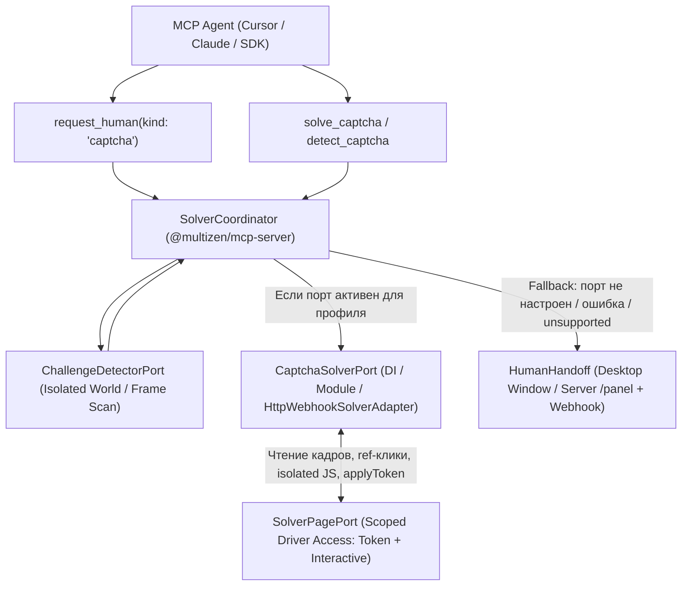

# Спецификация задачи: Порты для подключения решателей капчи (Challenge Solver Ports)

> **Статус:** Спроектировано по итогам брифа (готово к реализации)  
> **Базовая версия:** MultiZen Extended `0.11.0`  
> **Охват пакетов:** `@multizen/types`, `@multizen/browser-runtime`, `@multizen/mcp-server`, `@multizen/profile-manager`, `@multizen/settings-store`, `apps/server`, `apps/desktop`

---

## 0. Назначение и рамки (Guardrails)

MultiZen **не встраивает в ядро логику решения или обхода CAPTCHA** и не содержит жёстких интеграций с конкретными коммерческими сервисами. Задача данного проекта — спроектировать и внедрить **гексагональные порты (Ports & Adapters)**, через которые разработчик или оператор может подключить собственный адаптер решателя (локальный TS/ESM-модуль или внешний HTTP-микросервис) с соблюдением всех инвариантов MultiZen:

1. **Стелс-изоляция:** детекция челленджа и инъекция/взаимодействие по умолчанию выполняются в **isolated world** (или через штатные примитивы ввода `BrowserDriver`), без включения рискованных доменов CDP (`Runtime.enable`, `DOM.enable`) и без загрязнения `window.*` в main world.
2. **Когерентность сети и отпечатка:** адаптер решателя получает эффективный `FingerprintConfig` запущенного профиля и (по умолчанию) локальный адрес его SOCKS5-моста (`socks5Bridge`), чтобы внешние запросы решателя шли с того же выходного IP и под тем же User-Agent / Client Hints без утечки сырых паролей прокси.
3. **Координация с агентом и человеком:** на время работы порта пишущие действия MCP-агента на профиле блокируются, а при отсутствии решателя, неподдерживаемом типе челленджа или ошибке срабатывает управляемый **fallback на человека** (`HumanHandoff` — окно браузера или веб-панель `/panel`).
4. **Двухдвижковая совместимость:** контракты порта работают единообразно на **CloakBrowser** (Chromium/CDP) и **Camoufox** (Firefox/Playwright).

---

## 1. Зафиксированные решения брифа

| № | Вопрос | Принятое архитектурное решение |
|---|--------|-------------------------------|
| **A1** | **Транспортные форматы портов** | 1) **TypeScript SDK / DI-интерфейс** (`CaptchaSolverPort` в `@multizen/types` + динамическая загрузка ESM-плагина/модуля).<br>2) **Внешний HTTP / Webhook-порт** (встроенный эталонный адаптер `HttpWebhookSolverAdapter`, отправляющий контекст задачи во внешний сервис по HTTP и принимающий решение или интерактивные команды по обратному каналу). |
| **A2** | **Уровень абстракции взаимодействия со страницей** | **Гибридный контракт (`SolverPagePort`):** поддерживает и **Token/Metadata-уровень** (чтение параметров капчи, cookies, вставка токена), и **Interactive/UI-уровень** (захват кадров `captureFrame`, AX-snapshot с `ref`, ввод `dispatchInput`/`clickRef`/`typeRef`, выполнение скриптов в isolated world). |
| **A3** | **Связь с MCP и `HumanHandoff`** | **Комбинированный режим:**<br>1) Прозрачный перехват в `request_human(kind: "captcha")` (с политикой fallback на человека при отказе/таймауте решателя).<br>2) Отдельные MCP-инструменты явного вызова и диагностики (`detect_captcha`, `solve_captcha`, `get_solver_status`, `cancel_solver`). |
| **A4** | **Детекция типа капчи и параметров** | **Порт детектора (`ChallengeDetectorPort`) + базовый сборщик контекста (`DefaultChallengeDetector`)**, извлекающий в isolated world метаданные страницы/фреймов и стандартные атрибуты (`sitekey`, `action`, `rqdata`, `data-s`), с возможностью переопределения детектора в подключаемом адаптере. |
| **A5** | **Передача Proxy и Fingerprint** | **Управляемая политика (`ProxyExposureMode`):** по умолчанию в порт передаются эффективный `FingerprintConfig` (UA, Client Hints, OS, locale, timezone) + адрес локального **SOCKS5-моста** профиля (`socks5://127.0.0.1:<port>`). Сырые креды upstream-прокси (`username`/`password`) передаются только при явном разрешении (`proxyExposure: "raw"`). |
| **A6** | **Конфигурация и хранение секретов** | 1) **Глобальная конфигурация** (`SettingsStore`, CLI-флаги/env в `multizen-server`, секреты в `secretBox`) + **опциональный override на уровне профиля** (`Profile.solverConfig`).<br>2) **GUI в десктоп-приложении** (экран `Settings` и карточка профиля) + **CLI-флаги/команды** в `multizen-server`. |

---

## 2. Архитектура и обзор потоков данных



---

## 3. Спецификация контрактов (`@multizen/types`)

Новый модуль [`packages/types/src/solver.ts`](file:///c:/Users/Kiseru/Documents/Repositories/multizen-browser-extended/packages/types/src/solver.ts), реэкспортируемый из [`packages/types/src/index.ts`](file:///c:/Users/Kiseru/Documents/Repositories/multizen-browser-extended/packages/types/src/index.ts).

### 3.1. Модель челленджа и порт детектора (`ChallengeDetectorPort`)

```ts
export const CHALLENGE_KINDS = [
  "turnstile",
  "recaptcha_v2",
  "recaptcha_v3",
  "hcaptcha",
  "geetest",
  "arkose",
  "datadome",
  "custom",
  "unknown",
] as const;

export type ChallengeKind = (typeof CHALLENGE_KINDS)[number];

export interface ChallengeFrameInfo {
  targetId: string;
  frameId?: string;
  url: string;
  isCrossOrigin: boolean;
  bounds?: { x: number; y: number; width: number; height: number };
}

export interface ChallengeDescriptor {
  kind: ChallengeKind;
  /** Опциональный уточняющий идентификатор вендора/режима (например, "turnstile-managed", "recaptcha-v2-enterprise"). */
  vendor?: string;
  pageUrl: string;
  pageTitle?: string;
  frame?: ChallengeFrameInfo;
  sitekey?: string;
  action?: string;
  dataS?: string;
  rqdata?: string;
  pagedata?: string;
  enterprise?: boolean;
  invisible?: boolean;
  /** Сырые безопасные DOM-атрибуты контейнера/фрейма, собранные в isolated world. */
  rawAttributes?: Record<string, string>;
  detectedAt: string;
}

export interface ChallengeDetectorPort {
  /**
   * Анализирует активную вкладку и её фреймы через SolverPagePort (в isolated world).
   * Возвращает null, если признаков известного челленджа не обнаружено.
   */
  detect(
    page: SolverPageReadPort,
    hint?: Partial<ChallengeDescriptor>,
  ): Promise<ChallengeDescriptor | null>;
}
```

### 3.2. Сетевой контекст и политика экспозиции прокси (`SolverNetworkContext`)

```ts
export const PROXY_EXPOSURE_MODES = ["bridge", "raw", "none"] as const;
export type ProxyExposureMode = (typeof PROXY_EXPOSURE_MODES)[number];

export interface SolverNetworkContext {
  profileId: ProfileId;
  engine: BrowserEngine;
  /** Эффективный отпечаток запущенного профиля (с учётом reconcileVersionInFingerprint и reducedUserAgent). */
  fingerprint: {
    userAgent: string;
    platform: FingerprintConfig["platform"];
    clientHints: ClientHints;
    locale: string;
    languages: string[];
    acceptLanguage: string;
    timezone: string;
    screen: { width: number; height: number };
    dpr: number;
  };
  /**
   * Локальный SOCKS5-мост профиля (127.0.0.1:<port>).
   * Доступен при proxyExposure === "bridge" | "raw", если профиль запущен через мост.
   * Позволяет решателю отправлять внешние запросы через тот же egress IP без раскрытия пароля прокси.
   */
  bridgeProxy?: {
    type: "socks5";
    host: "127.0.0.1";
    port: number;
    url: string;
  };
  /**
   * Полные реквизиты upstream-прокси профиля (включая username/password).
   * Заполняется ТОЛЬКО при proxyExposure === "raw".
   */
  upstreamProxy?: ProxyConfig;
  proxyCountry?: string;
}
```

### 3.3. Гибридный порт страницы (`SolverPagePort`)

Порт предоставляет адаптеру решателя доступ к вкладке профиля в обход агентского блокировщика `HUMAN_IN_CONTROL`, но в рамках жизненного цикла задачи `taskId` (после `AbortSignal` или завершения задачи все методы `SolverPagePort` отвергают вызовы с `SOLVER_SESSION_CLOSED`).

```ts
export interface SolverTokenPayload {
  /** Основной токен решения (g-recaptcha-response, cf-turnstile-response, h-captcha-response и т.д.). */
  token: string;
  /** Опциональный ключ/селектор поля назначения; если не задан — определяется по ChallengeDescriptor.kind. */
  targetSelector?: string;
  /** Дополнительные поля формы/ответа (например, lot_number, pass_token, gen_time для GeeTest). */
  extraFields?: Record<string, string>;
  /** Вызвать ли связанный вендорский JS-callback или событие input/change. По умолчанию true. */
  triggerCallback?: boolean;
}

/** Читающее подмножество порта страницы, доступное детектору. */
export interface SolverPageReadPort {
  readonly profileId: ProfileId;
  readonly engine: BrowserEngine;
  extract(): Promise<{ result: unknown }>;
  captureFrame(opts?: { quality?: number }): Promise<CapturedFrame>;
  listTabs(): Promise<unknown>;
  getCookies(urls?: string[]): Promise<unknown>;
  /** Выполнение JS строго в изолированном мире (isolated world), невидимом для хуков страницы. */
  evaluateIsolatedJs(expression: string): Promise<unknown>;
}

/** Полный гибридный порт взаимодействия решателя со страницей. */
export interface SolverPagePort extends SolverPageReadPort {
  /** Применить полученный токен решения в DOM / форму челленджа. */
  applyToken(payload: SolverTokenPayload): Promise<{ applied: boolean; details?: string }>;
  /** Установить cookies (например, cf_clearance). */
  setCookies(cookies: unknown[]): Promise<unknown>;
  /** Низкоуровневый ввод (мышь, колесо, клавиши) в нормализованных координатах 0..1. */
  dispatchInput(event: HumanInputEvent): Promise<void>;
  /** Действия по ref из extract() (работают на обоих движках и внутри OOPIF). */
  clickRef(ref: string): Promise<{ ok: true }>;
  typeRef(ref: string, text: string): Promise<{ ok: true }>;
  /** Штатные действия драйвера (hover, scroll, press_key, select_option). */
  performAction(action: DriverAction): Promise<{ ok: true }>;
  /**
   * Выполнение JS в main world страницы.
   * Доступно ТОЛЬКО если в настройках порта явно разрешено `allowMainWorldJs: true`
   * (например, для вызова глобального колбэка виджета после вставки токена).
   * Иначе выбрасывает MultizenError("FORBIDDEN", ...).
   */
  evaluateMainWorldJs(expression: string): Promise<unknown>;
}
```

### 3.4. Главный порт решателя (`CaptchaSolverPort`)

```ts
export interface SolverTask {
  taskId: string;
  handoffId?: string;
  profileId: ProfileId;
  reason?: string;
  challenge: ChallengeDescriptor;
  network: SolverNetworkContext;
  createdAt: string;
  expiresAt: string;
}

export type SolverOutcome =
  | {
      status: "solved";
      mode: "token" | "interactive";
      /** Если адаптер вернул токен, но сам не вызывал page.applyToken(), координатор применит его автоматически. */
      tokenPayload?: SolverTokenPayload;
      notes?: string;
    }
  | {
      status: "unsupported";
      reason: string;
      fallbackToHuman?: boolean;
    }
  | {
      status: "failed";
      reason: string;
      retryable?: boolean;
      fallbackToHuman?: boolean;
    };

export interface CaptchaSolverPort {
  readonly id: string;
  readonly name: string;
  readonly capabilities: {
    kinds: readonly ChallengeKind[];
    modes: readonly ("token" | "interactive")[];
  };
  /** Опциональный детектор адаптера, дополняющий или заменяющий DefaultChallengeDetector. */
  readonly detector?: ChallengeDetectorPort;
  /** Быстрая синхронная/асинхронная проверка перед запуском сессии решения. */
  canSolve?(challenge: ChallengeDescriptor, network: SolverNetworkContext): Promise<boolean> | boolean;
  /** Основной метод решения челленджа. Прерывается через signal при отмене или закрытии браузера. */
  solve(task: SolverTask, page: SolverPagePort, signal: AbortSignal): Promise<SolverOutcome>;
  /** Проверка доступности внешнего сервиса/модуля (для кнопки Test в GUI и /readyz). */
  healthcheck?(): Promise<{ ok: boolean; latencyMs?: number; details?: Record<string, unknown> }>;
  dispose?(): Promise<void>;
}
```

### 3.5. Новые коды ошибок (`packages/types/src/errors.ts`)

В `MULTIZEN_ERROR_CODES` добавляются:
- `SOLVER_NOT_CONFIGURED` (`retryable: false`) — вызван `solve_captcha` при `fallback_to_human: false`, когда ни один адаптер не подключён или порт отключён на профиле.
- `SOLVER_UNSUPPORTED_CHALLENGE` (`retryable: false`) — подключённый адаптер не поддерживает обнаруженный тип челленджа (при `fallbackPolicy: "solver-only"`).
- `SOLVER_FAILED` (`retryable: true` по умолчанию, переопределяется из `outcome.retryable`) — адаптер вернул ошибку решения (при `fallbackPolicy: "solver-only"`).

---

## 4. Два механизма подключения адаптеров (A1)

### 4.1. Программный DI и динамический ESM-модуль (`ModuleSolverLoader`)

1. **Прямая передача в коде:** `createMultizenMcpServer` и `ServerRuntime` принимают опциональный `solverPort?: CaptchaSolverPort` (или `solverCoordinator?: SolverCoordinator`).
2. **Подключение внешнего плагина (`--solver-module <path>` / `settings.solver.modulePath`):**
   - Загрузчик в `packages/browser-runtime/src/solver/moduleLoader.ts` импортирует указанный локальный ESM-модуль (`import(pathToFileURL(resolvedPath).href)`).
   - Модуль должен экспортировать фабрику:
     ```ts
     export function createSolverPort(ctx: {
       options?: Record<string, unknown>;
       apiKey?: string;
       secret?: string;
     }): CaptchaSolverPort | Promise<CaptchaSolverPort>;
     ```
   - Путь валидируется: модуль загружается только из конфигурации владельца (`settings.json` / CLI-флаг сервера), агент через MCP задать или поменять `modulePath` не может.

### 4.2. Внешний HTTP / Webhook-порт (`HttpWebhookSolverAdapter` + `/solver/v1/*`)

Встроенный адаптер в `packages/mcp-server/src/solver/HttpWebhookSolverAdapter.ts`, реализующий `CaptchaSolverPort` для взаимодействия с любым внешним микросервисом-решателем на любом языке (Python, Go, Rust, Node.js):

1. **Исходящий запрос `POST <webhookUrl>`:**
   - Заголовки:
     - `Content-Type: application/json`
     - `User-Agent: multizen-server`
     - `X-MultiZen-Signature: sha256=<hmac_hex>` (если задан секрет вебхука)
   - Тело запроса:
     ```json
     {
       "taskId": "uuid",
       "handoffId": "uuid-or-null",
       "profileId": "prof_...",
       "challenge": { "kind": "turnstile", "pageUrl": "https://...", "sitekey": "0x4..." },
       "network": {
         "engine": "cloakbrowser",
         "fingerprint": { "userAgent": "...", "clientHints": { ... }, "locale": "en-US", "timezone": "America/New_York" },
         "bridgeProxy": { "type": "socks5", "host": "127.0.0.1", "port": 54321, "url": "socks5://127.0.0.1:54321" }
       },
       "endpoints": {
         "baseUrl": "http://127.0.0.1:7777/solver/v1/tasks/<taskId>",
         "sessionToken": "<ephemeral-single-task-token>"
       },
       "expiresAt": "2026-11-27T23:05:00.000Z"
     }
     ```
   - Как и в `handoffWebhook.ts`, `redirect: "manual"` (редиректы не преследуются, чтобы исключить утечку `sessionToken` и `network` на сторонний хост).
2. **Два способа ответа от внешнего HTTP-решателя:**
   - **Способ А (Синхронный HTTP-ответ):** если сервис решает задачу быстро или только проверяет `canSolve`, он может сразу вернуть в теле ответа `200 OK` структуру `SolverOutcome` (`{ "status": "solved", "mode": "token", "tokenPayload": { "token": "..." } }` или `{ "status": "unsupported", "reason": "..." }`).
   - **Способ Б (Асинхронный / Интерактивный через `/solver/v1/tasks/:taskId/*`):** сервис отвечает `202 Accepted` `{ "status": "accepted" }`, после чего использует одноразовый `Authorization: Bearer <sessionToken>` (действителен только для `:taskId` и только до `expiresAt` / закрытия задачи) для вызова маршрутов обратного канала на HTTP-сервере MultiZen:
     - `GET  /solver/v1/tasks/:taskId/frame` — получить JPEG-скриншот и размеры viewport (`captureFrame`).
     - `POST /solver/v1/tasks/:taskId/extract` — получить AX-дерево с `ref`.
     - `POST /solver/v1/tasks/:taskId/input` — отправить `HumanInputEvent` (`mouse`, `wheel`, `key`, `text`).
     - `POST /solver/v1/tasks/:taskId/action` — выполнить `click_ref`, `type_ref` или `performAction`.
     - `POST /solver/v1/tasks/:taskId/evaluate-isolated` — выполнить JS-выражение в isolated world.
     - `POST /solver/v1/tasks/:taskId/evaluate-main` — выполнить JS в main world (только при `allowMainWorldJs: true`, иначе `403`).
     - `POST /solver/v1/tasks/:taskId/apply-token` — применить `SolverTokenPayload`.
     - `POST /solver/v1/tasks/:taskId/cookies` — прочитать или установить cookies.
     - `POST /solver/v1/tasks/:taskId/settle` — завершить задачу с финальным `SolverOutcome` (`solved` | `failed` | `unsupported`).

---

## 5. Стелс-детектор и доставка токенов (`@multizen/browser-runtime`)

### 5.1. `DefaultChallengeDetector` (Isolated World)
Располагается в `packages/browser-runtime/src/solver/DefaultChallengeDetector.ts`:
- Выполняет диагностический скрипт **только через изолированный мир** (`Page.createIsolatedWorld` на CloakBrowser; изолированный `page.evaluate` в Camoufox).
- Ищет стандартные DOM-признаки без обращения к JS-глобалам страницы (`window.grecaptcha`, `window.turnstile` из isolated world не видны и не трогаются):
  - Ифреймы (`iframe[src*="challenges.cloudflare.com"]`, `iframe[src*="google.com/recaptcha"]`, `iframe[src*="recaptcha.net"]`, `iframe[src*="hcaptcha.com"]`, `iframe[src*="arkoselabs.com"]`, `iframe[src*="geetest.com"]`, `iframe[src*="captcha-delivery.com"]`).
  - Контейнеры с атрибутами `data-sitekey`, `class="cf-turnstile"`, `class="g-recaptcha"`, `class="h-captcha"`, `data-action`, `data-s`, `data-rqdata`, `data-callback`.
  - Заголовки/текст интерстициалов ("Verify you are human", "Just a moment...", `#challenge-form`, `#cf-challenge-running`).
- Сопоставляет найденный `iframe` со списком целей/фреймов драйвера (`ChallengeFrameInfo`), вычисляя его `bounds` во viewport.

### 5.2. Доставка токена (`applyToken` в драйверах)
- **Установка значений DOM-полей (`textarea[name="g-recaptcha-response"]`, `[name="h-captcha-response"]`, `[name="cf-turnstile-response"]` или `payload.targetSelector`):** выполняется в **isolated world** (DOM общий между мирами) с генерацией нативных событий `new Event('input', { bubbles: true })` и `new Event('change', { bubbles: true })`.
- **Вызов JS-колбэка виджета (`triggerCallback: true`):**
  - Если форма сабмитится стандартным событием DOM или кликом по кнопке сабмита — main world не затрагивается вообще.
  - Если требуется вызвать зарегистрированный в `window` callback вендорского виджета (по имени из `data-callback`), это делается **только** при разрешённом `allowMainWorldJs: true` через минимальный одноразовый вызов без создания глобальных переменных или модификации прототипов.

### 5.3. Доступ к локальному SOCKS5-мосту профиля
- В [`packages/browser-runtime/src/socks5Bridge.ts`](file:///c:/Users/Kiseru/Documents/Repositories/multizen-browser-extended/packages/browser-runtime/src/socks5Bridge.ts) добавляется геттер `getProfileBridgeInfo(profileId: ProfileId): { port: number; url: string } | null`.
- Когда профиль запущен с прокси (или на сервере под `EgressPolicy`), `SolverCoordinator` передаёт `socks5://127.0.0.1:<port>` в `SolverNetworkContext.bridgeProxy`.

---

## 6. Оркестрация с `HumanHandoff` и MCP-инструменты (`@multizen/mcp-server`)

### 6.1. `SolverCoordinator` и бесшовная связка с `HumanHandoff`
Новый координатор в `packages/mcp-server/src/solver/SolverCoordinator.ts`:

1. **При вызове `request_human({ profile_id, kind: "captcha", reason })`:**
   - Проверяется эффективная конфигурация решателя для профиля (`resolveProfileSolverConfig(profile, appSettings)`).
   - Если порт решателя **выключен** или `fallbackPolicy === "human-only"` → сразу выполняется штатный `handoff.request(profileId, reason, { kind: "captcha" })`.
   - Если порт решателя **включён** (`"solver-then-human"` или `"solver-only"`):
     1. В `HumanHandoff` регистрируется запись с новым начальным/промежуточным состоянием или метаданными активного решения, чтобы:
        - `toolGate.ts` сразу блокировал пишущие вызовы агента (`HUMAN_IN_CONTROL`),
        - `request_human` мгновенно вернул агенту `{ status: "solving_captcha" | "waiting_for_human", handoff_id, ... }`, не блокируя MCP-запрос,
        - внешний `--handoff-webhook` для человека **не дёргался преждевременно**, пока работает автоматический порт!
     2. В фоне запускается `SolverCoordinator.runTask(profileId, handoffId)`:
        - Вызывается `detector.detect(pagePort)`.
        - Вызывается `solverPort.solve(task, pagePort, abortSignal)`.
        - **Успех (`status === "solved"`):** `handoff.resumeById(handoffId, "solver:<adapterId>")`. Агент, ожидающий в `wait_for_human` или опрашивающий `get_human_status`, получает `{ resumed: true, status: "resumed", settled_by: "solver:<adapterId>" }` и продолжает работу!
        - **Неудача / Неподдерживаемый тип / Таймаут:**
          - При `fallbackPolicy === "solver-then-human"`: запись переводится в ожидание человека (`pending` для оператора), поднимается баннер в Desktop GUI / активируется `/panel` и отправляется уведомление в `--handoff-webhook` с пометкой `solverFallbackReason`. Агент продолжает ждать на том же `handoff_id`!
          - При `fallbackPolicy === "solver-only"`: `handoff.abortById(handoffId, "solver-failed")`.

### 6.2. Новые MCP-инструменты (`packages/mcp-server/src/tools/solver.ts`)

| Инструмент | Группа в `toolPolicy.ts` | Lock / Gate | Описание |
|------------|--------------------------|-------------|----------|
| `detect_captcha` | `read` | `lock: "op"`, `humanGate: "allow"` | Запускает `ChallengeDetectorPort` на активной вкладке. Возвращает `{ detected: boolean, challenge: ChallengeDescriptor \| null }`. |
| `solve_captcha` | `act` | `lock: "none"`, `humanGate: "allow"` | Явно запускает задачу в `SolverCoordinator`. Принимает `{ profile_id, kind?, sitekey?, reason?, fallback_to_human?: boolean, wait?: boolean, timeout_ms?: number }`. Если `wait: true` (по умолчанию до 55 с), ждёт завершения или перехода в fallback. |
| `get_solver_status` | `read` | `lock: "none"`, `humanGate: "allow"` | Неблокирующий статус активной или последней задачи решателя на профиле (`{ profile_id, task_id? }`) + статус самого порта (`{ configured: boolean, adapterId: string \| null, capabilities }`). |
| `cancel_solver` | `act` | `lock: "none"`, `humanGate: "allow"` | Отменяет активную задачу решателя на профиле (`{ profile_id, task_id?, handoff_to_human?: boolean }`). |

Все 4 инструмента добавляются в `TOOL_POLICIES` ([`packages/mcp-server/src/toolPolicy.ts`](file:///c:/Users/Kiseru/Documents/Repositories/multizen-browser-extended/packages/mcp-server/src/toolPolicy.ts)) с явными `ToolAnnotations` и покрываются snapshot-тестом `tools-list.baseline.json`.

---

## 7. Конфигурация, секреты, CLI и Desktop GUI (A5, A6)

### 7.1. Глобальные настройки (`@multizen/settings-store`)
В `AppSettings` ([`packages/settings-store/src/index.ts`](file:///c:/Users/Kiseru/Documents/Repositories/multizen-browser-extended/packages/settings-store/src/index.ts)) добавляется необязательное поле `solver?: SolverSettings`:

```ts
export type SolverFallbackPolicy = "solver-then-human" | "solver-only" | "human-only";
export type SolverAdapterKind =
  | "none"
  | "capsolver"
  | "2captcha"
  | "rucaptcha"
  | "webhook"
  | "module";

export interface SolverSettings {
  enabled: boolean;
  adapter: SolverAdapterKind;
  webhookUrl?: string;
  /** Секрет/API-ключ хранится в зашифрованном виде через secretBox (на сервере) или в защищённом поле; в MCP не отдаётся. */
  webhookSecret?: string;
  apiKey?: string;
  modulePath?: string;
  fallbackPolicy: SolverFallbackPolicy;
  proxyExposure: ProxyExposureMode;
  allowMainWorldJs: boolean;
  timeoutMs: number;
  options?: Record<string, unknown>;
}
```

Дефолт: `{ enabled: false, adapter: "none", fallbackPolicy: "solver-then-human", proxyExposure: "bridge", allowMainWorldJs: false, timeoutMs: 120_000 }`.

### 7.2. Переопределение на уровне профиля (`@multizen/profile-manager`)
1. В таблицу `profiles` ([`packages/profile-manager/src/ProfileManager.ts`](file:///c:/Users/Kiseru/Documents/Repositories/multizen-browser-extended/packages/profile-manager/src/ProfileManager.ts)) добавляется идемпотентная миграция:
   ```sql
   ALTER TABLE profiles ADD COLUMN solver_config TEXT
   ```
2. Тип `ProfileSolverConfig` в `@multizen/types`:
   ```ts
   export interface ProfileSolverConfig {
     /** "inherit" следует глобальной настройке; "enabled" / "disabled" переопределяют её для профиля. */
     mode: "inherit" | "enabled" | "disabled";
     fallbackPolicy?: SolverFallbackPolicy;
     proxyExposure?: ProxyExposureMode;
     allowMainWorldJs?: boolean;
     timeoutMs?: number;
   }
   ```
3. При экспорте/импорте `.mzar` (`archive.ts`) `solver_config` профиля сохраняется, а глобальные секреты (`webhookSecret`, `apiKey`) в архив профиля **не включаются**.
4. Секреты глобального адаптера на сервере шифруются тем же `SecretBox` (`MULTIZEN_SECRET_KEY` / `secret.key`), что и пароли прокси, и поддерживают `multizen-server secrets rotate`.

### 7.3. CLI и окружение `multizen-server` (`apps/server`)
1. Новые флаги для `multizen-server serve` и `multizen-server stdio`:
   - `--solver-webhook <url>` (`MULTIZEN_SOLVER_WEBHOOK`)
   - `--solver-webhook-secret <secret>` (`MULTIZEN_SOLVER_WEBHOOK_SECRET`)
   - `--solver-module <path>` (`MULTIZEN_SOLVER_MODULE`)
   - `--solver-api-key <key>` (`MULTIZEN_SOLVER_API_KEY`)
   - `--solver-fallback solver-then-human|solver-only|human-only` (`MULTIZEN_SOLVER_FALLBACK`)
   - `--solver-proxy-exposure bridge|raw|none` (`MULTIZEN_SOLVER_PROXY_EXPOSURE`)
   - `--solver-allow-main-world-js` (`MULTIZEN_SOLVER_ALLOW_MAIN_WORLD_JS=1`)
   - `--solver-timeout-ms <ms>` (`MULTIZEN_SOLVER_TIMEOUT_MS`)
2. Подкоманда диагностики:
   - `multizen-server solver status [--data-dir <dir>]` — показывает активный адаптер, его `capabilities` и результат `healthcheck()`.

### 7.4. GUI Десктоп-приложения (`apps/desktop`)
1. **Экран `Settings.tsx`:**
   - Карточка **Challenge Solver Port**:
     - Переключатель `Enable solver port` и выбор адаптера (`HTTP Webhook` / `Local ESM Module`).
     - Поля `Webhook URL` + `HMAC Secret` (или `Module Path` + `API Key`).
     - Селекторы `Fallback policy` (`Solver → Human fallback`, `Solver only`, `Human only`), `Proxy exposure` (`Local SOCKS5 bridge (Recommended)`, `Raw upstream credentials`, `No proxy`), чекбокс `Allow main-world callback execution`.
     - Кнопка **Test solver port** (вызывает IPC `solver:test` → `solverPort.healthcheck()`).
2. **Форма создания/редактирования профиля (`NewProfileSheet.tsx`, `ProfileEditSheet.tsx`):**
   - В секции `BrowserSection` / `Advanced`: выпадающий список **Challenge solver** (`Follow app default`, `Enabled for this profile`, `Disabled (Human handoff only)`).
3. **Баннер `HandoffBanner.tsx` и `ActivityDrawer.tsx`:**
   - Отображение активного состояния `Solver port running…` с кнопкой `Take over manually` (прерывает решатель и сразу передаёт управление человеку).
   - Если сработал fallback — плашка с причиной (`Solver fallback: <reason>`).

---

## 8. Поэтапный план реализации (Work Breakdown)

### Фаза 1. Контракты типов, ошибки и миграция профилей (`@multizen/types`, `@multizen/settings-store`, `@multizen/profile-manager`)
- Создать [`packages/types/src/solver.ts`](file:///c:/Users/Kiseru/Documents/Repositories/multizen-browser-extended/packages/types/src/solver.ts) со всеми интерфейсами портов (`CaptchaSolverPort`, `ChallengeDetectorPort`, `SolverPagePort`, `ChallengeDescriptor`, `SolverNetworkContext`, `ProfileSolverConfig`).
- Расширить `MULTIZEN_ERROR_CODES` в [`packages/types/src/errors.ts`](file:///c:/Users/Kiseru/Documents/Repositories/multizen-browser-extended/packages/types/src/errors.ts).
- Добавить `SolverSettings` в [`packages/settings-store/src/index.ts`](file:///c:/Users/Kiseru/Documents/Repositories/multizen-browser-extended/packages/settings-store/src/index.ts) с валидацией при загрузке и обновлении.
- Добавить колонку `solver_config` в [`packages/profile-manager/src/ProfileManager.ts`](file:///c:/Users/Kiseru/Documents/Repositories/multizen-browser-extended/packages/profile-manager/src/ProfileManager.ts) и поддержку в `create`/`update`/`archive`.

### Фаза 2. Детектор челленджей, `SolverPagePort` и экспорт SOCKS5-моста (`@multizen/browser-runtime`)
- Экспортировать `getProfileBridgeInfo(profileId)` из [`packages/browser-runtime/src/socks5Bridge.ts`](file:///c:/Users/Kiseru/Documents/Repositories/multizen-browser-extended/packages/browser-runtime/src/socks5Bridge.ts).
- Реализовать ` evaluateIsolatedJs` и `applyToken` на обоих драйверах (`ChromiumBrowserDriver.ts` через `Page.createIsolatedWorld`, `FirefoxBrowserDriver.ts` через Playwright isolated evaluation).
- Реализовать `DefaultChallengeDetector` в `packages/browser-runtime/src/solver/DefaultChallengeDetector.ts` (распознавание Turnstile, reCAPTCHA v2/v3, hCaptcha, GeeTest, Arkose, DataDome в isolated world + сопоставление фреймов).
- Реализовать `createSolverPagePort` и `loadModuleSolverPort` в `packages/browser-runtime/src/solver/`.

### Фаза 3. `SolverCoordinator`, `HttpWebhookSolverAdapter` и MCP-инструменты (`@multizen/mcp-server`)
- Реализовать `SolverCoordinator` (`packages/mcp-server/src/solver/SolverCoordinator.ts`), связывающий `CaptchaSolverPort`, `ChallengeDetectorPort` и `HumanHandoff` (с поддержкой `solver-then-human`, `solver-only`, `human-only` и отложенной отправкой `--handoff-webhook` только при переходе к человеку).
- Реализовать `HttpWebhookSolverAdapter` и HTTP-маршруты обратного канала `/solver/v1/tasks/:taskId/*` с одноразовыми токенами задач и проверкой HMAC.
- Добавить MCP-инструменты `detect_captcha`, `solve_captcha`, `get_solver_status`, `cancel_solver` в `packages/mcp-server/src/tools/solver.ts` и зарегистрировать их в `toolPolicy.ts` и `tools-list.baseline.json`.
- Обновить `request_human` / `wait_for_human` / `get_human_status` в [`packages/mcp-server/src/tools/human.ts`](file:///c:/Users/Kiseru/Documents/Repositories/multizen-browser-extended/packages/mcp-server/src/tools/human.ts) для работы через `SolverCoordinator` при `kind === "captcha"`.

### Фаза 4. Интеграция в `multizen-server` (`apps/server`)
- Расширить `ServerConfig` и парсер аргументов/env в [`apps/server/src/config.ts`](file:///c:/Users/Kiseru/Documents/Repositories/multizen-browser-extended/apps/server/src/config.ts) и [`apps/server/src/cli.ts`](file:///c:/Users/Kiseru/Documents/Repositories/multizen-browser-extended/apps/server/src/cli.ts).
- Подключить инициализацию `CaptchaSolverPort` (модуль или webhook) и маршруты `/solver/v1/*` в [`apps/server/src/runtime.ts`](file:///c:/Users/Kiseru/Documents/Repositories/multizen-browser-extended/apps/server/src/runtime.ts) и `commands/serve.ts` / `commands/stdio.ts`.
- Добавить команду `multizen-server solver status`.

### Фаза 5. Интеграция в Desktop GUI (`apps/desktop`)
- Добавить IPC-каналы `solver:status`, `solver:test`, `solver:cancel`, `solver:takeover` в [`apps/desktop/src/main/index.ts`](file:///c:/Users/Kiseru/Documents/Repositories/multizen-browser-extended/apps/desktop/src/main/index.ts) и `preload/index.ts`.
- Добавить секцию настройки порта решателя в [`apps/desktop/src/renderer/src/components/screens/Settings.tsx`](file:///c:/Users/Kiseru/Documents/Repositories/multizen-browser-extended/apps/desktop/src/renderer/src/components/screens/Settings.tsx).
- Добавить переключатель `solverConfig.mode` в `NewProfileSheet.tsx` и `ProfileEditSheet.tsx`, а также индикацию и кнопку `Take over` в `HandoffBanner.tsx`.

---

## 9. Критерии приёмки (Acceptance Criteria)

- [ ] **AC1. Стелс и изоляция миров:** `DefaultChallengeDetector` и `SolverPagePort.evaluateIsolatedJs` / `applyToken` (при `allowMainWorldJs: false`) не включают `Runtime.enable` / `DOM.enable` на CloakBrowser и не оставляют видимых свойств или прототипных хуков в `window` страницы (проверяется тестом на creepjs-like lie detector fixture).
- [ ] **AC2. Политика прокси (`ProxyExposureMode`):** при `proxyExposure: "bridge"` (по умолчанию) адаптер и вебхук получают рабочий `bridgeProxy.url` (`socks5://127.0.0.1:<port>`) и эффективный `fingerprint`, но в JSON-пейлоаде гарантированно отсутствуют `username` и `password` upstream-прокси. При `proxyExposure: "raw"` `upstreamProxy` передаётся полностью; при `"none"` оба поля отсутствуют.
- [ ] **AC3. Комбинированный поток MCP + Fallback:**
  - Если подключён mock-адаптер, возвращающий `solved`, вызов `request_human({ profile_id, kind: "captcha", reason })` автоматически завершается статусом `resumed` с `settled_by: "solver:<id>"`, без отправки уведомления в `--handoff-webhook`.
  - Если адаптер возвращает `unsupported` или `failed` (или падает по таймауту) при `fallbackPolicy: "solver-then-human"`, тот же `handoff_id` бесшовно переходит в ожидание человека (`pending`), срабатывает `--handoff-webhook` и открывается `/panel` / баннер десктопа.
  - Явные инструменты `detect_captcha`, `solve_captcha`, `get_solver_status`, `cancel_solver` работают как самостоятельно, так и в связке с `wait_for_human`.
- [ ] **AC4. Защита от гонок с агентом:** пока задача решателя находится в статусе `solving`, любые пишущие вызовы MCP-агента (`click`, `type`, `navigate`, `evaluate_js`) на этом профиле получают `HUMAN_IN_CONTROL` (`retryable: true`), тогда как вызовы самого адаптера через `SolverPagePort` (или `/solver/v1/tasks/:taskId/*` с валидным одноразовым `sessionToken`) проходят. После `settle` или `cancel_solver` одноразовый `sessionToken` немедленно аннулируется (`401/410`).
- [ ] **AC5. Двухдвижковость:** unit- и интеграционные тесты `DefaultChallengeDetector` и `SolverPagePort` (`extract`, `captureFrame`, `clickRef`, `applyToken`, `evaluateIsolatedJs`) проходят на локальной HTML-фикстуре с имитацией виджетов на обоих драйверах (CloakBrowser и Camoufox).
- [ ] **AC6. Полный гейт репозитория:** `corepack yarn typecheck` и `corepack yarn test:unit` проходят без ошибок во всех пакетах.
