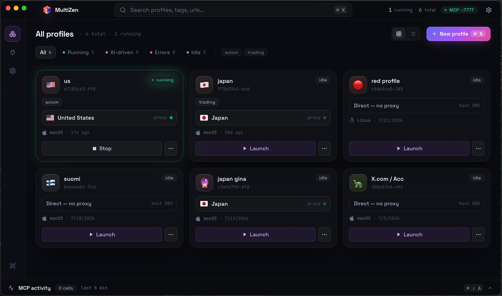
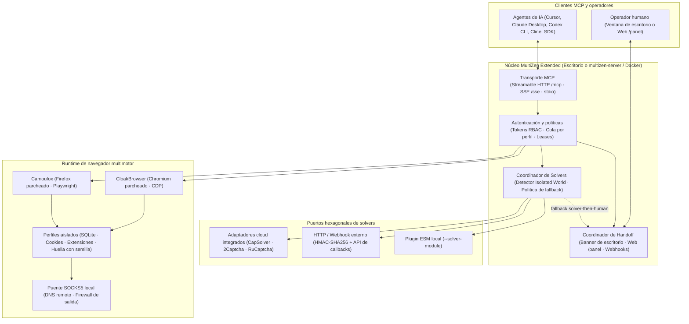

<div align="center">
  

  <h1>MultiZen Extended</h1>

  <p><strong>Navegador antidetección multimotor y servidor MCP para agentes de IA y operadores humanos.</strong></p>

  <p>
    Perfiles aislados de <strong>CloakBrowser</strong> (Chromium) y <strong>Camoufox</strong> (Firefox) con cookies persistentes, huellas de hardware coherentes, proxy por perfil, puertos hexagonales de resolución de CAPTCHA, traspaso humano (handoff) y modo servidor headless con Docker.
  </p>

  <p>
    <a href="../../README.md">English</a>
    &nbsp;·&nbsp;
    <a href="README.ru.md">Русский</a>
    &nbsp;·&nbsp;
    <a href="README.zh-CN.md">简体中文</a>
    &nbsp;·&nbsp;
    <a href="README.ja.md">日本語</a>
    &nbsp;·&nbsp;
    <strong>Español</strong>
    &nbsp;·&nbsp;
    <a href="README.ko.md">한국어</a>
  </p>

  <p>
    <a href="https://github.com/kiserufetch/multizen-browser-extended/releases/latest"></a>
    <a href="https://github.com/kiserufetch/multizen-browser-extended/actions/workflows/ci.yml"></a>
    <a href="https://github.com/kiserufetch/multizen-browser-extended/actions/workflows/release.yml"></a>
    <a href="https://github.com/kiserufetch/multizen-browser-extended/releases"></a>
    <a href="https://github.com/kiserufetch/multizen-browser-extended/stargazers"></a>
    <a href="../../LICENSE"></a>
  </p>

  <p>
    
    
    
    
  </p>

  <p>
    <a href="https://github.com/kiserufetch/multizen-browser-extended/releases/latest"><strong>Descargar última versión</strong></a>
    &nbsp;·&nbsp;
    <a href="#conectar-un-agente-codex-cursor-claude-desktop">Inicio rápido MCP</a>
    &nbsp;·&nbsp;
    <a href="../../apps/server/README.md">Documentación del servidor</a>
    &nbsp;·&nbsp;
    <a href="../../CHANGELOG.md">Changelog</a>
    &nbsp;·&nbsp;
    <a href="https://github.com/kiserufetch/multizen-browser-extended/issues">Issues</a>
    &nbsp;·&nbsp;
    <a href="https://github.com/kiserufetch/multizen-browser-extended/discussions">Discussions</a>
  </p>

  <br/>

  

  <br/><br/>
</div>

## Tabla de contenidos

- [¿Qué es MultiZen Extended?](#qué-es-multizen-extended)
- [Capacidades clave](#capacidades-clave)
- [Arquitectura](#arquitectura)
- [Instalación (aplicación de escritorio)](#instalación-aplicación-de-escritorio)
- [Conectar un agente (Codex, Cursor, Claude Desktop)](#conectar-un-agente-codex-cursor-claude-desktop)
- [Puertos de resolución de CAPTCHA y desafíos](#puertos-de-resolución-de-captcha-y-desafíos)
- [Modo servidor y Docker](#modo-servidor-y-docker)
- [¿Por qué MultiZen Extended?](#por-qué-multizen-extended)
- [Stack técnico y estructura del repositorio](#stack-técnico-y-estructura-del-repositorio)
- [Desarrollo](#desarrollo)
- [Uso aceptable](#uso-aceptable)
- [Licencia](#licencia)

---

## ¿Qué es MultiZen Extended?

**MultiZen Extended** es una plataforma de navegador de código abierto y autoalojada diseñada tanto para **agentes de IA** como para **operadores humanos**. Gestiona una biblioteca local de perfiles aislados —cada uno con sus propias cookies, almacenamiento, extensiones, proxy y huella de hardware coherente— y ejecuta cada perfil con el motor antidetección que elijas: **CloakBrowser** (Chromium parcheado a nivel de código fuente) o **Camoufox** (basado en Firefox).

Un servidor **Model Context Protocol (MCP)** integrado en `127.0.0.1:7777` expone **51 herramientas** de control de navegador, perfiles, resolución de CAPTCHA y traspaso humano mediante Streamable HTTP, SSE heredado o stdio. Puede ejecutarse como una **aplicación de escritorio Electron** en macOS, Windows y Linux, o desplegarse sin interfaz gráfica con **`multizen-server`** en servidores Linux/Windows o en **Docker**.

Cuando un agente encuentra una verificación 2FA, una pantalla de inicio de sesión o un CAPTCHA, MultiZen Extended puede enrutar el desafío a un **puerto de resolución de CAPTCHA** enchufable (CapSolver, 2Captcha, RuCaptcha, webhook HTTP o plugin ESM local) o ceder el control de forma fluida a un operador humano —directamente en la ventana de escritorio o de forma remota en la vista web en vivo `/panel`. Una vez resuelto, el agente continúa exactamente donde se detuvo manteniendo todas las cookies y sesiones intactas.

---

## Capacidades clave

| Capacidad | Detalles |
| --- | --- |
| **Motores antidetección duales** | Elige por perfil entre **CloakBrowser** (Chromium parcheado en C++ con suplantación de canvas/WebGL/audio y prevención de fugas WebRTC) o **Camoufox** (basado en Firefox, semilla determinista por perfil y pila TLS/JS distinta a Chrome). |
| **Personas coherentes de alta entropía** | Catálogos ampliados de dispositivos Windows, Mac (Apple Silicon M2–M4 e Intel) y Linux con perfiles reconciliados de UA/Client Hints/WebGL/pantalla, semillas rotables, diagnóstico de deriva `probe_fingerprint` y política strict-pin de zona horaria (con `alignTimezoneToProxy` / `strictGeoCoherence` opcionales). |
| **51 herramientas MCP listas para producción** | CRUD completo de perfiles, interacción DOM/ARIA basada en referencias (`click_ref` / `type_ref`) en todas las pestañas e iframes cross-origin, eventos sintéticos realistas de teclado/puntero, descargas y subidas, políticas de diálogos JS, arrendamientos exclusivos (leases), colas por perfil, errores tipados reintentables y acceso CDP directo opcional (`cdp_send` / `cdp_send_no_safety`). |
| **Puertos hexagonales de solvers** | Subsistema enchufable de resolución de CAPTCHA con adaptadores integrados para **CapSolver**, **2Captcha**, **RuCaptcha**, **HTTP/Webhook** firmado con HMAC y **plugins ESM locales**. Detección sigilosa en isolated world para Turnstile, reCAPTCHA v2/v3/Enterprise, hCaptcha, GeeTest, Arkose FunCaptcha y DataDome — configurable en caliente vía MCP. |
| **Traspaso humano y Web `/panel`** | Escala 2FA, inicios de sesión o desafíos no resueltos mediante `request_human` / `wait_for_human`. Los operadores intervienen en el escritorio o de forma remota en `/panel` (vista en vivo hasta 5 FPS, ratón, rueda, teclado, cambio de pestañas, diálogos JS, selectores de archivo y webhooks firmados) mientras las acciones de escritura del agente se pausan con `HUMAN_IN_CONTROL`. |
| **Servidor headless y Docker endurecido** | `multizen-server` ejecuta el servidor MCP completo y ambos motores sin Electron. Soporta modos `headed`, `xvfb` y `headless`, tokens RBAC nombrados (`read`, `act`, `profile-admin`, `raw`, `operator`), firewall de salida SOCKS5 por conexión (`block-private`), cifrado AES-256-GCM para contraseñas de proxy, limpiador tras fallos, sandbox Chromium con seccomp, audio PipeWire y fuentes de escritorio Linux en la imagen. |
| **Proxy + puente SOCKS5 local** | Proxy HTTP o SOCKS5 por perfil mediante un puente SOCKS5 local para mantener la resolución DNS remota. Incluye probador de latencia, analizador multipatrón al pegar proxies y alineación automática de persona geográfica. |
| **Ergonomía de escritorio y extensiones** | Vistas en cuadrícula y lista, avatares emoji, etiquetas, URL de inicio por perfil, almacén compartido y deduplicado de extensiones MV3 con botón en Chrome Web Store, exportación/importación cifrada `.mzar`, registro en vivo de actividad MCP y autoactualizador vinculado a este repositorio. |
| **100% autoalojado y Open Source** | Los perfiles se guardan localmente en SQLite y directorios estándar de navegador. Sin cuentas en la nube, sin servidor de licencias, telemetría desactivada por defecto y licencia MIT. |

---

## Arquitectura



---

## Instalación (aplicación de escritorio)

Los instaladores precompilados para macOS, Windows y Linux están disponibles en la [página de GitHub Releases](https://github.com/kiserufetch/multizen-browser-extended/releases/latest).

### macOS (Apple Silicon e Intel)

Descarga el DMG correspondiente a tu arquitectura desde [Releases](https://github.com/kiserufetch/multizen-browser-extended/releases/latest):

- **Apple Silicon (M1–M4):** [`MultiZen-mac-arm64.dmg`](https://github.com/kiserufetch/multizen-browser-extended/releases/latest/download/MultiZen-mac-arm64.dmg)
- **Intel (x64):** [`MultiZen-mac-x64.dmg`](https://github.com/kiserufetch/multizen-browser-extended/releases/latest/download/MultiZen-mac-x64.dmg)

Abre el DMG, arrastra **MultiZen** a `Applications` y elimina una sola vez la marca de cuarentena de Gatekeeper (las compilaciones utilizan firma ad-hoc sin notarización de pago de Apple):

```sh
xattr -cr /Applications/MultiZen.app
```

### Windows (x64)

Descarga y ejecuta [`MultiZen-win-x64.exe`](https://github.com/kiserufetch/multizen-browser-extended/releases/latest/download/MultiZen-win-x64.exe).

Windows SmartScreen puede mostrar una advertencia en el primer inicio al tratarse de un instalador open-source sin firma comercial — haz clic en **Más información (More info)** y luego en **Ejecutar de todas formas (Run anyway)**.

### Linux (x86_64 AppImage)

```sh
curl -LO https://github.com/kiserufetch/multizen-browser-extended/releases/latest/download/MultiZen-linux-x86_64.AppImage
chmod +x MultiZen-linux-x86_64.AppImage
./MultiZen-linux-x86_64.AppImage
```

Algunas distribuciones requieren `libfuse2` (`sudo apt install libfuse2t64` en Ubuntu 24.04+).

<details>
<summary><strong>Configuración de sandbox en Linux (Ubuntu 24.04+ y kernels con user namespaces restringidos)</strong></summary>

En Ubuntu 24.04+ y otros kernels que restringen espacios de nombres de usuario sin privilegios, el sandbox de Chromium se bloquea por defecto. En el primer arranque afectado, MultiZen Extended ofrece una **configuración segura** única que instala un perfil AppArmor específico (`/etc/apparmor.d/multizen-cloakbrowser`) para habilitar el sandbox únicamente para el motor incluido (una sola solicitud de contraseña). También puedes ejecutarlo de nuevo desde **Settings** o consultar allí el comando exacto de `apparmor_parser` para aplicarlo manualmente. Si lo rechazas, la app de escritorio arrancará sin sandbox para seguir funcionando. Para forzar la desactivación del sandbox, lanza el AppImage con `--no-sandbox`.

</details>

<details>
<summary><strong>Vista previa de la bienvenida inicial</strong></summary>

<br/>

<div align="center">
  
</div>

</details>

---

## Conectar un agente (Codex, Cursor, Claude Desktop)

Al iniciar, el servidor MCP escucha en `127.0.0.1:7777` exponiendo el transporte moderno **Streamable HTTP** en `http://127.0.0.1:7777/mcp` (además de HTTP+SSE heredado en `/sse`).

La autenticación usa un **token Bearer** generado en el primer inicio y visible en **MCP → Connect an agent** (también guardado en `mcp-token` dentro del directorio de datos, o creado por agente con `multizen-server token create`). El panel MCP de escritorio incluye un botón **Copy for LLM** con tu token listo para pegar.

**Codex CLI** (`~/.codex/config.toml`):

```toml
[mcp_servers.multizen]
url = "http://127.0.0.1:7777/mcp"
http_headers = { Authorization = "Bearer <token>" }
```

**Cursor** (`~/.cursor/mcp.json`), **Cline**, **Continue** y otros clientes JSON con soporte de URL:

```json
{
  "mcpServers": {
    "multizen": {
      "url": "http://127.0.0.1:7777/mcp",
      "headers": { "Authorization": "Bearer <token>" }
    }
  }
}
```

**Claude Desktop** (`~/Library/Application Support/Claude/claude_desktop_config.json` en macOS, `%APPDATA%\Claude\claude_desktop_config.json` en Windows) — puentea la conexión con [`mcp-remote`](https://www.npmjs.com/package/mcp-remote) (o `multizen-server stdio --connect`):

```json
{
  "mcpServers": {
    "multizen": {
      "command": "npx",
      "args": ["mcp-remote", "http://127.0.0.1:7777/mcp", "--header", "Authorization: Bearer <token>"]
    }
  }
}
```

Reinicia tu cliente MCP. Tu agente tendrá acceso al conjunto completo de **51 herramientas**:

| Categoría | Herramientas |
| --- | --- |
| **Perfiles y personas** | `list_profiles`, `create_profile`, `update_profile`, `delete_profile`, `launch_profile`, `close_profile`, `list_fingerprint_options` |
| **Lectura de página** | `extract`, `screenshot` |
| **Acciones en página** | `navigate`, `click`, `type`, `click_ref`, `type_ref`, `press_key`, `hover`, `select_option`, `scroll`, `evaluate_js` |
| **Pestañas** | `list_tabs`, `new_tab`, `activate_tab`, `close_tab` |
| **Cookies** | `get_cookies`, `set_cookies` |
| **Esperas** | `wait_for_load`, `wait_for_navigation`, `wait_for_selector` |
| **Archivos y descargas** | `upload_file`, `list_downloads`, `get_download`, `delete_download` |
| **Diálogos JavaScript** | `set_dialog_policy`, `list_dialogs`, `handle_dialog` |
| **Traspaso humano** | `request_human`, `get_human_status`, `wait_for_human`, `resume_human` |
| **Puertos de solver CAPTCHA** | `configure_solver`, `get_solver_balance`, `detect_captcha`, `solve_captcha`, `get_solver_status`, `cancel_solver` |
| **Arrendamientos exclusivos** | `acquire_profile`, `renew_profile`, `release_profile` |
| **Diagnóstico y CDP directo** | `probe_fingerprint`, `cdp_send`, `cdp_send_no_safety` |

<details>
<summary><strong>Notas para clientes MCP: motores, refs, errores y concurrencia</strong></summary>

- **Aprovisionamiento completo:** `create_profile` y `update_profile` aceptan `engine` (`cloakbrowser` o `camoufox`), `display_mode` (`headed`, `headless` o `xvfb`), `proxy`, `alignTimezoneToProxy` / `strictGeoCoherence` y ajustes de alto nivel en `fingerprint` (`device`, `localeId`, `timezone`, `screen`, `hardwareConcurrency`, `deviceMemory`, `seed`). Usa `list_fingerprint_options` para listar dispositivos y grupos de localización válidos.
- **Fijación de motor:** `create_profile` sin `engine` hereda el motor predeterminado y lo fija en el perfil. Cambiar de motor con `update_profile` requiere llamar antes a `close_profile`; cada motor mantiene su propio directorio de cookies y datos.
- **Particularidades de Camoufox:** Camoufox no expone CDP, por lo que `cdp_send` y `cdp_send_no_safety` devuelven `UNSUPPORTED_ON_ENGINE`. Las referencias `ref` y todas las demás herramientas funcionan en ambos motores: `extract` devuelve un `ariaSnapshot` con iframes anidados y refs como `p3.e7`, y `evaluate_js` corre en isolated world. Camoufox fija sistema operativo, idioma, pantalla, área disponible, hilos de CPU, fabricante de GPU y ruido determinista a partir de la semilla del perfil.
- **Errores tipados:** Cada fallo devuelve un `code` estable (`PROFILE_NOT_RUNNING`, `STALE_REF`, `DIALOG_OPEN`, `INPUT_NOT_DELIVERED`, `HUMAN_IN_CONTROL`, `EGRESS_BLOCKED`, `PROFILE_LEASED`, `TIMEOUT`, ...), `retryable`, una sugerencia `hint` y opcionalmente `details.retry_after_ms`.
- **Pestaña activa y serialización:** Las herramientas actúan sobre la pestaña activa (`list_tabs`, `new_tab`, `activate_tab`). Las llamadas sobre un mismo perfil se serializan automáticamente entre todos los clientes; usa `acquire_profile` / `renew_profile` / `release_profile` para flujos exclusivos de varios pasos.

</details>

---

## Puertos de resolución de CAPTCHA y desafíos

MultiZen Extended implementa una **arquitectura hexagonal (Ports & Adapters)** para detectar y resolver desafíos — sin ataduras a proveedores, con aislamiento sigiloso y respaldo humano automático.

| Adaptador | Tipo | Características destacadas |
| --- | --- | --- |
| `capsolver` | Cloud integrado (REST v2) | Mapeo automático proxy/proxyless, coherencia de User-Agent con la persona y consulta de saldo en vivo. |
| `2captcha` | Cloud integrado (REST v2) | API REST v2 completa (`createTask` / `getTaskResult` / `getBalance`) y soporte para URL base personalizada. |
| `rucaptcha` | Cloud integrado (REST v2) | Integración nativa con RuCaptcha REST v2 y mapeo automático de proxy. |
| `webhook` | HTTP / Webhook externo | Firma HMAC-SHA256 (`X-MultiZen-Signature`) + token efímero por tarea + rutas interactivas `/solver/v1/tasks/:taskId/{frame,extract,input,action,apply-token,cookies,evaluate-isolated,evaluate-main,settle}`. |
| `module` | Plugin ESM local | Carga dinámica de cualquier módulo local (`--solver-module`) que exporte `createSolverPort(ctx)`. |
| `none` | Solo humano | Envía todas las llamadas `request_human(kind: "captcha")` directamente al operador. |

**Garantías principales:**

- **Detección sigilosa en isolated world:** El detector integrado analiza marcos en isolated world (sin contaminar `window.*` ni activar dominios CDP detectables) para **Cloudflare Turnstile / WAF**, **reCAPTCHA v2/v3 (Estándar y Enterprise)**, **hCaptcha**, **GeeTest v3/v4**, **Arkose FunCaptcha** y **DataDome**.
- **Autoservicio MCP sin preconfiguración:** Los agentes pueden configurar o intercambiar solvers en caliente (globalmente o por perfil) con `configure_solver`, consultar saldo con `get_solver_balance`, ejecutar `detect_captcha` / `solve_captcha`, revisar `get_solver_status` o cancelar y escalar a humano con `cancel_solver(handoff_to_human: true)`.
- **Intercepción transparente de `request_human`:** Al invocar `request_human(kind: "captcha")`, el solver activo se ejecuta primero evitando notificaciones prematuras; con `solver-then-human` (predeterminado), cualquier fallo o desafío no soportado cae suavemente al banner de escritorio o a `/panel`.
- **Exposición segura de proxy (`ProxyExposureMode`):** Por defecto usa `"bridge"` (pasa el puente SOCKS5 local `socks5://127.0.0.1:<port>` y el `FingerprintConfig` efectivo sin exponer credenciales del proxy upstream). Usa `"raw"` solo cuando el solver necesite credenciales directas, o `"none"` para resolución sin proxy.

Consulta la especificación completa en [`docs/captcha-solver-ports-spec.md`](../captcha-solver-ports-spec.md).

---

## Modo servidor y Docker

`multizen-server` ofrece exactamente las mismas 51 herramientas MCP y ambos motores de navegador **sin Electron ni interfaz gráfica** — ideal para máquinas Linux, servidores Windows, pipelines CI y flotas de agentes en contenedores.

### Inicio rápido desde código fuente (Node 22+, Corepack)

```sh
git clone https://github.com/kiserufetch/multizen-browser-extended.git
cd multizen-browser-extended
corepack yarn install
corepack yarn workspace @multizen/server build
node apps/server/bin/multizen-server.cjs serve --headless
```

En una segunda terminal, crea un token con privilegios mínimos para tu agente (se muestra una única vez):

```sh
node apps/server/bin/multizen-server.cjs token create --name agent --tools read,act,profile-admin
```

### Inicio rápido con Docker Compose

El contenedor se ejecuta como usuario no-root (`node`) con todas las capacidades Linux eliminadas, perfil seccomp personalizado para el sandbox de Chromium (`docker/seccomp-chromium.json`), pantallas virtuales Xvfb, servidor de audio silencioso PipeWire y fuentes de escritorio Linux preinstaladas:

```sh
docker compose up -d
docker compose logs -f multizen     # espera a "listening" (el primer arranque descarga el motor en el volumen)
docker compose exec multizen node /app/dist/cli.js token create --name agent --tools read,act,profile-admin
```

> [!NOTE]
> La imagen Docker no incluye binarios de navegador empaquetados a propósito: el motor se descarga en el volumen persistente durante el primer arranque. Conecta tus agentes mediante tokens creados con `token create` y reserva `owner-token` exclusivamente para administración, ya que incluye `raw` (puede eludir la política de salida) y `operator`.

### Qué añade `multizen-server`

- **Modos de pantalla:** `headed`, `xvfb` (servidor X privado por perfil en Linux) y `headless` (`--headless=new` / `headless: true`), configurables por servidor, perfil o lanzamiento.
- **Tokens RBAC nombrados:** Grupos de herramientas (`read`, `act`, `profile-admin`, `raw`, `operator`), listas blancas por herramienta, alcance por perfil, expiración y revocación en menos de un segundo.
- **Acceso remoto y TLS:** Loopback por defecto; el acceso remoto exige `--allow-remote`, certificados TLS (o proxy inverso + `--public-url`), validación estricta de `Host`/`Origin` frente a DNS rebinding y límite de intentos fallidos.
- **Firewall de salida por conexión:** `--egress-policy block-private` (predeterminado) bloquea redes RFC 1918, loopback, link-local, CGNAT y metadatos cloud (incluyendo IPv4 en IPv6, NAT64, redirecciones, `fetch`, WebSockets y DNS rebinding) dentro del propio puente SOCKS5 local.
- **Traspaso humano remoto (`/panel`):** Vista interactiva en vivo (hasta 5 FPS) protegida por token `operator` con webhooks firmados (`--handoff-webhook`).
- **Endurecimiento operativo:** Contraseñas de proxy cifradas con AES-256-GCM (`secrets rotate`), cuotas de cuerpo de petición y sockets, recolector tras cierres inesperados (`run/state.json`), relé `stdio --connect` con keepalive y CLI de exportación/importación `.mzar`.

> [!IMPORTANT]
> **Líneas base de detección:** La paridad con el escritorio se cumple en hosts **Windows** (con ventana y headless). En **Linux** (incluido Docker), siguen siendo observables diferencias en fuentes, audio, dispositivos y WebGL en ambos motores — ejecuta personas Windows en hosts Windows y usa personas Linux en servidores Linux (prefiriendo `xvfb` sobre `headless`). Las mediciones reproducibles están en [`docs/detection-baselines/README.md`](../detection-baselines/README.md).

Referencia completa de flags CLI, variables de entorno, seguridad, proxy inverso y solución de problemas: **[`apps/server/README.md`](../../apps/server/README.md)**.

*Nota sobre licencia del motor:* Puedes usar MultiZen Extended libremente para tus propios agentes e infraestructura; ofrecer automatización respaldada por CloakBrowser como servicio SaaS para terceros requiere licencia OEM/SaaS de CloakHQ.

---

## ¿Por qué MultiZen Extended?

| Característica | MultiZen Extended | Navegadores Cloud *(Browserbase / Hyperbrowser)* | Antidetección comercial *(GoLogin / AdsPower / Multilogin)* |
| --- | :---: | :---: | :---: |
| **Servidor MCP nativo (51 herramientas)** | Sí | Sí | Solo CRUD de perfiles |
| **Motores duales (Chromium + Firefox)** | Sí *(CloakBrowser + Camoufox)* | Solo Chromium | Varía |
| **Antidetección a nivel C++** | Sí | Parcial | Sí |
| **Puertos enchufables de solver CAPTCHA** | Sí *(Cloud + Webhook + ESM)* | Gestionado / propietario | Extensiones de terceros |
| **Traspaso humano (Escritorio + Web `/panel`)** | Sí | URL de vista en vivo | Solo escritorio manual |
| **Servidor headless y Docker endurecido** | Sí | Solo nube | No |
| **Tokens RBAC y firewall de salida** | Sí | Gestionado por plataforma | No |
| **Perfiles y cookies locales persistentes** | Sí *(SQLite + disco)* | Por sesión / facturado | Sincronizado en nube |
| **Pago por hora de navegador / usuario** | **No (Gratis)** | Sí | Sí |
| **100% autoalojado y Open Source** | **Sí (MIT)** | Solo SDK | No |

---

## Stack técnico y estructura del repositorio

| Capa | Tecnología |
| --- | --- |
| **Aplicación de escritorio** | Electron 33, React 19, Tailwind CSS v4, TypeScript (strict), `electron-vite`, `electron-builder` |
| **Motores de navegador** | CloakBrowser (Chromium parcheado vía CDP / `chrome-remote-interface`) y Camoufox (Firefox parcheado vía `playwright-core`) |
| **Servidor MCP** | `@modelcontextprotocol/sdk` sobre Streamable HTTP (`/mcp`), SSE heredado (`/sse`) y `stdio` |
| **Servidor headless** | Node.js 22+, esbuild, Docker + perfil seccomp de Chromium + Xvfb + PipeWire |
| **Almacenamiento y seguridad** | `better-sqlite3` con migraciones idempotentes, cifrado AES-256-GCM y archivos `.mzar` cifrados |
| **Build y CI** | Workspaces de Yarn 4 (Corepack), validación en GitHub Actions + matriz de 4 objetivos (macOS arm64/x64, Windows x64, Linux x64) |

<details>
<summary><strong>Estructura del repositorio</strong></summary>

```text
apps/
  desktop/                GUI Electron + React + Tailwind y proceso principal
  server/                 multizen-server: CLI headless, MCP HTTP/stdio, /panel, RBAC y política egress
packages/
  browser-runtime/        Drivers duales, descargador de motores, modos de pantalla, puente SOCKS5 y solvers
  mcp-server/             Servidor MCP de 51 herramientas, colas por perfil, leases, handoff y solvers
  cdp-driver/             Cliente CDP tipado con timeouts y protecciones de seguridad
  profile-manager/        Almacén SQLite, generador ampliado de huellas, pruebas de entropía y archivos .mzar
  settings-store/         Ajustes persistentes de la aplicación y secretos cifrados
  types/                  Contratos TypeScript compartidos (perfiles, huellas, MCP, puertos de solver)
docker/                   Dockerfile del servidor, seccomp-chromium.json, entrypoint PipeWire + Xvfb
scripts/
  detection-baseline/     Suite reproducible de CreepJS, rebrowser-bot-detector, JA4/H2, WebRTC y fuentes
docs/
  i18n/                   READMEs localizados (RU, ZH-CN, JA, ES, KO)
  detection-baselines/    Matrices registradas de detección en Windows y Linux
  captcha-solver-ports-spec.md
.github/
  workflows/              ci.yml (typecheck, pruebas unitarias, Docker) y release.yml (matriz multi-OS por tag)
```

</details>

---

## Desarrollo

Requiere **Node.js 22+** y **Yarn 4** mediante Corepack.

```sh
git clone https://github.com/kiserufetch/multizen-browser-extended.git
cd multizen-browser-extended
corepack enable
yarn install

yarn dev                        # Iniciar la app de escritorio Electron en modo desarrollo
yarn server:dev                 # Ejecutar multizen-server con navegadores reales desde el código fuente
yarn mcp:dev                    # Ejecutar el servidor MCP con driver simulado para pruebas de protocolo
yarn typecheck                  # Verificación estricta de TypeScript en todos los workspaces
yarn test:unit                  # Ejecutar todas las suites de pruebas unitarias
yarn test:fingerprint           # Validar generación y coherencia de huellas
yarn test:fingerprint-entropy   # Verificar umbrales de entropía del catálogo de hardware/SO
yarn build                      # Compilación completa de todos los workspaces
```

---

## Uso aceptable

Un navegador antidetección multiperfil es una herramienta de doble uso. **MultiZen Extended** está destinado a flujos legítimos: pruebas QA por región y rol, operaciones autorizadas de agencias, investigación de mercado y precios, gestión de múltiples tiendas de comercio electrónico, ingeniería de ventas asistida por IA y administración de cuentas personales que posees legítimamente.

**No debe** utilizarse para infringir Términos de Servicio de plataformas, acceso no autorizado, relleno de credenciales, granjas masivas de cuentas, evasión de bloqueos o fraude. Los operadores y desarrolladores son los únicos responsables de cumplir las leyes aplicables y los términos de los servicios con los que interactúan.

---

## Licencia

Distribuido bajo la **[Licencia MIT](../../LICENSE)**.

<div align="center">
  <br/>
  <sub>
    Originalmente bifurcado del proyecto de código abierto MultiZen y ampliado de forma independiente.<br/>
    Si MultiZen Extended te ahorra tiempo, considera darle una ⭐ al repositorio en <a href="https://github.com/kiserufetch/multizen-browser-extended">GitHub</a>.
  </sub>
</div>
