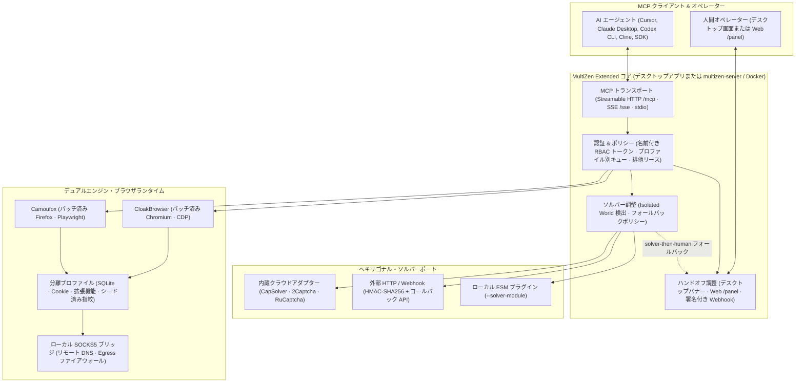

<div align="center">
  

  <h1>MultiZen Extended</h1>

  <p><strong>AI エージェントと人間のオペレーターのためのマルチエンジン対応アンチディテクトブラウザ &amp; MCP サーバー。</strong></p>

  <p>
    永続 Cookie、整合性の高いハードウェアフィンガープリント、プロファイル別プロキシ、ヘキサゴナル CAPTCHA ソルバーポート、ヒューマンハンドオフ、ヘッドレスサーバー &amp; Docker に対応した <strong>CloakBrowser</strong>（Chromium）および <strong>Camoufox</strong>（Firefox）の分離プロファイル環境。
  </p>

  <p>
    <a href="../../README.md">English</a>
    &nbsp;·&nbsp;
    <a href="README.ru.md">Русский</a>
    &nbsp;·&nbsp;
    <a href="README.zh-CN.md">简体中文</a>
    &nbsp;·&nbsp;
    <strong>日本語</strong>
    &nbsp;·&nbsp;
    <a href="README.es.md">Español</a>
    &nbsp;·&nbsp;
    <a href="README.ko.md">한국어</a>
  </p>

  <p>
    <a href="https://github.com/kiserufetch/multizen-browser-extended/releases/latest"></a>
    <a href="https://github.com/kiserufetch/multizen-browser-extended/actions/workflows/ci.yml"></a>
    <a href="https://github.com/kiserufetch/multizen-browser-extended/actions/workflows/release.yml"></a>
    <a href="https://github.com/kiserufetch/multizen-browser-extended/releases"></a>
    <a href="https://github.com/kiserufetch/multizen-browser-extended/stargazers"></a>
    <a href="../../LICENSE"></a>
  </p>

  <p>
    
    
    
    
  </p>

  <p>
    <a href="https://github.com/kiserufetch/multizen-browser-extended/releases/latest"><strong>最新版をダウンロード</strong></a>
    &nbsp;·&nbsp;
    <a href="#エージェントの接続codexcursorclaude-desktop">MCP クイックスタート</a>
    &nbsp;·&nbsp;
    <a href="../../apps/server/README.md">サーバーモード詳細</a>
    &nbsp;·&nbsp;
    <a href="../../CHANGELOG.md">変更履歴</a>
    &nbsp;·&nbsp;
    <a href="https://github.com/kiserufetch/multizen-browser-extended/issues">Issues</a>
    &nbsp;·&nbsp;
    <a href="https://github.com/kiserufetch/multizen-browser-extended/discussions">Discussions</a>
  </p>

  <br/>

  

  <br/><br/>
</div>

## 目次

- [MultiZen Extended とは？](#multizen-extended-とは)
- [主な機能](#主な機能)
- [アーキテクチャ](#アーキテクチャ)
- [インストール（デスクトップアプリ）](#インストールデスクトップアプリ)
- [エージェントの接続（Codex、Cursor、Claude Desktop）](#エージェントの接続codexcursorclaude-desktop)
- [CAPTCHA・チャレンジソルバーポート](#captchaチャレンジソルバーポート)
- [サーバーモードと Docker](#サーバーモードと-docker)
- [MultiZen Extended が選ばれる理由](#multizen-extended-が選ばれる理由)
- [技術スタックとリポジトリ構成](#技術スタックとリポジトリ構成)
- [開発](#開発)
- [利用規約・適正利用](#利用規約適正利用)
- [ライセンス](#ライセンス)

---

## MultiZen Extended とは？

**MultiZen Extended** は、**AI エージェント** と **人間のオペレーター** の双方のために設計されたオープンソース・セルフホスト型のブラウザプラットフォームです。独立した Cookie、ストレージ、拡張機能、プロキシ、整合性の高いハードウェアフィンガープリントを備えたプロファイルライブラリをローカル管理し、プロファイルごとに **CloakBrowser**（ソースレベルでパッチ済みの Chromium）または **Camoufox**（Firefox ベース）を選択して実行できます。

`127.0.0.1:7777` で動作する内蔵 **Model Context Protocol (MCP)** サーバーは、Streamable HTTP・レガシー SSE・stdio 経由で **51 種類のブラウザ操作・プロファイル管理・ソルバー・ハンドオフツール** を公開します。macOS / Windows / Linux 向けの視覚的な **Electron デスクトップアプリ** として使えるだけでなく、GUI なしの **`multizen-server`** によりベアメタル環境や **Docker** 上でも同一のドライバーと MCP サーバーを運用できます。

エージェントが 2FA 認証、ログイン画面、CAPTCHA に遭遇した場合、プラガブルな **CAPTCHA ソルバーポート**（CapSolver、2Captcha、RuCaptcha、HTTP Webhook、ローカル ESM プラグイン）で自動解決するか、デスクトップウィンドウまたはリモートの `/panel` ライブ画面を通じて人間へシームレスに操作を引き継げます。解決後は Cookie とセッション状態を保持したままエージェントが処理を再開します。

---

## 主な機能

| 機能 | 詳細 |
| --- | --- |
| **デュアル・アンチディテクトエンジン** | プロファイルごとに **CloakBrowser**（C++ レベルの Canvas/WebGL/Audio スプーフィングおよび WebRTC リーク防止機能を備えたパッチ済み Chromium）または **Camoufox**（Firefox ベース、プロファイルごとの決定論的シード、非 Chrome TLS/JS フィンガープリント）を選択可能。 |
| **高エントロピーで整合的なペルソナ** | Windows、Mac（Apple Silicon M2–M4 / Intel）、Linux デスクトップ・ノート PC の拡張カタログを搭載。UA/Client Hints/WebGL/画面の整合性を自動調整し、シードのローテーション、`probe_fingerprint` によるドリフト診断、厳格ピン留めタイムゾーンポリシー（オプションで `alignTimezoneToProxy` / `strictGeoCoherence`）に対応。 |
| **51 の実用的な MCP ツール** | プロファイルの完全 CRUD、タブやクロスオリジン iframe を跨ぐ `ref` ベースの DOM/ARIA 操作（`click_ref` / `type_ref`）、自然な合成キーボード・ポインター入力、ダウンロード・アップロード、JS ダイアログポリシー、排他リース、プロファイル単位の実行キュー、リトライ可能な型付きエラー、オプションの生の CDP パススルー（`cdp_send` / `cdp_send_no_safety`）。 |
| **ヘキサゴナル・ソルバーポート** | **CapSolver**、**2Captcha**、**RuCaptcha**、HMAC 署名付き **HTTP/Webhook**、ローカル **ESM プラグイン** を備えたプラガブル CAPTCHA 解決基盤。Turnstile、reCAPTCHA v2/v3/Enterprise、hCaptcha、GeeTest、Arkose FunCaptcha、DataDome を isolated world でステルス検出し、MCP から動的に構成可能。 |
| **ヒューマンハンドオフ &amp; Web `/panel`** | `request_human` / `wait_for_human` で 2FA やログイン、未解決のチャレンジを人間にエスカレーション。オペレーターはデスクトップ画面またはリモート `/panel`（最大 5 FPS ライブ映像、マウス・ホイール・キーボード、タブ切替、JS ダイアログ、ファイル選択、署名付き Webhook）で介入し、その間エージェントの書き込み操作は `HUMAN_IN_CONTROL` で安全に一時停止します。 |
| **ヘッドレスサーバー &amp; 堅牢な Docker** | `multizen-server` は Electron なしで完全な MCP サーバーと両エンジンを実行。`headed` / `xvfb` / `headless` 表示モード、名前付き RBAC トークン（`read`、`act`、`profile-admin`、`raw`、`operator`）、接続レベル SOCKS5 Egress ファイアウォール（`block-private`）、AES-256-GCM によるプロキシパスワード暗号化、クラッシュリーパー、Chromium seccomp サンドボックス、PipeWire オーディオ &amp; Linux フォントを搭載。 |
| **プロキシ + ローカル SOCKS5 ブリッジ** | プロファイル別 HTTP/SOCKS5 プロキシに加え、DNS 解決をリモート側に保つローカル SOCKS5 ブリッジを内蔵。レイテンシ計測付きプロキシテスター、多形式ペーストパーサー、自動ジオペルソナ調整を提供。 |
| **デスクトップ UX &amp; 拡張機能** | グリッド・リスト表示、絵文字アバター、タグ、プロファイル別スタート URL、Chrome ウェブストア用コンパニオンボタン付きの共有重複排除 MV3 拡張ストア、暗号化 `.mzar` エクスポート・インポート、リアルタイム MCP アクティビティログ、本リポジトリ向け自動アップデーター。 |
| **100% セルフホスト &amp; オープンソース** | プロファイルはローカルの SQLite と標準ブラウザディレクトリに保存。クラウドアカウント不要、ライセンスサーバー不要、テレメトリはデフォルト無効、MIT ライセンス。 |

---

## アーキテクチャ



---

## インストール（デスクトップアプリ）

macOS、Windows、Linux 用のビルド済みインストーラーは [GitHub Releases ページ](https://github.com/kiserufetch/multizen-browser-extended/releases/latest) から入手できます。

### macOS（Apple Silicon &amp; Intel）

お使いのアーキテクチャに対応する DMG を [Releases](https://github.com/kiserufetch/multizen-browser-extended/releases/latest) からダウンロードします：

- **Apple Silicon (M1–M4):** [`MultiZen-mac-arm64.dmg`](https://github.com/kiserufetch/multizen-browser-extended/releases/latest/download/MultiZen-mac-arm64.dmg)
- **Intel (x64):** [`MultiZen-mac-x64.dmg`](https://github.com/kiserufetch/multizen-browser-extended/releases/latest/download/MultiZen-mac-x64.dmg)

DMG を開いて **MultiZen** を `Applications` へドラッグし、初回のみ以下のコマンドで Gatekeeper の検疫属性を解除してください（有料の Apple 公証ではなく ad-hoc 署名のため）：

```sh
xattr -cr /Applications/MultiZen.app
```

### Windows (x64)

[`MultiZen-win-x64.exe`](https://github.com/kiserufetch/multizen-browser-extended/releases/latest/download/MultiZen-win-x64.exe) をダウンロードして実行します。

初回実行時に Windows SmartScreen の警告が表示された場合は、**詳細情報（More info）** → **実行（Run anyway）** をクリックしてください。

### Linux (x86_64 AppImage)

```sh
curl -LO https://github.com/kiserufetch/multizen-browser-extended/releases/latest/download/MultiZen-linux-x86_64.AppImage
chmod +x MultiZen-linux-x86_64.AppImage
./MultiZen-linux-x86_64.AppImage
```

一部のディストリビューションでは `libfuse2` が必要です（Ubuntu 24.04+ では `sudo apt install libfuse2t64`）。

<details>
<summary><strong>Linux サンドボックス設定（Ubuntu 24.04+ および非特権ユーザー名前空間が制限されたカーネル）</strong></summary>

Ubuntu 24.04+ など非特権 user namespaces を制限するカーネルでは、Chromium のサンドボックスがデフォルトでブロックされます。対象環境での初回起動時、MultiZen Extended は同梱エンジン専用に限定的な AppArmor プロファイル（`/etc/apparmor.d/multizen-cloakbrowser`）をインストールする 1 回限りの**セキュアセットアップ**を提案します（パスワード入力は 1 回のみ）。後から **Settings** で再実行したり、手動実行用の `apparmor_parser` コマンドを確認することも可能です。スキップした場合、デスクトップアプリはサンドボックスなしで起動するようフォールバックします。明示的にサンドボックスを無効化する場合は `--no-sandbox` を付けて AppImage を起動してください。

</details>

<details>
<summary><strong>初回オンボーディング画面のプレビュー</strong></summary>

<br/>

<div align="center">
  
</div>

</details>

---

## エージェントの接続（Codex、Cursor、Claude Desktop）

起動中、MCP サーバーは `127.0.0.1:7777` で待機し、最新の **Streamable HTTP** エンドポイント `http://127.0.0.1:7777/mcp`（およびレガシー HTTP+SSE の `/sse`）を提供します。

認証には初回起動時に生成される **Bearer トークン** を使用します。デスクトップアプリの **MCP → Connect an agent** に表示されるほか、データディレクトリの `mcp-token` に保存されます（サーバーモードでは `multizen-server token create` で発行）。アプリの MCP パネルにはトークン入りの設定をワンクリックでコピーできる **Copy for LLM** ボタンがあります。

**Codex CLI**（`~/.codex/config.toml`）：

```toml
[mcp_servers.multizen]
url = "http://127.0.0.1:7777/mcp"
http_headers = { Authorization = "Bearer <token>" }
```

**Cursor**（`~/.cursor/mcp.json`）、**Cline**、**Continue** などの JSON URL クライアント：

```json
{
  "mcpServers": {
    "multizen": {
      "url": "http://127.0.0.1:7777/mcp",
      "headers": { "Authorization": "Bearer <token>" }
    }
  }
}
```

**Claude Desktop**（macOS: `~/Library/Application Support/Claude/claude_desktop_config.json`、Windows: `%APPDATA%\Claude\claude_desktop_config.json`）— [`mcp-remote`](https://www.npmjs.com/package/mcp-remote)（または `multizen-server stdio --connect`）でブリッジします：

```json
{
  "mcpServers": {
    "multizen": {
      "command": "npx",
      "args": ["mcp-remote", "http://127.0.0.1:7777/mcp", "--header", "Authorization: Bearer <token>"]
    }
  }
}
```

クライアントを再起動すると、エージェントは全 **51 ツール** を利用できるようになります：

| カテゴリ | ツール一覧 |
| --- | --- |
| **プロファイル &amp; ペルソナ** | `list_profiles`, `create_profile`, `update_profile`, `delete_profile`, `launch_profile`, `close_profile`, `list_fingerprint_options` |
| **ページの読み取り** | `extract`, `screenshot` |
| **ページの操作** | `navigate`, `click`, `type`, `click_ref`, `type_ref`, `press_key`, `hover`, `select_option`, `scroll`, `evaluate_js` |
| **タブ管理** | `list_tabs`, `new_tab`, `activate_tab`, `close_tab` |
| **Cookie** | `get_cookies`, `set_cookies` |
| **待機処理** | `wait_for_load`, `wait_for_navigation`, `wait_for_selector` |
| **ファイル &amp; ダウンロード** | `upload_file`, `list_downloads`, `get_download`, `delete_download` |
| **JavaScript ダイアログ** | `set_dialog_policy`, `list_dialogs`, `handle_dialog` |
| **ヒューマンハンドオフ** | `request_human`, `get_human_status`, `wait_for_human`, `resume_human` |
| **CAPTCHA ソルバーポート** | `configure_solver`, `get_solver_balance`, `detect_captcha`, `solve_captcha`, `get_solver_status`, `cancel_solver` |
| **排他リース** | `acquire_profile`, `renew_profile`, `release_profile` |
| **診断 &amp; 生 CDP** | `probe_fingerprint`, `cdp_send`, `cdp_send_no_safety` |

<details>
<summary><strong>MCP クライアント向けの補足（エンジン・ref・エラー・同時実行）</strong></summary>

- **プロファイルの完全構成：** `create_profile` と `update_profile` は `engine`（`cloakbrowser` / `camoufox`）、`display_mode`（`headed` / `headless` / `xvfb`）、`proxy`、`alignTimezoneToProxy` / `strictGeoCoherence`、高レベルな `fingerprint` 設定（`device`、`localeId`、`timezone`、`screen`、`hardwareConcurrency`、`deviceMemory`、`seed`）を受け付けます。有効なデバイスとロケールは `list_fingerprint_options` で一覧取得できます。
- **エンジンの固定：** `engine` を省略した `create_profile` はデフォルトエンジンを継承してプロファイルに固定します。`update_profile` でエンジンを切り替えるには先に `close_profile` が必要で、Cookie や状態はエンジンごとに別管理されます。
- **Camoufox の仕様：** Camoufox には CDP がないため `cdp_send` と `cdp_send_no_safety` は `UNSUPPORTED_ON_ENGINE` を返します。`ref` と全ページ操作ツールは両エンジン共通で動作し、`extract` はネストされた iframe と `p3.e7` のような ref を含む `ariaSnapshot` を返し、`evaluate_js` は isolated world で実行されます。Camoufox は OS・ロケール・画面・利用可能領域・スレッド数・GPU ベンダーおよびプロファイルシード由来のノイズを固定します。
- **型付きエラー：** すべてのエラーには安定した `code`（`PROFILE_NOT_RUNNING`、`STALE_REF`、`DIALOG_OPEN`、`INPUT_NOT_DELIVERED`、`HUMAN_IN_CONTROL`、`EGRESS_BLOCKED`、`PROFILE_LEASED`、`TIMEOUT` など）、`retryable`、対処方法の `hint`、および必要に応じた `details.retry_after_ms` が含まれます。
- **アクティブタブ &amp; 直列化：** ページ操作はアクティブタブ（`list_tabs`、`new_tab`、`activate_tab`）を対象とします。同一プロファイルに対する呼び出しは全クライアント間で自動的に直列化されます。複数ステップを排他的に実行したい場合は `acquire_profile` / `renew_profile` / `release_profile` を利用してください。

</details>

---

## CAPTCHA・チャレンジソルバーポート

MultiZen Extended は、チャレンジ検出と解決のために **ヘキサゴナルアーキテクチャ（Ports &amp; Adapters）** を実装しています。ベンダーロックインなしでステルス分離を維持し、解決できない場合は自動で人間へフォールバックします。

| アダプター | 種別 | 特長 |
| --- | --- | --- |
| `capsolver` | 内蔵クラウド（REST v2） | プロキシあり／なしの自動マッピング、ペルソナの User-Agent 整合性維持、残高確認に対応。 |
| `2captcha` | 内蔵クラウド（REST v2） | REST API v2（`createTask` / `getTaskResult` / `getBalance`）完全対応、カスタムベース URL 指定可能。 |
| `rucaptcha` | 内蔵クラウド（REST v2） | RuCaptcha REST v2 にネイティブ対応し、プロキシ設定を自動マッピング。 |
| `webhook` | 外部 HTTP / Webhook | HMAC-SHA256 署名（`X-MultiZen-Signature`）+ タスク単位の一時 Bearer トークン + 対話型コールバック `/solver/v1/tasks/:taskId/{frame,extract,input,action,apply-token,cookies,evaluate-isolated,evaluate-main,settle}`。 |
| `module` | ローカル ESM プラグイン | `createSolverPort(ctx)` をエクスポートする任意のローカルモジュール（`--solver-module`）を動的ロード。 |
| `none` | 人間のみ | すべての `request_human(kind: "captcha")` を直接オペレーターへ転送。 |

**設計上の保証：**

- **Isolated world によるステルス検出：** 内蔵検出器は `window.*` を汚さず、検知されやすい CDP ドメインも有効化せずにフレームを検査し、**Cloudflare Turnstile / WAF**、**reCAPTCHA v2/v3（Standard &amp; Enterprise）**、**hCaptcha**、**GeeTest v3/v4**、**Arkose FunCaptcha**、**DataDome** を判別します。
- **事前設定不要の MCP セルフサービス：** エージェントは実行時に `configure_solver` でグローバルまたはプロファイル別にソルバーを設定・切替でき、`get_solver_balance` で残高確認、`detect_captcha` / `solve_captcha` の実行、`get_solver_status` の確認、`cancel_solver(handoff_to_human: true)` による人間への引き継ぎが可能です。
- **`request_human` の透過的インターセプト：** `request_human(kind: "captcha")` を呼ぶと最初に有効なソルバーが試行され、不要な人間通知を抑制します。デフォルトの `solver-then-human` ポリシーでは、非対応や失敗時にデスクトップバナーまたは `/panel` へ自動で引き継ぎます。
- **安全なプロキシ公開制御（`ProxyExposureMode`）：** デフォルトは `"bridge"` で、上流プロキシの認証情報を渡さずにローカル SOCKS5 ブリッジ（`socks5://127.0.0.1:<port>`）と有効な `FingerprintConfig` のみを渡します。上流認証情報が必要な場合のみ `"raw"`、プロキシなし解決の場合は `"none"` を指定できます。

プロトコルとアダプター契約の詳細は [`docs/captcha-solver-ports-spec.md`](../captcha-solver-ports-spec.md) を参照してください。

---

## サーバーモードと Docker

`multizen-server` は、デスクトップ版と同じ 51 の MCP ツールと両ブラウザエンジンを **Electron なし・GUI なし** で提供します。Linux VM、Windows サーバー、CI パイプライン、コンテナ化されたエージェント基盤に最適です。

### ソースからのクイックスタート（Node 22+、Corepack）

```sh
git clone https://github.com/kiserufetch/multizen-browser-extended.git
cd multizen-browser-extended
corepack yarn install
corepack yarn workspace @multizen/server build
node apps/server/bin/multizen-server.cjs serve --headless
```

別ターミナルでエージェント用の最小権限トークンを発行します（一度のみ表示）：

```sh
node apps/server/bin/multizen-server.cjs token create --name agent --tools read,act,profile-admin
```

### Docker Compose クイックスタート

コンテナは非 root ユーザー（`node`）かつ全 Linux ケーパビリティ無効で動作し、カスタム Chromium seccomp プロファイル（`docker/seccomp-chromium.json`）、Xvfb 仮想ディスプレイ、PipeWire 無音サウンドサーバー、Linux デスクトップフォントを標準装備しています：

```sh
docker compose up -d
docker compose logs -f multizen     # "listening" 表示まで待機（初回起動時にエンジンがボリュームへ自動ダウンロードされます）
docker compose exec multizen node /app/dist/cli.js token create --name agent --tools read,act,profile-admin
```

> [!NOTE]
> Docker イメージには意図的にブラウザバイナリを含めず、初回起動時に永続ボリュームへダウンロードする設計です。エージェントには必ず `token create` で作成したトークンを渡し、`raw`（Egress 制御を回避可能）や `operator` を含むデータディレクトリ内の `owner-token` は管理者専用にしてください。

### `multizen-server` の追加機能

- **表示モード：** `headed`、`xvfb`（Linux でプロファイルごとに専用 X サーバーを起動）、`headless`（`--headless=new` / `headless: true`）をサーバー・プロファイル・起動単位で指定可能。
- **名前付き RBAC トークン：** ツールグループ（`read`、`act`、`profile-admin`、`raw`、`operator`）、個別ツール許可リスト、対象プロファイル制限、有効期限、1 秒以内の失効反映。
- **リモートアクセス &amp; TLS：** デフォルトはループバック限定。リモート公開には `--allow-remote`、TLS 証明書（またはリバースプロキシ + `--public-url`）、DNS リバインディング対策の `Host`/`Origin` 検証、ログイン回数制限が必須。
- **接続レベルの Egress ファイアウォール：** デフォルトの `--egress-policy block-private` がローカル SOCKS5 ブリッジ内で RFC 1918、ループバック、リンクローカル、CGNAT、クラウドメタデータ IP/ホスト名（IPv4 射影 IPv6、NAT64、リダイレクト、`fetch`、WebSocket、DNS リバインディングを含む）を遮断。
- **リモートハンドオフ（`/panel`）：** `operator` トークン認証付きのリアルタイムブラウザ操作画面（最大 5 FPS）および署名付き Webhook 通知（`--handoff-webhook`）。
- **運用向けハードニング：** AES-256-GCM によるプロキシパスワード暗号化（`secrets rotate`）、受信ボディ・ソケット制限、クラッシュ後の残留プロセス回収（`run/state.json`）、キープアライブ付き `stdio --connect` リレー、`.mzar` エクスポート・インポート CLI。

> [!IMPORTANT]
> **検出ベースラインについて：** デスクトップ版と同等のステルス性は **Windows** ホスト（headed / headless 双方）で確認されています。**Linux**（Docker 含む）ではフォント・音声・デバイス・WebGL の差異が両エンジンで観測されるため、Windows ペルソナは Windows ホストで実行し、Linux サーバーでは Linux ペルソナ（かつ `headless` より `xvfb`）を使用してください。再現可能な計測結果は [`docs/detection-baselines/README.md`](../detection-baselines/README.md) にまとめています。

全 CLI フラグ、環境変数、セキュリティモデル、リバースプロキシ設定、トラブルシューティングは **[`apps/server/README.md`](../../apps/server/README.md)** を参照してください。

*エンジンライセンスに関する注記：* ご自身のエージェントやインフラでの利用は自由です。CloakBrowser を利用した自動化機能を第三者向けホスト型 SaaS として提供する場合は、CloakHQ の OEM/SaaS ライセンスが必要です。

---

## MultiZen Extended が選ばれる理由

| 機能 | MultiZen Extended | クラウドブラウザ *(Browserbase / Hyperbrowser)* | 商用アンチディテクト *(GoLogin / AdsPower / Multilogin)* |
| --- | :---: | :---: | :---: |
| **ネイティブ MCP サーバー（51 ツール）** | 対応 | 対応 | プロファイル CRUD のみ |
| **デュアルエンジン（Chromium + Firefox）** | 対応 *(CloakBrowser + Camoufox)* | Chromium のみ | 製品により異なる |
| **C++ レベルのアンチディテクト** | 対応 | 部分的 | 対応 |
| **プラガブル CAPTCHA ソルバーポート** | 対応 *(Cloud + Webhook + ESM)* | マネージド / 独自実装 | サードパーティ拡張機能 |
| **ヒューマンハンドオフ（デスクトップ + Web `/panel`）** | 対応 | ライブ閲覧 URL | ローカル手動のみ |
| **ヘッドレスサーバー &amp; 堅牢 Docker** | 対応 | クラウド専用 | 非対応 |
| **RBAC トークン &amp; Egress ファイアウォール** | 対応 | プラットフォーム管理 | 非対応 |
| **永続ローカルプロファイル &amp; Cookie** | 対応 *(SQLite + ローカルディスク)* | セッション単位 / 課金 | クラウド同期 |
| **ブラウザ稼働時間 / シート課金** | **なし（無料）** | あり | あり |
| **100% セルフホスト &amp; オープンソース** | **対応（MIT）** | SDK のみ | 非対応 |

---

## 技術スタックとリポジトリ構成

| レイヤー | 技術 |
| --- | --- |
| **デスクトップシェル** | Electron 33, React 19, Tailwind CSS v4, TypeScript (strict), `electron-vite`, `electron-builder` |
| **ブラウザエンジン** | CloakBrowser（CDP / `chrome-remote-interface` 経由のパッチ済み Chromium）&amp; Camoufox（`playwright-core` 経由のパッチ済み Firefox） |
| **MCP サーバー** | `@modelcontextprotocol/sdk`（Streamable HTTP `/mcp`、レガシー SSE `/sse`、`stdio`） |
| **ヘッドレスサーバー** | Node.js 22+, esbuild, Docker + カスタム Chromium seccomp + Xvfb + PipeWire |
| **ストレージ &amp; セキュリティ** | `better-sqlite3`（冪等マイグレーション）、AES-256-GCM 認証情報暗号化、暗号化 `.mzar` アーカイブ |
| **ビルド &amp; CI** | Yarn 4 ワークスペース（Corepack）、GitHub Actions 検証 + 4 ターゲットリリース行列（macOS arm64/x64, Windows x64, Linux x64） |

<details>
<summary><strong>リポジトリ構成</strong></summary>

```text
apps/
  desktop/                Electron + React + Tailwind GUI およびメインプロセス
  server/                 multizen-server：ヘッドレス CLI、HTTP/stdio MCP、/panel、RBAC、Egress ポリシー
packages/
  browser-runtime/        デュアルエンジンドライバー、エンジン取得、表示モード、SOCKS5 ブリッジ、ソルバーアダプター
  mcp-server/             51 ツール MCP サーバー、プロファイル別キュー、リース、ハンドオフ・ソルバー調整
  cdp-driver/             タイムアウト・安全ガード付き型安全 CDP クライアント
  profile-manager/        SQLite プロファイル管理、拡張フィンガープリント生成、エントロピー検証、.mzar アーカイブ
  settings-store/         アプリ設定の永続化と暗号化シークレット管理
  types/                  共通 TypeScript 型定義（プロファイル、フィンガープリント、MCP、ソルバーポート）
docker/                   サーバー用 Dockerfile、seccomp-chromium.json、PipeWire + Xvfb エントリーポイント
scripts/
  detection-baseline/     CreepJS、rebrowser-bot-detector、JA4/H2、WebRTC、フォントの再現ベンチマーク
docs/
  i18n/                   多言語 README（RU, ZH-CN, JA, ES, KO）
  detection-baselines/    Windows / Linux 検出ベースライン記録と差分
  captcha-solver-ports-spec.md
.github/
  workflows/              ci.yml（型チェック、ユニットテスト、Docker ビルド）& release.yml（タグ駆動マルチ OS ビルド）
```

</details>

---

## 開発

**Node.js 22+** と Corepack 経由の **Yarn 4** が必要です。

```sh
git clone https://github.com/kiserufetch/multizen-browser-extended.git
cd multizen-browser-extended
corepack enable
yarn install

yarn dev                        # Electron デスクトップアプリを開発モードで起動
yarn server:dev                 # 実ブラウザを使う multizen-server をソースから起動
yarn mcp:dev                    # プロトコルテスト用にモックドライバーで MCP サーバーを起動
yarn typecheck                  # 全ワークスペースで厳密な TypeScript 型チェックを実行
yarn test:unit                  # 全ワークスペースのユニットテストを実行
yarn test:fingerprint           # フィンガープリント生成と整合性を検証
yarn test:fingerprint-entropy   # ハードウェア / OS 候補プールのエントロピー閾値を検証
yarn build                      # 全ワークスペースをビルド
```

---

## 利用規約・適正利用

マルチプロファイル対応アンチディテクトブラウザはデュアルユース（両用）ツールです。**MultiZen Extended** は、地域別・ロール別 QA テスト、権限を与えられたエージェンシー業務、市場・価格調査、複数ストアの EC 運用、AI 支援セールスエンジニアリング、および自身が正当に所有する個人アカウントの管理といった正当な用途を想定しています。

プラットフォームの利用規約違反、不正アクセス、クレデンシャルスタッフィング、アカウントの大量不正作成、BAN 回避、詐欺行為への利用は**禁止**されています。適用される法令および接続先サービスの規約を遵守する責任は、すべてオペレーターおよび開発者にあります。

---

## ライセンス

**[MIT License](../../LICENSE)** の下で公開されています。

<div align="center">
  <br/>
  <sub>
    オープンソースの MultiZen プロジェクトから派生し、独自に拡張・開発されています。<br/>
    MultiZen Extended が役に立ったら、ぜひ <a href="https://github.com/kiserufetch/multizen-browser-extended">GitHub</a> で ⭐ を付けて応援してください。
  </sub>
</div>
