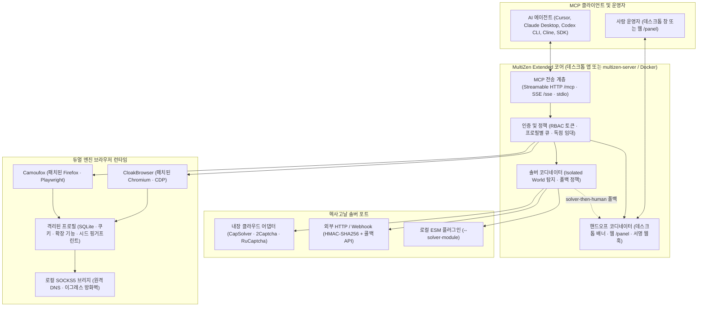

<div align="center">
  

  <h1>MultiZen Extended</h1>

  <p><strong>AI 에이전트와 사람 운영자를 위한 멀티 엔진 안티디텍트 브라우저 및 MCP 서버.</strong></p>

  <p>
    영구 쿠키, 일관된 하드웨어 핑거프린트, 프로필별 프록시, 헥사고날 CAPTCHA 솔버 포트, 휴먼 핸드오프, 헤드리스 서버 및 Docker를 지원하는 격리된 <strong>CloakBrowser</strong>(Chromium)와 <strong>Camoufox</strong>(Firefox) 프로필 환경.
  </p>

  <p>
    <a href="../../README.md">English</a>
    &nbsp;·&nbsp;
    <a href="README.ru.md">Русский</a>
    &nbsp;·&nbsp;
    <a href="README.zh-CN.md">简体中文</a>
    &nbsp;·&nbsp;
    <a href="README.ja.md">日本語</a>
    &nbsp;·&nbsp;
    <a href="README.es.md">Español</a>
    &nbsp;·&nbsp;
    <strong>한국어</strong>
  </p>

  <p>
    <a href="https://github.com/kiserufetch/multizen-browser-extended/releases/latest"></a>
    <a href="https://github.com/kiserufetch/multizen-browser-extended/actions/workflows/ci.yml"></a>
    <a href="https://github.com/kiserufetch/multizen-browser-extended/actions/workflows/release.yml"></a>
    <a href="https://github.com/kiserufetch/multizen-browser-extended/releases"></a>
    <a href="https://github.com/kiserufetch/multizen-browser-extended/stargazers"></a>
    <a href="../../LICENSE"></a>
  </p>

  <p>
    
    
    
    
  </p>

  <p>
    <a href="https://github.com/kiserufetch/multizen-browser-extended/releases/latest"><strong>최신 버전 다운로드</strong></a>
    &nbsp;·&nbsp;
    <a href="#에이전트-연결-codex-cursor-claude-desktop">MCP 빠른 시작</a>
    &nbsp;·&nbsp;
    <a href="../../apps/server/README.md">서버 모드 문서</a>
    &nbsp;·&nbsp;
    <a href="../../CHANGELOG.md">변경 이력</a>
    &nbsp;·&nbsp;
    <a href="https://github.com/kiserufetch/multizen-browser-extended/issues">Issues</a>
    &nbsp;·&nbsp;
    <a href="https://github.com/kiserufetch/multizen-browser-extended/discussions">Discussions</a>
  </p>

  <br/>

  

  <br/><br/>
</div>

## 목차

- [MultiZen Extended란?](#multizen-extended란)
- [주요 기능](#주요-기능)
- [아키텍처](#아키텍처)
- [설치 (데스크톱 앱)](#설치-데스크톱-앱)
- [에이전트 연결 (Codex, Cursor, Claude Desktop)](#에이전트-연결-codex-cursor-claude-desktop)
- [CAPTCHA 및 챌린지 솔버 포트](#captcha-및-챌린지-솔버-포트)
- [서버 모드 및 Docker](#서버-모드-및-docker)
- [왜 MultiZen Extended인가?](#왜-multizen-extended인가)
- [기술 스택 및 저장소 구조](#기술-스택-및-저장소-구조)
- [개발](#개발)
- [허용되는 사용 범위](#허용되는-사용-범위)
- [라이선스](#라이선스)

---

## MultiZen Extended란?

**MultiZen Extended**는 **AI 에이전트**와 **사람 운영자** 모두를 위해 설계된 오픈소스 셀프 호스팅 브라우저 플랫폼입니다. 각 프로필마다 독립된 쿠키, 스토리지, 확장 프로그램, 프록시, 일관된 하드웨어 핑거프린트를 갖는 로컬 프로필 라이브러리를 관리하며, 프로필별로 **CloakBrowser**(소스 패치된 Chromium) 또는 **Camoufox**(Firefox 기반) 안티디텍트 엔진을 선택해 실행할 수 있습니다.

`127.0.0.1:7777`에서 동작하는 내장 **Model Context Protocol (MCP)** 서버는 Streamable HTTP, 레거시 SSE 또는 stdio를 통해 **51개의 브라우저 제어·프로필·솔버·핸드오프 도구**를 제공합니다. macOS, Windows, Linux에서 시각적인 **Electron 데스크톱 앱**으로 실행하거나, GUI 없이 **`multizen-server`**를 사용해 베어메탈 서버나 **Docker**에 동일한 드라이버와 MCP 서버를 배포할 수 있습니다.

에이전트가 2FA 인증, 로그인 화면 또는 CAPTCHA를 만나면 MultiZen Extended는 플러그형 **CAPTCHA 솔버 포트**(CapSolver, 2Captcha, RuCaptcha, HTTP 웹훅, 로컬 ESM 플러그인)로 자동 처리하거나, 데스크톱 창 또는 원격 `/panel` 라이브 웹 뷰를 통해 사람 운영자에게 제어권을 매끄럽게 넘깁니다. 해결이 끝나면 쿠키와 세션을 그대로 유지한 채 에이전트가 작업을 이어갑니다.

---

## 주요 기능

| 기능 | 설명 |
| --- | --- |
| **듀얼 안티디텍트 엔진** | 프로필마다 **CloakBrowser**(C++ 레벨 Canvas/WebGL/Audio 스푸핑 및 WebRTC IP 유출 방지 적용 Chromium) 또는 **Camoufox**(Firefox 기반, 프로필별 결정적 시드, 비-Chrome TLS/JS 핑거프린트)를 자유롭게 선택합니다. |
| **고엔트로피 일관 페르소나** | 확장된 Windows, Mac(Apple Silicon M2–M4 및 Intel), Linux 장치 카탈로그, 자동 정합되는 UA/Client Hints/WebGL/화면 설정, 교체 가능한 핑거프린트 시드, `probe_fingerprint` 드리프트 진단, strict-pin 타임존 정책(옵션 `alignTimezoneToProxy` / `strictGeoCoherence`)을 제공합니다. |
| **51개 프로덕션급 MCP 도구** | 전체 프로필 CRUD, 탭 및 크로스 오리진 iframe을 넘나드는 `ref` 기반 DOM/ARIA 제어(`click_ref` / `type_ref`), 현실적인 합성 키보드/포인터 입력, 다운로드 및 업로드, JS 대화상자 정책, 프로필 독점 임대(Lease), 프로필별 실행 큐, 재시도 가능한 타입 오류 및 선택적 로우 CDP(`cdp_send` / `cdp_send_no_safety`). |
| **헥사고날 솔버 포트** | **CapSolver**, **2Captcha**, **RuCaptcha**, HMAC 서명 **HTTP/Webhook**, 로컬 **ESM 플러그인** 어댑터를 내장한 확장형 CAPTCHA 솔버 아키텍처. Turnstile, reCAPTCHA v2/v3/Enterprise, hCaptcha, GeeTest, Arkose FunCaptcha, DataDome을 isolated world에서 은밀하게 탐지하며 MCP로 실시간 설정 가능합니다. |
| **휴먼 핸드오프 &amp; 웹 `/panel`** | `request_human` / `wait_for_human`으로 2FA, 로그인, 미해결 챌린지를 에스컬레이션합니다. 운영자는 데스크톱 창이나 원격 `/panel`(최대 5 FPS 라이브 스트림, 마우스·휠·키보드, 탭 전환, JS 대화상자, 파일 선택, 서명 웹훅)에서 개입하며, 그 동안 에이전트의 쓰기 작업은 `HUMAN_IN_CONTROL`로 안전하게 일시 정지됩니다. |
| **헤드리스 서버 &amp; 강화된 Docker** | `multizen-server`는 Electron 없이 전체 MCP 서버와 두 엔진을 실행합니다. `headed`, `xvfb`, `headless` 표시 모드, 명명된 RBAC 토큰(`read`, `act`, `profile-admin`, `raw`, `operator`), 연결 수준 SOCKS5 이그레스 방화벽(`block-private`), AES-256-GCM 프록시 비밀번호 암호화, 크래시 리퍼, Chromium seccomp 샌드박스, PipeWire 오디오 및 Linux 데스크톱 폰트를 지원합니다. |
| **프록시 + 로컬 SOCKS5 브리지** | DNS 해석을 원격에 유지하는 로컬 SOCKS5 브리지와 프로필별 HTTP/SOCKS5 프록시를 지원합니다. 지연 시간 측정기, 다중 포맷 프록시 붙여넣기 파서, 자동 지역 페르소나 정렬을 포함합니다. |
| **데스크톱 편의성 및 확장 기능** | 그리드/리스트 보기, 이모지 아바타, 태그, 프로필별 시작 URL, Chrome 웹 스토어 연동 버튼이 포함된 공유 중복 제거 MV3 확장 스토어, 암호화 `.mzar` 내보내기/가져오기, 실시간 MCP 활동 피드, 본 저장소 기반 자동 업데이터. |
| **100% 셀프 호스팅 &amp; 오픈소스** | 모든 프로필은 로컬 SQLite와 표준 브라우저 디렉터리에 저장됩니다. 클라우드 계정이나 라이선스 서버가 없으며, 텔레메트리는 기본적으로 꺼져 있고 MIT 라이선스로 배포됩니다. |

---

## 아키텍처



---

## 설치 (데스크톱 앱)

macOS, Windows, Linux용 사전 빌드 설치 프로그램은 [GitHub Releases 페이지](https://github.com/kiserufetch/multizen-browser-extended/releases/latest)에서 다운로드할 수 있습니다.

### macOS (Apple Silicon 및 Intel)

[Releases](https://github.com/kiserufetch/multizen-browser-extended/releases/latest)에서 시스템 아키텍처에 맞는 DMG를 다운로드하세요:

- **Apple Silicon (M1–M4):** [`MultiZen-mac-arm64.dmg`](https://github.com/kiserufetch/multizen-browser-extended/releases/latest/download/MultiZen-mac-arm64.dmg)
- **Intel (x64):** [`MultiZen-mac-x64.dmg`](https://github.com/kiserufetch/multizen-browser-extended/releases/latest/download/MultiZen-mac-x64.dmg)

DMG를 열어 **MultiZen**을 `Applications`로 드래그한 뒤, 최초 1회 다음 명령으로 Gatekeeper 격리 속성을 해제하세요(유료 Apple 공증 대신 ad-hoc 서명이 적용되어 있습니다):

```sh
xattr -cr /Applications/MultiZen.app
```

### Windows (x64)

[`MultiZen-win-x64.exe`](https://github.com/kiserufetch/multizen-browser-extended/releases/latest/download/MultiZen-win-x64.exe)를 다운로드하여 실행합니다.

최초 실행 시 Windows SmartScreen 경고가 표시되면 **추가 정보(More info)** → **실행(Run anyway)**을 클릭하세요.

### Linux (x86_64 AppImage)

```sh
curl -LO https://github.com/kiserufetch/multizen-browser-extended/releases/latest/download/MultiZen-linux-x86_64.AppImage
chmod +x MultiZen-linux-x86_64.AppImage
./MultiZen-linux-x86_64.AppImage
```

일부 배포판에서는 `libfuse2`가 필요합니다(Ubuntu 24.04+에서는 `sudo apt install libfuse2t64`).

<details>
<summary><strong>Linux 샌드박스 설정 (Ubuntu 24.04+ 및 비특권 사용자 네임스페이스 제한 커널)</strong></summary>

Ubuntu 24.04+ 등 비특권 user namespaces를 제한하는 커널에서는 Chromium 샌드박스가 기본적으로 차단됩니다. 해당 환경에서 처음 실행하면 MultiZen Extended가 번들 엔진에만 샌드박스를 허용하는 좁은 AppArmor 프로필(`/etc/apparmor.d/multizen-cloakbrowser`)을 설치하는 1회성 **보안 설정**을 안내합니다(비밀번호 입력 1회). **Settings**에서 다시 실행하거나 수동 설치용 `apparmor_parser` 명령을 확인할 수도 있습니다. 건너뛰면 데스크톱 앱은 샌드박스 없이 실행되도록 자동 폴백합니다. 샌드박스를 명시적으로 끄려면 `--no-sandbox` 옵션으로 AppImage를 실행하세요.

</details>

<details>
<summary><strong>최초 실행 온보딩 미리보기</strong></summary>

<br/>

<div align="center">
  
</div>

</details>

---

## 에이전트 연결 (Codex, Cursor, Claude Desktop)

실행 중 MCP 서버는 `127.0.0.1:7777`에서 대기하며 최신 **Streamable HTTP** 엔드포인트 `http://127.0.0.1:7777/mcp`(및 레거시 HTTP+SSE `/sse`)를 제공합니다.

인증에는 최초 실행 시 생성되는 **Bearer 토큰**이 사용되며, 데스크톱 앱의 **MCP → Connect an agent**에서 확인하거나 데이터 디렉터리의 `mcp-token` 파일에서 읽을 수 있습니다(서버 모드에서는 `multizen-server token create`로 발급). 앱의 MCP 패널에는 토큰이 채워진 설정을 바로 복사할 수 있는 **Copy for LLM** 버튼이 있습니다.

**Codex CLI** (`~/.codex/config.toml`):

```toml
[mcp_servers.multizen]
url = "http://127.0.0.1:7777/mcp"
http_headers = { Authorization = "Bearer <token>" }
```

**Cursor** (`~/.cursor/mcp.json`), **Cline**, **Continue** 및 기타 JSON URL 클라이언트:

```json
{
  "mcpServers": {
    "multizen": {
      "url": "http://127.0.0.1:7777/mcp",
      "headers": { "Authorization": "Bearer <token>" }
    }
  }
}
```

**Claude Desktop** (macOS: `~/Library/Application Support/Claude/claude_desktop_config.json`, Windows: `%APPDATA%\Claude\claude_desktop_config.json`) — [`mcp-remote`](https://www.npmjs.com/package/mcp-remote)(또는 `multizen-server stdio --connect`)로 브리지합니다:

```json
{
  "mcpServers": {
    "multizen": {
      "command": "npx",
      "args": ["mcp-remote", "http://127.0.0.1:7777/mcp", "--header", "Authorization: Bearer <token>"]
    }
  }
}
```

MCP 클라이언트를 재시작하면 에이전트가 전체 **51개 도구**를 사용할 수 있습니다:

| 분류 | 도구 |
| --- | --- |
| **프로필 및 페르소나** | `list_profiles`, `create_profile`, `update_profile`, `delete_profile`, `launch_profile`, `close_profile`, `list_fingerprint_options` |
| **페이지 읽기** | `extract`, `screenshot` |
| **페이지 동작** | `navigate`, `click`, `type`, `click_ref`, `type_ref`, `press_key`, `hover`, `select_option`, `scroll`, `evaluate_js` |
| **탭 관리** | `list_tabs`, `new_tab`, `activate_tab`, `close_tab` |
| **쿠키** | `get_cookies`, `set_cookies` |
| **대기** | `wait_for_load`, `wait_for_navigation`, `wait_for_selector` |
| **파일 및 다운로드** | `upload_file`, `list_downloads`, `get_download`, `delete_download` |
| **JavaScript 대화상자** | `set_dialog_policy`, `list_dialogs`, `handle_dialog` |
| **휴먼 핸드오프** | `request_human`, `get_human_status`, `wait_for_human`, `resume_human` |
| **CAPTCHA 솔버 포트** | `configure_solver`, `get_solver_balance`, `detect_captcha`, `solve_captcha`, `get_solver_status`, `cancel_solver` |
| **독점 임대(Lease)** | `acquire_profile`, `renew_profile`, `release_profile` |
| **진단 및 로우 CDP** | `probe_fingerprint`, `cdp_send`, `cdp_send_no_safety` |

<details>
<summary><strong>MCP 클라이언트 참고 사항: 엔진, ref, 오류 코드 및 동시성</strong></summary>

- **전체 프로필 구성:** `create_profile`과 `update_profile`은 `engine`(`cloakbrowser` 또는 `camoufox`), `display_mode`(`headed`, `headless`, `xvfb`), `proxy`, `alignTimezoneToProxy` / `strictGeoCoherence` 및 고수준 `fingerprint` 옵션(`device`, `localeId`, `timezone`, `screen`, `hardwareConcurrency`, `deviceMemory`, `seed`)을 지원합니다. 유효한 장치 패밀리와 로케일 그룹은 `list_fingerprint_options`로 조회할 수 있습니다.
- **엔진 고정:** `engine` 없이 `create_profile`을 호출하면 기본 엔진을 상속해 프로필에 고정합니다. `update_profile`로 엔진을 바꾸려면 먼저 `close_profile`을 호출해야 하며, 각 엔진은 쿠키와 저장소를 별도 디렉터리에 유지합니다.
- **Camoufox 세부 사항:** Camoufox에는 CDP가 없으므로 `cdp_send`와 `cdp_send_no_safety`는 `UNSUPPORTED_ON_ENGINE`을 반환합니다. `ref`와 모든 페이지 도구는 두 엔진에서 동일하게 작동하며, `extract`는 중첩 iframe과 `p3.e7` 같은 ref가 포함된 `ariaSnapshot`을 반환하고 `evaluate_js`는 isolated world에서 실행됩니다. Camoufox는 프로필 시드를 바탕으로 OS, 로케일, 화면, 가용 창 영역, CPU 스레드 수, GPU 벤더 및 노이즈를 고정합니다.
- **타입 오류:** 모든 실패는 안정적인 `code`(`PROFILE_NOT_RUNNING`, `STALE_REF`, `DIALOG_OPEN`, `INPUT_NOT_DELIVERED`, `HUMAN_IN_CONTROL`, `EGRESS_BLOCKED`, `PROFILE_LEASED`, `TIMEOUT` 등), `retryable`, 복구 `hint`, 선택적 `details.retry_after_ms`를 포함합니다.
- **활성 탭 및 직렬화:** 페이지 도구는 활성 탭(`list_tabs`, `new_tab`, `activate_tab`)을 대상으로 실행됩니다. 동일 프로필에 대한 호출은 모든 클라이언트 간에 자동으로 직렬화되며, 다단계 독점 작업이 필요할 때는 `acquire_profile` / `renew_profile` / `release_profile`을 사용합니다.

</details>

---

## CAPTCHA 및 챌린지 솔버 포트

MultiZen Extended는 챌린지 탐지와 해결을 위해 **헥사고날 아키텍처(Ports & Adapters)**를 채택했습니다. 특정 공급자 종속 없이 스텔스 격리를 유지하며 실패 시 자동으로 사람에게 폴백합니다.

| 어댑터 | 유형 | 주요 특징 |
| --- | --- | --- |
| `capsolver` | 내장 클라우드 (REST v2) | 프록시/프록시리스 작업 자동 매핑, 페르소나 User-Agent 일관성 유지, 실시간 잔액 조회. |
| `2captcha` | 내장 클라우드 (REST v2) | REST API v2(`createTask` / `getTaskResult` / `getBalance`) 전체 지원, 커스텀 Base URL 지원. |
| `rucaptcha` | 내장 클라우드 (REST v2) | RuCaptcha REST v2 네이티브 통합 및 자동 프록시 매핑. |
| `webhook` | 외부 HTTP / Webhook | HMAC-SHA256 서명(`X-MultiZen-Signature`) + 단일 작업 임시 Bearer 토큰 + 대화형 콜백 경로 `/solver/v1/tasks/:taskId/{frame,extract,input,action,apply-token,cookies,evaluate-isolated,evaluate-main,settle}`. |
| `module` | 로컬 ESM 플러그인 | `createSolverPort(ctx)`를 내보내는 사용자 정의 로컬 모듈(`--solver-module`) 동적 로드. |
| `none` | 사람 전용 | 모든 `request_human(kind: "captcha")` 요청을 운영자에게 직접 전달. |

**핵심 설계 보장:**

- **Isolated world 스텔스 탐지:** 내장 탐지기는 `window.*`를 오염시키거나 탐지 위험이 있는 CDP 도메인을 활성화하지 않고 isolated world에서 프레임을 검사하여 **Cloudflare Turnstile / WAF**, **reCAPTCHA v2/v3(Standard & Enterprise)**, **hCaptcha**, **GeeTest v3/v4**, **Arkose FunCaptcha**, **DataDome**을 식별합니다.
- **사전 설정 없는 MCP 셀프 서비스:** 에이전트는 실행 중 `configure_solver`로 전역 또는 프로필별 솔버를 설정·교체하고, `get_solver_balance`로 잔액을 확인하며, `detect_captcha` / `solve_captcha` 실행, `get_solver_status` 조회, `cancel_solver(handoff_to_human: true)`로 취소 후 사람에게 인계할 수 있습니다.
- **투명한 `request_human` 가로채기:** `request_human(kind: "captcha")` 호출 시 활성 솔버가 우선 시도되며 불필요한 사람 알림을 억제합니다. 기본 정책인 `solver-then-human`에서는 미지원 챌린지나 오류 발생 시 데스크톱 배너 또는 웹 `/panel`로 자동 전환됩니다.
- **안전한 프록시 노출 정책(`ProxyExposureMode`):** 기본값은 `"bridge"`로, 업스트림 프록시 자격 증명을 노출하지 않고 프로필의 로컬 SOCKS5 브리지(`socks5://127.0.0.1:<port>`)와 유효한 `FingerprintConfig`만 전달합니다. 외부 솔버가 업스트림 자격 증명을 직접 필요로 할 때만 `"raw"`, 프록시리스 해결에는 `"none"`을 사용하세요.

전체 프로토콜과 어댑터 계약은 [`docs/captcha-solver-ports-spec.md`](../captcha-solver-ports-spec.md)에서 확인할 수 있습니다.

---

## 서버 모드 및 Docker

`multizen-server`는 **Electron과 GUI 없이** 데스크톱 앱과 완전히 동일한 51개 MCP 도구와 두 브라우저 엔진을 제공합니다. Linux VM, Windows 서버, CI 파이프라인 및 컨테이너 기반 에이전트 클러스터에 최적화되어 있습니다.

### 소스에서 빠른 시작 (Node 22+, Corepack)

```sh
git clone https://github.com/kiserufetch/multizen-browser-extended.git
cd multizen-browser-extended
corepack yarn install
corepack yarn workspace @multizen/server build
node apps/server/bin/multizen-server.cjs serve --headless
```

다른 터미널에서 에이전트용 최소 권한 토큰을 발급합니다(한 번만 출력):

```sh
node apps/server/bin/multizen-server.cjs token create --name agent --tools read,act,profile-admin
```

### Docker Compose 빠른 시작

컨테이너는 비루트 사용자(`node`)와 모든 Linux capability 제거 상태로 실행되며, 커스텀 Chromium seccomp 프로필(`docker/seccomp-chromium.json`), Xvfb 가상 디스플레이, PipeWire 무음 사운드 서버 및 Linux 데스크톱 폰트가 기본 포함되어 있습니다:

```sh
docker compose up -d
docker compose logs -f multizen     # "listening"이 표시될 때까지 대기 (최초 실행 시 엔진이 볼륨으로 자동 다운로드됨)
docker compose exec multizen node /app/dist/cli.js token create --name agent --tools read,act,profile-admin
```

> [!NOTE]
> Docker 이미지에는 브라우저 바이너리가 미리 포함되지 않으며 최초 부팅 시 영구 볼륨으로 자동 다운로드됩니다. 에이전트에는 반드시 `token create`로 생성한 토큰을 사용하고, `raw`(이그레스 정책 우회 가능) 및 `operator` 권한이 포함된 `owner-token`은 관리자 전용으로 보관하세요.

### `multizen-server` 추가 기능

- **표시 모드:** `headed`, `xvfb`(Linux에서 프로필당 독립 X 서버), `headless`(`--headless=new` / `headless: true`)를 서버·프로필·실행 단위로 지정.
- **명명된 RBAC 토큰:** 세밀한 도구 그룹(`read`, `act`, `profile-admin`, `raw`, `operator`), 개별 도구 허용 목록, 프로필 범위 제한, 만료 시간 및 1초 이내 즉시 폐기.
- **원격 접근 및 TLS:** 기본값은 루프백 전용이며, 원격 바인딩 시 `--allow-remote`, TLS 인증서(또는 리버스 프록시 + `--public-url`), DNS 리바인딩 방어용 `Host`/`Origin` 검증 및 로그인 속도 제한을 강제합니다.
- **연결 수준 이그레스 방화벽:** 기본 `--egress-policy block-private`는 로컬 SOCKS5 브리지 내부에서 RFC 1918 사설망, 루프백, 링크 로컬, CGNAT 및 클라우드 메타데이터 IP/호스트명(IPv4-mapped IPv6, NAT64, 리다이렉트, `fetch`, WebSocket, DNS 리바인딩 포함)을 차단합니다.
- **원격 휴먼 핸드오프(`/panel`):** `operator` 토큰 로그인으로 보호되는 실시간 브라우저 제어 화면(최대 5 FPS) 및 서명 웹훅 알림(`--handoff-webhook`).
- **운영 보안 강화:** AES-256-GCM 프록시 비밀번호 암호화(`secrets rotate`), 요청 본문 및 소켓 쿼터, 비정상 종료 프로세스 정리(`run/state.json`), Keepalive 지원 `stdio --connect` 릴레이, `.mzar` 내보내기/가져오기 CLI.

> [!IMPORTANT]
> **탐지 기준선(Detection baselines):** 데스크톱과 동등한 수준은 **Windows** 호스트(창 모드 및 headless 모두)에서 검증되었습니다. **Linux**(Docker 포함)에서는 폰트, 오디오, 장치 및 WebGL 차이가 두 엔진 모두에서 관측되므로 Windows 페르소나는 Windows 호스트에서, Linux 서버에서는 Linux 페르소나를(`headless`보다 `xvfb` 권장) 사용하세요. 재현 가능한 측정 결과는 [`docs/detection-baselines/README.md`](../detection-baselines/README.md)에 있습니다.

전체 CLI 플래그, 환경 변수, 보안 모델, 리버스 프록시 설정 및 문제 해결: **[`apps/server/README.md`](../../apps/server/README.md)**.

*엔진 라이선스 안내:* 본인 소유의 에이전트 및 인프라에서는 자유롭게 사용할 수 있습니다. CloakBrowser 기반 자동화를 제3자 대상 호스팅 SaaS로 제공하는 경우 CloakHQ의 OEM/SaaS 라이선스가 필요합니다.

---

## 왜 MultiZen Extended인가?

| 기능 | MultiZen Extended | 클라우드 브라우저 *(Browserbase / Hyperbrowser)* | 상용 안티디텍트 *(GoLogin / AdsPower / Multilogin)* |
| --- | :---: | :---: | :---: |
| **네이티브 MCP 서버 (51개 도구)** | 지원 | 지원 | 프로필 CRUD만 지원 |
| **듀얼 엔진 (Chromium + Firefox)** | 지원 *(CloakBrowser + Camoufox)* | Chromium 전용 | 제품별 상이 |
| **C++ 레벨 안티디텍트 스푸핑** | 지원 | 부분 지원 | 지원 |
| **플러그형 CAPTCHA 솔버 포트** | 지원 *(Cloud + Webhook + ESM)* | 관리형 / 독점 방식 | 서드파티 확장 기능 |
| **휴먼 핸드오프 (데스크톱 + 웹 `/panel`)** | 지원 | 라이브 뷰 URL | 로컬 수동 조작만 |
| **헤드리스 서버 &amp; 강화된 Docker** | 지원 | 클라우드 전용 | 미지원 |
| **RBAC 토큰 &amp; 이그레스 방화벽** | 지원 | 플랫폼 관리 | 미지원 |
| **영구 로컬 프로필 및 쿠키** | 지원 *(SQLite + 디스크)* | 세션별 / 과금 | 클라우드 동기화 |
| **브라우저 시간당 / 좌석 과금** | **없음 (무료)** | 있음 | 있음 |
| **100% 셀프 호스팅 &amp; 오픈소스** | **지원 (MIT)** | SDK만 공개 | 미지원 |

---

## 기술 스택 및 저장소 구조

| 계층 | 기술 |
| --- | --- |
| **데스크톱 셸** | Electron 33, React 19, Tailwind CSS v4, TypeScript (strict), `electron-vite`, `electron-builder` |
| **브라우저 엔진** | CloakBrowser (CDP / `chrome-remote-interface` 기반 패치 Chromium) &amp; Camoufox (`playwright-core` 기반 패치 Firefox) |
| **MCP 서버** | `@modelcontextprotocol/sdk` (Streamable HTTP `/mcp`, 레거시 SSE `/sse`, `stdio`) |
| **헤드리스 서버** | Node.js 22+, esbuild, Docker + 커스텀 Chromium seccomp + Xvfb + PipeWire |
| **스토리지 및 보안** | `better-sqlite3`(멱등 마이그레이션), AES-256-GCM 자격 증명 암호화, 암호화 `.mzar` 아카이브 |
| **빌드 및 CI** | Yarn 4 워크스페이스(Corepack), GitHub Actions 검증 + 4개 타깃 릴리스 매트릭스(macOS arm64/x64, Windows x64, Linux x64) |

<details>
<summary><strong>저장소 구조</strong></summary>

```text
apps/
  desktop/                Electron + React + Tailwind GUI 및 메인 프로세스
  server/                 multizen-server: 헤드리스 CLI, HTTP/stdio MCP, /panel, RBAC 및 이그레스 정책
packages/
  browser-runtime/        듀얼 엔진 드라이버, 엔진 다운로더, 표시 모드, SOCKS5 브리지, 솔버 어댑터
  mcp-server/             51개 도구 MCP 서버, 프로필별 큐, 임대, 핸드오프 및 솔버 코디네이터
  cdp-driver/             타임아웃 및 안전 가드를 갖춘 타입 안전 CDP 클라이언트
  profile-manager/        SQLite 프로필 저장소, 확장 핑거프린트 생성기, 엔트로피 검증, .mzar 아카이브
  settings-store/         앱 설정 영구 저장 및 암호화 시크릿
  types/                  공유 TypeScript 계약 (프로필, 핑거프린트, MCP, 솔버 포트)
docker/                   서버 Dockerfile, seccomp-chromium.json, PipeWire + Xvfb 엔트리포인트
scripts/
  detection-baseline/     재현 가능한 CreepJS, rebrowser-bot-detector, JA4/H2, WebRTC 및 폰트 벤치마크
docs/
  i18n/                   다국어 README (RU, ZH-CN, JA, ES, KO)
  detection-baselines/    Windows 및 Linux 탐지 매트릭스와 비교 기록
  captcha-solver-ports-spec.md
.github/
  workflows/              ci.yml (타입체크, 단위 테스트, Docker 빌드) & release.yml (태그 트리거 멀티 OS 매트릭스)
```

</details>

---

## 개발

**Node.js 22+** 및 Corepack 기반 **Yarn 4**가 필요합니다.

```sh
git clone https://github.com/kiserufetch/multizen-browser-extended.git
cd multizen-browser-extended
corepack enable
yarn install

yarn dev                        # 개발 모드로 Electron 데스크톱 앱 실행
yarn server:dev                 # 소스에서 실제 브라우저로 multizen-server 실행
yarn mcp:dev                    # 프로토콜 테스트용 목(mock) 드라이버로 MCP 서버 실행
yarn typecheck                  # 모든 워크스페이스에서 엄격한 TypeScript 타입 검사
yarn test:unit                  # 전체 워크스페이스 단위 테스트 실행
yarn test:fingerprint           # 핑거프린트 생성 및 일관성 검증
yarn test:fingerprint-entropy   # 하드웨어/OS 풀 엔트로피 임계값 검증
yarn build                      # 전체 워크스페이스 빌드
```

---

## 허용되는 사용 범위

멀티 프로필 안티디텍트 브라우저는 이중 용도(dual-use) 도구입니다. **MultiZen Extended**는 지역·역할별 QA 테스트, 권한이 부여된 에이전시 운영, 시장 및 가격 조사, 멀티 스토어 이커머스 운영, AI 보조 세일즈 엔지니어링, 본인이 정당하게 소유한 개인 계정 관리 등 합법적인 워크플로를 위해 제작되었습니다.

플랫폼 서비스 약관(ToS) 위반, 무단 접근, 크리덴셜 스터핑, 대량 계정 파밍, 차단 우회 또는 사기 행위에는 사용해서는 **안 됩니다**. 적용 법률과 이용 대상 서비스의 약관을 준수할 책임은 전적으로 운영자와 개발자에게 있습니다.

---

## 라이선스

**[MIT License](../../LICENSE)**에 따라 배포됩니다.

<div align="center">
  <br/>
  <sub>
    오픈소스 MultiZen 프로젝트에서 포크되어 독립적으로 확장·개발되고 있습니다.<br/>
    MultiZen Extended가 시간을 아껴주었다면 <a href="https://github.com/kiserufetch/multizen-browser-extended">GitHub</a>에 ⭐를 눌러주세요.
  </sub>
</div>
