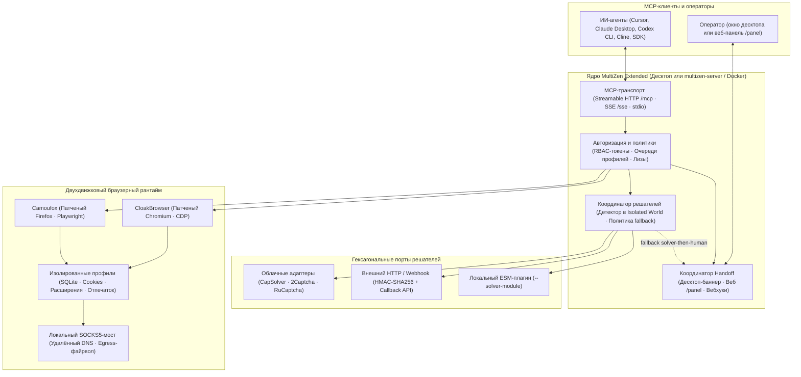
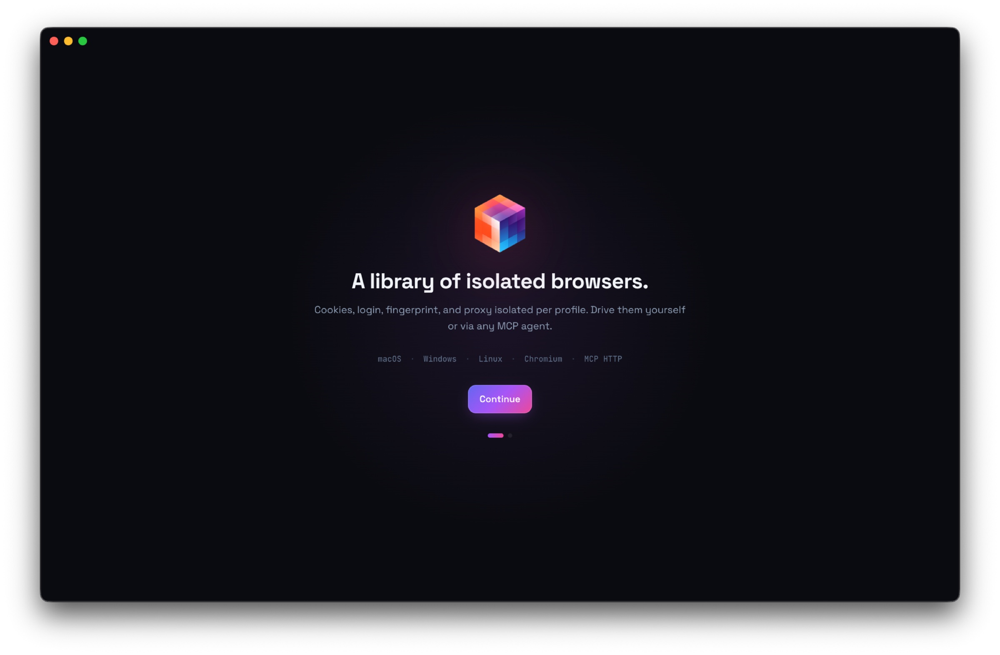

<div align="center">
  

  <h1>MultiZen Extended</h1>

  <p><strong>Мультидвижковый антидетект-браузер и MCP-сервер для ИИ-агентов и операторов.</strong></p>

  <p>
    Изолированные профили <strong>CloakBrowser</strong> (Chromium) и <strong>Camoufox</strong> (Firefox) с постоянными cookies, согласованными аппаратными отпечатками, прокси на профиль, гексагональными портами решателей CAPTCHA, передачей управления человеку и серверным режимом с Docker.
  </p>

  <p>
    <a href="../../README.md">English</a>
    &nbsp;·&nbsp;
    <strong>Русский</strong>
    &nbsp;·&nbsp;
    <a href="README.zh-CN.md">简体中文</a>
    &nbsp;·&nbsp;
    <a href="README.ja.md">日本語</a>
    &nbsp;·&nbsp;
    <a href="README.es.md">Español</a>
    &nbsp;·&nbsp;
    <a href="README.ko.md">한국어</a>
  </p>

  <p>
    <a href="https://github.com/kiserufetch/multizen-browser-extended/releases/latest"></a>
    <a href="https://github.com/kiserufetch/multizen-browser-extended/actions/workflows/ci.yml"></a>
    <a href="https://github.com/kiserufetch/multizen-browser-extended/actions/workflows/release.yml"></a>
    <a href="https://github.com/kiserufetch/multizen-browser-extended/releases"></a>
    <a href="https://github.com/kiserufetch/multizen-browser-extended/stargazers"></a>
    <a href="../../LICENSE"></a>
  </p>

  <p>
    
    
    
    
  </p>

  <p>
    <a href="https://github.com/kiserufetch/multizen-browser-extended/releases/latest"><strong>Скачать релиз</strong></a>
    &nbsp;·&nbsp;
    <a href="#подключение-агента-codex-cursor-claude-desktop">Быстрый старт MCP</a>
    &nbsp;·&nbsp;
    <a href="../../apps/server/README.md">Документация сервера</a>
    &nbsp;·&nbsp;
    <a href="../../CHANGELOG.md">История изменений</a>
    &nbsp;·&nbsp;
    <a href="https://github.com/kiserufetch/multizen-browser-extended/issues">Issues</a>
    &nbsp;·&nbsp;
    <a href="https://github.com/kiserufetch/multizen-browser-extended/discussions">Discussions</a>
  </p>

  <br/>

  

  <br/><br/>
</div>

## Содержание

- [Что такое MultiZen Extended?](#что-такое-multizen-extended)
- [Ключевые возможности](#ключевые-возможности)
- [Архитектура](#архитектура)
- [Установка (десктоп-приложение)](#установка-десктоп-приложение)
- [Подключение агента (Codex, Cursor, Claude Desktop)](#подключение-агента-codex-cursor-claude-desktop)
- [Порты решателей CAPTCHA и челленджей](#порты-решателей-captcha-и-челленджей)
- [Серверный режим и Docker](#серверный-режим-и-docker)
- [Почему MultiZen Extended?](#почему-multizen-extended)
- [Стек и структура репозитория](#стек-и-структура-репозитория)
- [Разработка](#разработка)
- [Допустимое использование](#допустимое-использование)
- [Лицензия](#лицензия)

---

## Что такое MultiZen Extended?

**MultiZen Extended** — это self-hosted браузерная платформа с открытым исходным кодом, созданная для совместной работы **ИИ-агентов** и **людей-операторов**. Приложение управляет локальной библиотекой изолированных браузерных профилей — каждый со своими cookies, хранилищем, расширениями, прокси и согласованным аппаратным отпечатком — и запускает каждый профиль на выбранном антидетект-движке: **CloakBrowser** (пропатченный Chromium) или **Camoufox** (на базе Firefox).

Встроенный сервер **Model Context Protocol (MCP)** на `127.0.0.1:7777` предоставляет **51 инструмент** для управления браузером, профилями, решателями капчи и передачей управления через Streamable HTTP, legacy SSE или stdio. Платформу можно запускать как десктопное приложение на **Electron** (macOS, Windows, Linux) или развернуть те же драйверы и MCP-сервер без GUI через **`multizen-server`** на сервере или в **Docker**.

Когда агент упирается в 2FA, форму входа или CAPTCHA, MultiZen Extended может автоматически направить задачу в подключаемый **порт решателя CAPTCHA** (CapSolver, 2Captcha, RuCaptcha, HTTP-вебхук или локальный ESM-плагин) либо плавно передать управление оператору — прямо в окне десктопа или удалённо через веб-панель `/panel`. После завершения шага агент продолжает работу с того же места, сохраняя все сессии и cookies.

---

## Ключевые возможности

| Возможность | Описание |
| --- | --- |
| **Два антидетект-движка** | Выбор движка на уровне каждого профиля: **CloakBrowser** (пропатченный на уровне C++ Chromium: подмена canvas/WebGL/audio и защита от утечки WebRTC) или **Camoufox** (на базе Firefox, детерминированный seed на профиль, не-Chrome TLS/JS-стек). |
| **Высокоэнтропийные согласованные персоны** | Расширенные каталоги устройств Windows, Mac (Apple Silicon M2–M4 и Intel) и Linux с согласованными UA/Client Hints/WebGL/экранами, сменяемым seed отпечатка, диагностикой дрейфа `probe_fingerprint` и политикой strict-pin часового пояса (с опциональными `alignTimezoneToProxy` / `strictGeoCoherence`). |
| **51 производственный MCP-инструмент** | Полный CRUD профилей, взаимодействие по `ref` (`click_ref` / `type_ref`) во всех вкладках и cross-origin iframe, реалистичные синтетические события клавиатуры и указателя, загрузки и выгрузки файлов, политики JS-диалогов, эксклюзивные лизы профилей, очереди вызовов на профиль, типизированные повторяемые ошибки и опциональный сырой CDP (`cdp_send` / `cdp_send_no_safety`). |
| **Гексагональные порты решателей** | Подключаемая подсистема решения CAPTCHA со встроенными адаптерами **CapSolver**, **2Captcha**, **RuCaptcha**, подписанным **HTTP/Webhook** и локальными **ESM-плагинами**. Стелс-детекция в isolated world для Turnstile, reCAPTCHA v2/v3/Enterprise, hCaptcha, GeeTest, Arkose FunCaptcha и DataDome — настраивается на лету через MCP. |
| **Передача человеку и веб-панель `/panel`** | Эскалация 2FA, логинов и нерешённых челленджей через `request_human` / `wait_for_human`. Оператор подключается в окне десктопа или удалённо через `/panel` (живой поток до 5 FPS, мышь, колесо, клавиатура, переключение вкладок, JS-диалоги, выбор файлов, подписанные вебхуки), пока пишущие команды агента блокируются с кодом `HUMAN_IN_CONTROL`. |
| **Серверный режим и защищённый Docker** | `multizen-server` запускает полный MCP-сервер и оба браузерных движка без Electron. Поддержка режимов `headed`, `xvfb` и `headless`, именованные RBAC-токены (`read`, `act`, `profile-admin`, `raw`, `operator`), SOCKS5 egress-файрвол уровня соединений (`block-private`), шифрование паролей прокси AES-256-GCM, сборщик зависших процессов, seccomp-песочница Chromium, а также PipeWire-аудио и Linux-шрифты в образе. |
| **Прокси + локальный SOCKS5-мост** | Отдельный HTTP- или SOCKS5-прокси на профиль с локальным SOCKS5-мостом для удалённого резолва DNS. Встроенный тестер прокси с задержкой, парсер популярных форматов вставки и выравнивание гео-персоны. |
| **Удобство десктопа и расширения** | Вид сеткой и списком, эмодзи-аватары, теги, стартовые URL на профиль, общее дедуплицированное хранилище MV3-расширений с кнопкой-компаньоном в Chrome Web Store, шифрованный экспорт/импорт профилей `.mzar`, лента MCP-активности и встроенное автообновление из релизов этого репозитория. |
| **100% self-hosted и Open Source** | Профили хранятся локально в SQLite и стандартных каталогах браузеров. Без облачных аккаунтов и серверов лицензий, телеметрия отключена по умолчанию, лицензия MIT. |

---

## Архитектура



---

## Установка (десктоп-приложение)

Готовые установщики для macOS, Windows и Linux публикуются на странице [GitHub Releases](https://github.com/kiserufetch/multizen-browser-extended/releases/latest).

### macOS (Apple Silicon и Intel)

Скачайте DMG под вашу архитектуру со страницы [Релизов](https://github.com/kiserufetch/multizen-browser-extended/releases/latest):

- **Apple Silicon (M1–M4):** [`MultiZen-mac-arm64.dmg`](https://github.com/kiserufetch/multizen-browser-extended/releases/latest/download/MultiZen-mac-arm64.dmg)
- **Intel (x64):** [`MultiZen-mac-x64.dmg`](https://github.com/kiserufetch/multizen-browser-extended/releases/latest/download/MultiZen-mac-x64.dmg)

Откройте DMG, перетащите **MultiZen** в `Applications` и один раз снимите карантин Gatekeeper (сборки подписаны ad-hoc без платной нотаризации Apple):

```sh
xattr -cr /Applications/MultiZen.app
```

### Windows (x64)

Скачайте и запустите [`MultiZen-win-x64.exe`](https://github.com/kiserufetch/multizen-browser-extended/releases/latest/download/MultiZen-win-x64.exe).

При первом запуске Windows SmartScreen может показать предупреждение для неподписанного open-source установщика — нажмите **Подробнее (More info)**, затем **Выполнить в любом случае (Run anyway)**.

### Linux (x86_64 AppImage)

```sh
curl -LO https://github.com/kiserufetch/multizen-browser-extended/releases/latest/download/MultiZen-linux-x86_64.AppImage
chmod +x MultiZen-linux-x86_64.AppImage
./MultiZen-linux-x86_64.AppImage
```

Для некоторых дистрибутивов требуется `libfuse2` (`sudo apt install libfuse2t64` в Ubuntu 24.04+).

<details>
<summary><strong>Настройка песочницы на Linux (Ubuntu 24.04+ и ограниченные user namespaces)</strong></summary>

В Ubuntu 24.04+ и других ядрах, ограничивающих непривилегированные user namespaces, песочница Chromium заблокирована по умолчанию. При первом таком запуске MultiZen Extended предлагает одноразовую **безопасную настройку**, устанавливающую узкий профиль AppArmor (`/etc/apparmor.d/multizen-cloakbrowser`) только для встроенного браузерного движка (потребуется один ввод пароля). Её можно также запустить повторно из **Settings** или скопировать оттуда точную команду `apparmor_parser` для ручной установки. Если отказаться, десктоп-приложение автоматически перейдёт на запуск без песочницы. Чтобы принудительно отключить песочницу, запустите AppImage с флагом `--no-sandbox`.

</details>

<details>
<summary><strong>Экран первого запуска</strong></summary>

<br/>

<div align="center">
  
</div>

</details>

---

## Подключение агента (Codex, Cursor, Claude Desktop)

После запуска MCP-сервер слушает `127.0.0.1:7777` и предоставляет современный транспорт **Streamable HTTP** по адресу `http://127.0.0.1:7777/mcp` (плюс legacy HTTP+SSE на `/sse`).

Для авторизации используется **bearer-токен**, который генерируется при первом запуске и отображается в **MCP → Connect an agent** (также сохраняется в файле `mcp-token` в директории данных десктопа, либо создаётся отдельно командой `multizen-server token create`). В десктопной панели MCP есть кнопка **Copy for LLM**, копирующая готовую конфигурацию вместе с токеном.

**Codex CLI** (`~/.codex/config.toml`):

```toml
[mcp_servers.multizen]
url = "http://127.0.0.1:7777/mcp"
http_headers = { Authorization = "Bearer <token>" }
```

**Cursor** (`~/.cursor/mcp.json`), **Cline**, **Continue** и другие JSON-клиенты с поддержкой URL:

```json
{
  "mcpServers": {
    "multizen": {
      "url": "http://127.0.0.1:7777/mcp",
      "headers": { "Authorization": "Bearer <token>" }
    }
  }
}
```

**Claude Desktop** (`~/Library/Application Support/Claude/claude_desktop_config.json` на macOS, `%APPDATA%\Claude\claude_desktop_config.json` на Windows) — подключение через [`mcp-remote`](https://www.npmjs.com/package/mcp-remote) (или `multizen-server stdio --connect`):

```json
{
  "mcpServers": {
    "multizen": {
      "command": "npx",
      "args": ["mcp-remote", "http://127.0.0.1:7777/mcp", "--header", "Authorization: Bearer <token>"]
    }
  }
}
```

Перезапустите MCP-клиент. Агент получит доступ ко всему набору из **51 инструмента:**

| Категория | Инструменты |
| --- | --- |
| **Профили и персоны** | `list_profiles`, `create_profile`, `update_profile`, `delete_profile`, `launch_profile`, `close_profile`, `list_fingerprint_options` |
| **Чтение страницы** | `extract`, `screenshot` |
| **Действия на странице** | `navigate`, `click`, `type`, `click_ref`, `type_ref`, `press_key`, `hover`, `select_option`, `scroll`, `evaluate_js` |
| **Вкладки** | `list_tabs`, `new_tab`, `activate_tab`, `close_tab` |
| **Cookies** | `get_cookies`, `set_cookies` |
| **Ожидания** | `wait_for_load`, `wait_for_navigation`, `wait_for_selector` |
| **Файлы и загрузки** | `upload_file`, `list_downloads`, `get_download`, `delete_download` |
| **JavaScript-диалоги** | `set_dialog_policy`, `list_dialogs`, `handle_dialog` |
| **Передача человеку** | `request_human`, `get_human_status`, `wait_for_human`, `resume_human` |
| **Порты решателей CAPTCHA** | `configure_solver`, `get_solver_balance`, `detect_captcha`, `solve_captcha`, `get_solver_status`, `cancel_solver` |
| **Эксклюзивные лизы** | `acquire_profile`, `renew_profile`, `release_profile` |
| **Диагностика и сырой CDP** | `probe_fingerprint`, `cdp_send`, `cdp_send_no_safety` |

<details>
<summary><strong>Заметки для MCP-клиентов: движки, ref, ошибки и конкурентный доступ</strong></summary>

- **Полная настройка профилей:** `create_profile` и `update_profile` принимают `engine` (`cloakbrowser` или `camoufox`), `display_mode` (`headed`, `headless` или `xvfb`), `proxy`, `alignTimezoneToProxy` / `strictGeoCoherence` и высокоуровневые параметры `fingerprint` (`device`, `localeId`, `timezone`, `screen`, `hardwareConcurrency`, `deviceMemory`, `seed`). Список допустимых устройств и локалей возвращает `list_fingerprint_options`.
- **Фиксация движка:** `create_profile` без поля `engine` наследует движок по умолчанию и закрепляет его за профилем. Смена движка через `update_profile` требует предварительно вызвать `close_profile`; каждый движок хранит свои cookies и данные отдельно.
- **Особенности Camoufox:** У Camoufox нет CDP, поэтому `cdp_send` и `cdp_send_no_safety` возвращают `UNSUPPORTED_ON_ENGINE`. Ссылки `ref` и все остальные инструменты страницы работают на обоих движках: `extract` возвращает `ariaSnapshot` с вложенными iframe и ref вида `p3.e7`, а `evaluate_js` выполняется в isolated world. Camoufox закрепляет ОС, локаль, экран, доступную область окна, число потоков, вендора GPU и детерминированный шум от `seed` профиля.
- **Типизированные ошибки:** Каждая ошибка содержит стабильный код `code` (`PROFILE_NOT_RUNNING`, `STALE_REF`, `DIALOG_OPEN`, `INPUT_NOT_DELIVERED`, `HUMAN_IN_CONTROL`, `EGRESS_BLOCKED`, `PROFILE_LEASED`, `TIMEOUT`, ...), флаг `retryable`, подсказку `hint` и опциональный `details.retry_after_ms`.
- **Активная вкладка и сериализация:** Инструменты страницы работают с активной вкладкой (`list_tabs`, `new_tab`, `activate_tab`). Вызовы для одного профиля автоматически выстраиваются в очередь между всеми подключёнными клиентами; для эксклюзивной многошаговой сессии используйте `acquire_profile` / `renew_profile` / `release_profile`.

</details>

---

## Порты решателей CAPTCHA и челленджей

MultiZen Extended реализует **гексагональную архитектуру (Ports & Adapters)** для детекции и решения челленджей — без жёсткой привязки к провайдеру, со стелс-изоляцией и автоматическим fallback на человека.

| Адаптер | Тип | Особенности |
| --- | --- | --- |
| `capsolver` | Встроенный облачный (REST v2) | Автоматический маппинг proxy/proxyless-задач, согласованный User-Agent персоны, проверка баланса. |
| `2captcha` | Встроенный облачный (REST v2) | Полная поддержка REST API v2 (`createTask` / `getTaskResult` / `getBalance`), кастомный base URL. |
| `rucaptcha` | Встроенный облачный (REST v2) | Нативная интеграция с RuCaptcha REST v2 с автоматическим выбором proxy/proxyless. |
| `webhook` | Внешний HTTP / Webhook | Подпись HMAC-SHA256 (`X-MultiZen-Signature`), одноразовый bearer-токен на задачу и интерактивные callback-маршруты `/solver/v1/tasks/:taskId/{frame,extract,input,action,apply-token,cookies,evaluate-isolated,evaluate-main,settle}`. |
| `module` | Локальный ESM-плагин | Динамическая загрузка локального модуля (`--solver-module`), экспортирующего `createSolverPort(ctx)`. |
| `none` | Только человек | Направляет все вызовы `request_human(kind: "captcha")` напрямую оператору. |

**Ключевые гарантии:**

- **Стелс-детекция в isolated world:** Встроенный детектор сканирует фреймы в изолированном мире (не загрязняя `window.*` и не включая шумные домены CDP) и распознаёт **Cloudflare Turnstile / WAF**, **reCAPTCHA v2/v3 (Standard и Enterprise)**, **hCaptcha**, **GeeTest v3/v4**, **Arkose FunCaptcha** и **DataDome**.
- **Самообслуживание через MCP без предварительной настройки:** Агент может настроить или горячо переключить провайдер глобально или для конкретного профиля через `configure_solver`, проверить баланс через `get_solver_balance`, запустить `detect_captcha` / `solve_captcha`, проверить статус через `get_solver_status` или отменить задачу с передачей человеку через `cancel_solver(handoff_to_human: true)`.
- **Прозрачный перехват `request_human`:** Вызов `request_human(kind: "captcha")` сначала обращается к активному решателю и подавляет преждевременные уведомления человеку; в режиме `solver-then-human` (по умолчанию) при ошибке или неподдерживаемом типе челленджа задача автоматически передаётся в десктоп-баннер или веб-панель `/panel`.
- **Безопасная передача прокси (`ProxyExposureMode`):** По умолчанию используется `"bridge"` (в порт передаётся локальный SOCKS5-мост профиля `socks5://127.0.0.1:<port>` и эффективный `FingerprintConfig` без раскрытия паролей upstream-прокси). Режим `"raw"` включается только при явной необходимости передать исходные креды прокси, а `"none"` — для proxyless-решения.

Подробная спецификация протокола и контрактов: [`docs/captcha-solver-ports-spec.md`](../captcha-solver-ports-spec.md).

---

## Серверный режим и Docker

`multizen-server` предоставляет те же 51 MCP-инструмент и оба браузерных движка **без Electron и GUI** — идеально для Linux-серверов, Windows-машин, CI-пайплайнов и контейнерных ферм агентов.

### Быстрый старт из исходников (Node 22+, Corepack)

```sh
git clone https://github.com/kiserufetch/multizen-browser-extended.git
cd multizen-browser-extended
corepack yarn install
corepack yarn workspace @multizen/server build
node apps/server/bin/multizen-server.cjs serve --headless
```

Во втором терминале создайте токен с минимально необходимыми правами для агента (выводится один раз):

```sh
node apps/server/bin/multizen-server.cjs token create --name agent --tools read,act,profile-admin
```

### Быстрый старт через Docker Compose

Контейнер работает от непривилегированного пользователя (`node`) со сброшенными Linux capabilities, кастомным профилем seccomp для песочницы Chromium (`docker/seccomp-chromium.json`), виртуальным дисплеем Xvfb, звуковым сервером PipeWire и Linux-шрифтами:

```sh
docker compose up -d
docker compose logs -f multizen     # дождитесь строки "listening" (при первом запуске движок скачается в volume)
docker compose exec multizen node /app/dist/cli.js token create --name agent --tools read,act,profile-admin
```

> [!NOTE]
> Образ Docker намеренно не включает предзагруженные бинарники браузера — движок загружается в постоянный том при первом запуске. Подключайте агентов только через токены из `token create`, а `owner-token` в директории данных оставьте для администратора (он включает группы `raw`, способную обойти egress-политику, и `operator`).

### Что добавляет `multizen-server`

- **Режимы отображения:** `headed`, `xvfb` (отдельный приватный X-сервер на профиль в Linux) и `headless` (`--headless=new` / `headless: true`) — на уровне сервера, профиля или конкретного запуска.
- **Именованные RBAC-токены:** Гибкие группы инструментов (`read`, `act`, `profile-admin`, `raw`, `operator`), индивидуальные списки инструментов, ограничение по профилям, срок действия и мгновенный отзыв (до 1 секунды).
- **Удалённый доступ и TLS:** По умолчанию сервер слушает только loopback; для удалённых подключений требуются `--allow-remote`, TLS-сертификаты (или реверс-прокси + `--public-url`), строгая проверка `Host`/`Origin` от DNS rebinding и лимит неудачных входов.
- **Egress-файрвол уровня соединений:** `--egress-policy block-private` (по умолчанию) блокирует RFC 1918, loopback, link-local, CGNAT и адреса облачных метаданных (включая IPv4-mapped IPv6, NAT64, редиректы, `fetch`, WebSockets и DNS rebinding) прямо внутри локального SOCKS5-моста.
- **Удалённая передача человеку (`/panel`):** Интерактивный live-просмотр браузера (до 5 FPS) за авторизацией `operator`-токена и подписанные webhook-уведомления (`--handoff-webhook`).
- **Эксплуатационная защита:** Шифрование паролей прокси AES-256-GCM (`secrets rotate`), лимиты входящих тел и сокетов, очистка процессов после сбоя (`run/state.json`), релей `stdio --connect` с keepalive и CLI экспорта/импорта `.mzar`.

> [!IMPORTANT]
> **Замеры обнаружения:** Паритет с десктопом подтверждён на хостах **Windows** (в оконном и headless-режимах). На **Linux** (включая Docker) остаются отличия по шрифтам, аудио, устройствам и WebGL на обоих движках — запускайте Windows-персоны на Windows-хостах, а на Linux-серверах используйте Linux-персоны (предпочитая `xvfb` вместо `headless`). Все воспроизводимые замеры собраны в [`docs/detection-baselines/README.md`](../detection-baselines/README.md).

Полный справочник флагов CLI, переменных окружения, модели безопасности, настройки реверс-прокси и диагностики: **[`apps/server/README.md`](../../apps/server/README.md)**.

*Примечание по лицензированию движка:* Вы можете свободно использовать MultiZen Extended для своих агентов и инфраструктуры; предоставление автоматизации на базе CloakBrowser третьим лицам как SaaS-сервиса требует OEM/SaaS-лицензии CloakHQ.

---

## Почему MultiZen Extended?

| Возможность | MultiZen Extended | Облачные браузеры *(Browserbase / Hyperbrowser)* | Коммерческие антидетекты *(GoLogin / AdsPower / Multilogin)* |
| --- | :---: | :---: | :---: |
| **Нативный MCP-сервер (51 инструмент)** | Да | Да | Только CRUD профилей |
| **Два движка (Chromium + Firefox)** | Да *(CloakBrowser + Camoufox)* | Только Chromium | Зависит от продукта |
| **Антидетект-подмена на уровне C++** | Да | Частично | Да |
| **Подключаемые порты решателей CAPTCHA** | Да *(Облако + Webhook + ESM)* | Проприетарно | Сторонние расширения |
| **Передача человеку (Десктоп + Веб `/panel`)** | Да | Live-ссылка | Только локально вручную |
| **Headless-сервер и защищённый Docker** | Да | Только облако | Нет |
| **RBAC-токены и egress-файрвол** | Да | Управляется платформой | Нет |
| **Постоянные локальные профили и cookies** | Да *(SQLite + диск)* | Посессионно / платно | Облачная синхронизация |
| **Оплата за часы браузера / места** | **Нет (бесплатно)** | Да | Да |
| **100% self-hosted и Open Source** | **Да (MIT)** | Только SDK | Нет |

---

## Стек и структура репозитория

| Слой | Технологии |
| --- | --- |
| **Десктоп-оболочка** | Electron 33, React 19, Tailwind CSS v4, TypeScript (strict), `electron-vite`, `electron-builder` |
| **Браузерные движки** | CloakBrowser (патченый Chromium через CDP / `chrome-remote-interface`) и Camoufox (патченый Firefox через `playwright-core`) |
| **MCP-сервер** | `@modelcontextprotocol/sdk` поверх Streamable HTTP (`/mcp`), legacy SSE (`/sse`) и `stdio` |
| **Headless-сервер** | Node.js 22+, esbuild, Docker + профиль seccomp для Chromium + Xvfb + PipeWire |
| **Хранение и защита** | `better-sqlite3` с идемпотентными миграциями, шифрование секретов AES-256-GCM, архивы `.mzar` |
| **Сборка и CI** | Yarn 4 workspaces (Corepack), валидация GitHub Actions + релизная матрица на 4 цели (macOS arm64/x64, Windows x64, Linux x64) |

<details>
<summary><strong>Структура репозитория</strong></summary>

```text
apps/
  desktop/                Electron + React + Tailwind GUI и main-процесс
  server/                 multizen-server: headless CLI, HTTP/stdio MCP, /panel, RBAC и egress-политика
packages/
  browser-runtime/        Драйверы обоих движков, загрузчик, режимы дисплея, SOCKS5-мост, адаптеры решателей
  mcp-server/             MCP-сервер (51 инструмент), очереди профилей, лизы, координаторы handoff и solver
  cdp-driver/             Типизированный CDP-клиент с таймаутами и защитными ограничениями
  profile-manager/        SQLite-хранилище профилей, генератор отпечатков, проверки энтропии, архивы .mzar
  settings-store/         Постоянные настройки приложения и шифрованные секреты
  types/                  Общие контракты TypeScript (профили, отпечатки, MCP, порты решателей)
docker/                   Dockerfile сервера, seccomp-chromium.json, точка входа PipeWire + Xvfb
scripts/
  detection-baseline/     Воспроизводимый бенчмарк CreepJS, rebrowser-bot-detector, JA4/H2, WebRTC и шрифтов
docs/
  i18n/                   Локализованные README (RU, ZH-CN, JA, ES, KO)
  detection-baselines/    Зафиксированные матрицы обнаружения для Windows и Linux
  captcha-solver-ports-spec.md
.github/
  workflows/              ci.yml (typecheck, unit-тесты, сборка Docker) и release.yml (матрица сборок по тегу)
```

</details>

---

## Разработка

Требуются **Node.js 22+** и **Yarn 4** (через Corepack).

```sh
git clone https://github.com/kiserufetch/multizen-browser-extended.git
cd multizen-browser-extended
corepack enable
yarn install

yarn dev                        # Запуск десктоп-приложения Electron в dev-режиме
yarn server:dev                 # Запуск multizen-server с реальными браузерами из исходников
yarn mcp:dev                    # Запуск MCP-сервера на mock-драйвере для протокольных тестов
yarn typecheck                  # Строгая проверка TypeScript во всех воркспейсах
yarn test:unit                  # Запуск всех unit-тестов
yarn test:fingerprint           # Проверка генерации и согласованности отпечатков
yarn test:fingerprint-entropy   # Проверка порогов энтропии каталога устройств и ОС
yarn build                      # Полная сборка всех воркспейсов
```

---

## Допустимое использование

Мультипрофильный антидетект-браузер — инструмент двойного назначения. **MultiZen Extended** предназначен для легитимных сценариев: кросс-регионального и ролевого QA-тестирования, авторизованной агентской работы, маркетинговых и ценовых исследований, управления несколькими e-commerce магазинами, ИИ-ассистентов для продаж и работы с собственными аккаунтами.

Инструмент **не предназначен** для нарушения правил сервисов (ToS), несанкционированного доступа, подбора учётных данных, массового фарминга аккаунтов, обхода блокировок или мошенничества. Операторы и разработчики самостоятельно несут ответственность за соблюдение применимого законодательства и условий используемых платформ.

---

## Лицензия

Распространяется под лицензией **[MIT License](../../LICENSE)**.

<div align="center">
  <br/>
  <sub>
    Изначально основано на open-source проекте MultiZen и развивается независимо.<br/>
    Если MultiZen Extended экономит вам время, поставьте ⭐ репозиторию на <a href="https://github.com/kiserufetch/multizen-browser-extended">GitHub</a>.
  </sub>
</div>
