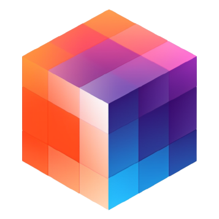
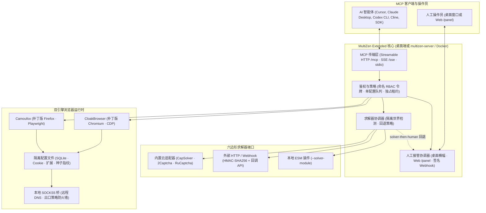

<div align="center">
  

  <h1>MultiZen Extended</h1>

  <p><strong>面向 AI 智能体与人工操作员的多引擎防检测浏览器与 MCP 服务器。</strong></p>

  <p>
    隔离的 <strong>CloakBrowser</strong>（Chromium）与 <strong>Camoufox</strong>（Firefox）配置文件，内置持久化 Cookie、一致性硬件指纹、独立代理、六边形验证码求解器端口、人机协作接管以及无头服务端与 Docker 部署支持。
  </p>

  <p>
    <a href="../../README.md">English</a>
    &nbsp;·&nbsp;
    <a href="README.ru.md">Русский</a>
    &nbsp;·&nbsp;
    <strong>简体中文</strong>
    &nbsp;·&nbsp;
    <a href="README.ja.md">日本語</a>
    &nbsp;·&nbsp;
    <a href="README.es.md">Español</a>
    &nbsp;·&nbsp;
    <a href="README.ko.md">한국어</a>
  </p>

  <p>
    <a href="https://github.com/kiserufetch/multizen-browser-extended/releases/latest"></a>
    <a href="https://github.com/kiserufetch/multizen-browser-extended/actions/workflows/ci.yml"></a>
    <a href="https://github.com/kiserufetch/multizen-browser-extended/actions/workflows/release.yml"></a>
    <a href="https://github.com/kiserufetch/multizen-browser-extended/releases"></a>
    <a href="https://github.com/kiserufetch/multizen-browser-extended/stargazers"></a>
    <a href="../../LICENSE"></a>
  </p>

  <p>
    
    
    
    
  </p>

  <p>
    <a href="https://github.com/kiserufetch/multizen-browser-extended/releases/latest"><strong>下载最新版</strong></a>
    &nbsp;·&nbsp;
    <a href="#连接智能体codexcursorclaude-desktop">MCP 快速开始</a>
    &nbsp;·&nbsp;
    <a href="../../apps/server/README.md">服务端文档</a>
    &nbsp;·&nbsp;
    <a href="../../CHANGELOG.md">更新日志</a>
    &nbsp;·&nbsp;
    <a href="https://github.com/kiserufetch/multizen-browser-extended/issues">Issues</a>
    &nbsp;·&nbsp;
    <a href="https://github.com/kiserufetch/multizen-browser-extended/discussions">Discussions</a>
  </p>

  <br/>

  

  <br/><br/>
</div>

## 目录

- [什么是 MultiZen Extended？](#什么是-multizen-extended)
- [核心特性](#核心特性)
- [系统架构](#系统架构)
- [安装（桌面端应用）](#安装桌面端应用)
- [连接智能体（Codex、Cursor、Claude Desktop）](#连接智能体codexcursorclaude-desktop)
- [CAPTCHA 与人机验证求解器端口](#captcha-与人机验证求解器端口)
- [服务端模式与 Docker](#服务端模式与-docker)
- [为什么选择 MultiZen Extended？](#为什么选择-multizen-extended)
- [技术栈与仓库结构](#技术栈与仓库结构)
- [本地开发](#本地开发)
- [合理使用声明](#合理使用声明)
- [开源协议](#开源协议)

---

## 什么是 MultiZen Extended？

**MultiZen Extended** 是一款开源、可自托管的浏览器平台，专为 **AI 智能体** 与 **人工操作员** 协作设计。它管理本地隔离的浏览器配置文件库——每个配置拥有独立的 Cookie、存储、扩展、代理以及高度一致的硬件指纹——并允许按配置选择防检测内核：**CloakBrowser**（源码级补丁 Chromium）或 **Camoufox**（基于 Firefox）。

内置的 **Model Context Protocol (MCP)** 服务器默认监听 `127.0.0.1:7777`，通过 Streamable HTTP、旧版 SSE 或 stdio 暴露 **51 个浏览器驱动、配置管理、验证码求解与人工接管工具**。既可以作为 **Electron 桌面端应用** 运行在 macOS、Windows 和 Linux 上，也可以通过 **`multizen-server`** 无 GUI 部署在物理服务器或 **Docker** 容器中。

当 AI 智能体遇到 2FA 二次验证、登录拦截或 CAPTCHA 时，MultiZen Extended 既可通过可插拔的 **CAPTCHA 求解器端口**（CapSolver、2Captcha、RuCaptcha、HTTP Webhook 或本地 ESM 插件）自动处理，也可以无缝切换给人工操作员——直接在桌面窗口或通过远程 `/panel` 实时网页接管。完成后智能体即可在保留完整 Cookie 与会话状态的前提下无缝继续执行。

---

## 核心特性

| 特性 | 说明 |
| --- | --- |
| **双防检测内核（按配置选择）** | 每个配置均可独立选择 **CloakBrowser**（C++ 层 Canvas/WebGL/Audio 指纹伪装及 WebRTC 防泄漏）或 **Camoufox**（Firefox 内核，按配置固定随机种子，提供真正的非 Chrome TLS/JS 指纹）。 |
| **高熵一致性设备画像** | 扩展的 Windows、Mac（Apple Silicon M2–M4 与 Intel）及 Linux 设备库，自动校准 UA/Client Hints/WebGL/分辨率，支持指纹种子轮换、`probe_fingerprint` 漂移诊断以及严格锁定时区策略（可选 `alignTimezoneToProxy` / `strictGeoCoherence`）。 |
| **51 个生产级 MCP 工具** | 完整配置 CRUD、跨标签页与跨域 iframe 的 `ref` 元素交互（`click_ref` / `type_ref`）、拟真合成键鼠事件、文件上传与下载、JS 弹窗策略、独占租约（Lease）、单配置串行队列、结构化可重试错误以及可选原生 CDP 直通（`cdp_send` / `cdp_send_no_safety`）。 |
| **六边形验证码求解器端口** | 可插拔验证求解子系统，内置 **CapSolver**、**2Captcha**、**RuCaptcha**、HMAC 签名 **HTTP/Webhook** 与本地 **ESM 插件** 适配器。在隔离世界（isolated world）静默检测 Turnstile、reCAPTCHA v2/v3/Enterprise、hCaptcha、GeeTest、Arkose FunCaptcha 与 DataDome，支持通过 MCP 运行时热配置。 |
| **人工接管与 Web `/panel`** | 通过 `request_human` / `wait_for_human` 将 2FA、登录或未解决验证转交人工。操作员可在桌面窗口或远程 `/panel`（最高 5 FPS 实时画面、键鼠、滚轮、标签页切换、JS 弹窗、文件选择与签名 Webhook）中处理，期间智能体写入操作将暂停并返回 `HUMAN_IN_CONTROL`。 |
| **无头服务端与加固 Docker** | `multizen-server` 无需 Electron 即可运行完整 MCP 服务与双引擎，支持 `headed`、`xvfb`、`headless` 显示模式、命名 RBAC 令牌（`read`、`act`、`profile-admin`、`raw`、`operator`）、连接级 SOCKS5 出口防火墙（`block-private`）、AES-256-GCM 代理密码加密、崩溃进程清理、Chromium seccomp 沙盒以及内置 PipeWire 音频与 Linux 桌面字体。 |
| **独立代理 + 本地 SOCKS5 桥** | 支持按配置设置 HTTP/SOCKS5 代理并通过本地 SOCKS5 桥保证远程 DNS 解析。内置延迟测速、多格式代理字符串一键解析与代理地理位置画像对齐。 |
| **桌面体验与扩展管理** | 网格/列表视图、Emoji 头像、标签、独立启动页、共享去重 MV3 扩展仓库（附 Chrome 应用商店伴侣按钮）、加密 `.mzar` 配置导入导出、实时 MCP 活动日志及基于本仓库 GitHub Releases 的自动更新。 |
| **100% 自托管与开源** | 所有配置以明文 SQLite 及标准浏览器目录保存在本地磁盘。无需账号、无授权服务器、默认关闭遥测、采用 MIT 协议开源。 |

---

## 系统架构



---

## 安装（桌面端应用）

macOS、Windows 和 Linux 的预编译安装包发布在 [GitHub Releases 页面](https://github.com/kiserufetch/multizen-browser-extended/releases/latest)。

### macOS（Apple Silicon 与 Intel）

从 [Releases](https://github.com/kiserufetch/multizen-browser-extended/releases/latest) 下载对应架构的 DMG：

- **Apple Silicon (M1–M4)：** [`MultiZen-mac-arm64.dmg`](https://github.com/kiserufetch/multizen-browser-extended/releases/latest/download/MultiZen-mac-arm64.dmg)
- **Intel (x64)：** [`MultiZen-mac-x64.dmg`](https://github.com/kiserufetch/multizen-browser-extended/releases/latest/download/MultiZen-mac-x64.dmg)

打开 DMG 并将 **MultiZen** 拖入 `Applications`，随后执行一次以下命令以移除 macOS Gatekeeper 隔离标记（开源版本采用 ad-hoc 签名，未购买 Apple 付费公证）：

```sh
xattr -cr /Applications/MultiZen.app
```

### Windows (x64)

下载并运行 [`MultiZen-win-x64.exe`](https://github.com/kiserufetch/multizen-browser-extended/releases/latest/download/MultiZen-win-x64.exe)。

首次运行时 Windows SmartScreen 可能会提示未签名安装包，点击 **更多信息（More info）** → **仍要运行（Run anyway）** 即可。

### Linux (x86_64 AppImage)

```sh
curl -LO https://github.com/kiserufetch/multizen-browser-extended/releases/latest/download/MultiZen-linux-x86_64.AppImage
chmod +x MultiZen-linux-x86_64.AppImage
./MultiZen-linux-x86_64.AppImage
```

部分发行版需要安装 `libfuse2`（Ubuntu 24.04+ 可执行 `sudo apt install libfuse2t64`）。

<details>
<summary><strong>Linux 沙盒配置（Ubuntu 24.04+ 及限制非特权用户命名空间的内核）</strong></summary>

在 Ubuntu 24.04+ 等限制非特权 user namespaces 的内核上，Chromium 沙盒默认会被阻止。首次触发时，MultiZen Extended 会提供一次性的**安全配置**，为内置浏览器内核安装最小权限 AppArmor 规则（`/etc/apparmor.d/multizen-cloakbrowser`，仅需输入一次密码）。你也可以随时在 **Settings** 中重新执行或查看具体的 `apparmor_parser` 手动命令。如选择跳过，桌面端会自动回退为无沙盒启动以保证可用。若需强制禁用沙盒，可通过 `--no-sandbox` 启动 AppImage。

</details>

<details>
<summary><strong>首次启动引导预览</strong></summary>

<br/>

<div align="center">
  
</div>

</details>

---

## 连接智能体（Codex、Cursor、Claude Desktop）

运行后，MCP 服务器会在 `127.0.0.1:7777` 启动，提供标准 **Streamable HTTP** 端点 `http://127.0.0.1:7777/mcp`（同时兼容旧版 `/sse`）。

鉴权采用 **Bearer 令牌**：首次运行时自动生成并显示在桌面端 **MCP → Connect an agent**（同时写入数据目录下的 `mcp-token`，或在服务端通过 `multizen-server token create` 生成独立令牌）。桌面端 MCP 面板提供一键 **Copy for LLM** 按钮，可直接复制包含令牌的完整配置。

**Codex CLI**（`~/.codex/config.toml`）：

```toml
[mcp_servers.multizen]
url = "http://127.0.0.1:7777/mcp"
http_headers = { Authorization = "Bearer <token>" }
```

**Cursor**（`~/.cursor/mcp.json`）、**Cline**、**Continue** 等支持 JSON URL 的客户端：

```json
{
  "mcpServers": {
    "multizen": {
      "url": "http://127.0.0.1:7777/mcp",
      "headers": { "Authorization": "Bearer <token>" }
    }
  }
}
```

**Claude Desktop**（macOS 位于 `~/Library/Application Support/Claude/claude_desktop_config.json`，Windows 位于 `%APPDATA%\Claude\claude_desktop_config.json`）——通过 [`mcp-remote`](https://www.npmjs.com/package/mcp-remote)（或 `multizen-server stdio --connect`）桥接：

```json
{
  "mcpServers": {
    "multizen": {
      "command": "npx",
      "args": ["mcp-remote", "http://127.0.0.1:7777/mcp", "--header", "Authorization: Bearer <token>"]
    }
  }
}
```

重启 MCP 客户端后，智能体即可调用全部 **51 个工具**：

| 分类 | 工具列表 |
| --- | --- |
| **配置文件与画像** | `list_profiles`, `create_profile`, `update_profile`, `delete_profile`, `launch_profile`, `close_profile`, `list_fingerprint_options` |
| **页面读取** | `extract`, `screenshot` |
| **页面交互** | `navigate`, `click`, `type`, `click_ref`, `type_ref`, `press_key`, `hover`, `select_option`, `scroll`, `evaluate_js` |
| **标签页管理** | `list_tabs`, `new_tab`, `activate_tab`, `close_tab` |
| **Cookie 管理** | `get_cookies`, `set_cookies` |
| **等待原语** | `wait_for_load`, `wait_for_navigation`, `wait_for_selector` |
| **文件与下载** | `upload_file`, `list_downloads`, `get_download`, `delete_download` |
| **JavaScript 弹窗** | `set_dialog_policy`, `list_dialogs`, `handle_dialog` |
| **人工接管** | `request_human`, `get_human_status`, `wait_for_human`, `resume_human` |
| **CAPTCHA 求解器端口** | `configure_solver`, `get_solver_balance`, `detect_captcha`, `solve_captcha`, `get_solver_status`, `cancel_solver` |
| **独占租约** | `acquire_profile`, `renew_profile`, `release_profile` |
| **诊断与原生 CDP** | `probe_fingerprint`, `cdp_send`, `cdp_send_no_safety` |

<details>
<summary><strong>MCP 客户端注意事项：引擎差异、ref、错误码与并发控制</strong></summary>

- **完整配置创建：** `create_profile` 与 `update_profile` 支持 `engine`（`cloakbrowser` 或 `camoufox`）、`display_mode`（`headed`、`headless` 或 `xvfb`）、`proxy`、`alignTimezoneToProxy` / `strictGeoCoherence` 以及高级 `fingerprint` 参数（`device`、`localeId`、`timezone`、`screen`、`hardwareConcurrency`、`deviceMemory`、`seed`）。可调用 `list_fingerprint_options` 查看有效设备与地区列表。
- **引擎锁定：** 未显式指定 `engine` 时，新建配置会继承并持久化当前默认引擎。通过 `update_profile` 切换引擎前需先调用 `close_profile`；两种引擎各自维护独立的 Cookie 与状态目录。
- **Camoufox 说明：** Camoufox 不提供 CDP，因此 `cdp_send` 与 `cdp_send_no_safety` 会返回 `UNSUPPORTED_ON_ENGINE`。其余全部页面工具与 `ref` 在双引擎上行为一致：`extract` 返回含嵌套 iframe 与类似 `p3.e7` 引用的 `ariaSnapshot`，`evaluate_js` 运行在隔离世界中。Camoufox 会依据配置 `seed` 固定系统、语言、屏幕、可用窗口区域、CPU 线程数、GPU 厂商及噪声。
- **结构化错误：** 所有失败响应均包含稳定错误码 `code`（如 `PROFILE_NOT_RUNNING`、`STALE_REF`、`DIALOG_OPEN`、`INPUT_NOT_DELIVERED`、`HUMAN_IN_CONTROL`、`EGRESS_BLOCKED`、`PROFILE_LEASED`、`TIMEOUT`）、布尔值 `retryable`、恢复提示 `hint` 及可选的 `details.retry_after_ms`。
- **活动标签与串行队列：** 页面工具始终作用于当前活动标签页（`list_tabs`、`new_tab`、`activate_tab`）。针对同一配置的并发调用会在所有客户端间自动排队串行执行；如需独占多步操作，请使用 `acquire_profile` / `renew_profile` / `release_profile`。

</details>

---

## CAPTCHA 与人机验证求解器端口

MultiZen Extended 采用**六边形架构（Ports & Adapters）**实现人机验证检测与求解——无厂商锁定、全程隔离防检测，并支持自动回退人工处理。

| 适配器 | 类型 | 亮点 |
| --- | --- | --- |
| `capsolver` | 内置云端（REST v2） | 自动映射有代理/无代理任务、保持画像 User-Agent 一致性、支持余额查询。 |
| `2captcha` | 内置云端（REST v2） | 完整实现 REST API v2（`createTask` / `getTaskResult` / `getBalance`），支持自定义 API 基址。 |
| `rucaptcha` | 内置云端（REST v2） | 原生 RuCaptcha REST v2 集成，自动适配代理模式。 |
| `webhook` | 外部 HTTP / Webhook | HMAC-SHA256 请求签名（`X-MultiZen-Signature`）+ 单任务临时 Bearer 令牌 + 交互式回调路由 `/solver/v1/tasks/:taskId/{frame,extract,input,action,apply-token,cookies,evaluate-isolated,evaluate-main,settle}`。 |
| `module` | 本地 ESM 插件 | 动态加载导出 `createSolverPort(ctx)` 的自定义本地模块（`--solver-module`）。 |
| `none` | 仅人工处理 | 将所有 `request_human(kind: "captcha")` 直接转交人工操作员。 |

**核心架构保障：**

- **隔离世界静默检测：** 内置检测器在 isolated world 中扫描页面与 iframe（不污染 `window.*`，不开启高风险 CDP 域），支持识别 **Cloudflare Turnstile / WAF**、**reCAPTCHA v2/v3（标准版与企业版）**、**hCaptcha**、**GeeTest v3/v4**、**Arkose FunCaptcha** 与 **DataDome**。
- **零预配置 MCP 自助管理：** 智能体可通过 `configure_solver` 在运行时全局或按配置热切换求解器，通过 `get_solver_balance` 查询余额，调用 `detect_captcha` / `solve_captcha` 执行检测与求解，查询 `get_solver_status`，或通过 `cancel_solver(handoff_to_human: true)` 取消并移交人工。
- **透明拦截 `request_human`：** 调用 `request_human(kind: "captcha")` 时优先路由至求解器并抑制过早的人工通知；在默认的 `solver-then-human` 策略下，遇到不支持类型或求解失败时自动降级至桌面横幅或 `/panel` 网页接管。
- **安全代理暴露策略（`ProxyExposureMode`）：** 默认为 `"bridge"`（仅向端口传递本地 SOCKS5 桥地址 `socks5://127.0.0.1:<port>` 与生效的 `FingerprintConfig`，不泄露上游代理账密）。仅在显式设为 `"raw"` 时传递原始凭证，或设为 `"none"` 使用无代理模式。

完整协议与接口定义请参阅 [`docs/captcha-solver-ports-spec.md`](../captcha-solver-ports-spec.md)。

---

## 服务端模式与 Docker

`multizen-server` 提供与桌面端完全一致的 51 个 MCP 工具与双浏览器引擎，**无需 Electron 与图形界面**——适用于 Linux 云主机、Windows 服务器、CI 流水线及容器化智能体集群。

### 从源码快速启动（Node 22+，Corepack）

```sh
git clone https://github.com/kiserufetch/multizen-browser-extended.git
cd multizen-browser-extended
corepack yarn install
corepack yarn workspace @multizen/server build
node apps/server/bin/multizen-server.cjs serve --headless
```

在另一个终端中为智能体签发最小权限令牌（仅显示一次）：

```sh
node apps/server/bin/multizen-server.cjs token create --name agent --tools read,act,profile-admin
```

### 使用 Docker Compose 快速部署

容器默认以非 root 用户（`node`）运行，移除全部 Linux capabilities，启用定制 Chromium seccomp 配置（`docker/seccomp-chromium.json`）、Xvfb 虚拟显示、PipeWire 静音音频服务以及 Linux 桌面字体：

```sh
docker compose up -d
docker compose logs -f multizen     # 等待出现 "listening"（首次启动会自动将浏览器内核下载至数据卷）
docker compose exec multizen node /app/dist/cli.js token create --name agent --tools read,act,profile-admin
```

> [!NOTE]
> Docker 镜像默认不预装浏览器二进制文件，会在首次启动时自动下载到持久化卷中。请使用 `token create` 为智能体分配受限令牌；数据目录中的 `owner-token` 包含 `raw`（可绕过出口防火墙）与 `operator` 权限，仅限管理员使用。

### `multizen-server` 专属增强

- **多显示模式：** 支持 `headed`、`xvfb`（Linux 下按配置隔离私有 X 服务）与 `headless`（`--headless=new` / `headless: true`），可按服务端、配置或单次启动粒度覆盖。
- **命名 RBAC 令牌：** 细粒度工具分组（`read`、`act`、`profile-admin`、`raw`、`operator`）、单工具白名单、配置文件作用域、过期时间与秒级吊销。
- **远程访问与 TLS：** 默认仅绑定回环地址；远程绑定强制要求 `--allow-remote`、TLS 证书（或反向代理 + `--public-url`）、防 DNS 重绑定的 `Host`/`Origin` 校验以及登录限流。
- **连接级出口防火墙：** 默认 `--egress-policy block-private` 在本地 SOCKS5 桥层拦截 RFC 1918 内网、回环、链路本地、CGNAT 与云元数据地址（覆盖 IPv4 映射 IPv6、NAT64、重定向、`fetch`、WebSocket 及 DNS 重绑定）。
- **远程人工接管（`/panel`）：** 基于 `operator` 令牌鉴权的实时交互网页视图（最高 5 FPS）及签名 Webhook 通知（`--handoff-webhook`）。
- **生产级加固：** AES-256-GCM 代理密码加密（`secrets rotate`）、请求体与连接配额、异常退出孤儿进程回收（`run/state.json`）、支持保活的 `stdio --connect` 中继以及 `.mzar` 导入导出命令行工具。

> [!IMPORTANT]
> **检测基线提示：** 在 **Windows** 宿主机上，服务端（有头与无头）与桌面端检测表现基本一致；但在 **Linux**（含 Docker）环境下，字体、音频、设备列表与 WebGL 仍存在可观测差异——建议在 Windows 宿主机上运行 Windows 画像，在 Linux 服务器上使用 Linux 画像（并优先选择 `xvfb` 而非 `headless`）。完整可复现测试数据见 [`docs/detection-baselines/README.md`](../detection-baselines/README.md)。

完整 CLI 参数、环境变量、安全模型、反向代理配置与排错指南请阅读 **[`apps/server/README.md`](../../apps/server/README.md)**。

*内核许可说明：* 你可以自由将 MultiZen Extended 用于自有智能体与基础设施；如将基于 CloakBrowser 的自动化能力作为托管 SaaS 提供给第三方，需向 CloakHQ 获取 OEM/SaaS 商业授权。

---

## 为什么选择 MultiZen Extended？

| 功能维度 | MultiZen Extended | 云浏览器 *(Browserbase / Hyperbrowser)* | 商业指纹浏览器 *(GoLogin / AdsPower / Multilogin)* |
| --- | :---: | :---: | :---: |
| **原生 MCP 服务器（51 工具）** | 是 | 是 | 仅配置 CRUD |
| **双内核（Chromium + Firefox）** | 是 *(CloakBrowser + Camoufox)* | 仅 Chromium | 视产品而定 |
| **C++ 层级防检测伪装** | 是 | 部分支持 | 是 |
| **可插拔 CAPTCHA 求解器端口** | 是 *(云端 + Webhook + ESM)* | 托管/封闭实现 | 依赖第三方扩展 |
| **人工接管（桌面 + Web `/panel`）** | 是 | 实时查看链接 | 仅本地手动桌面 |
| **无头服务端与加固 Docker** | 是 | 仅云端 | 否 |
| **RBAC 令牌与出口防火墙** | 是 | 平台托管 | 否 |
| **本地持久化配置与 Cookie** | 是 *(SQLite + 本地磁盘)* | 按会话计费/临时 | 云端同步 |
| **按浏览器时长 / 席位收费** | **否（免费）** | 是 | 是 |
| **100% 自托管与开源** | **是（MIT）** | 仅开源 SDK | 否 |

---

## 技术栈与仓库结构

| 层级 | 技术选型 |
| --- | --- |
| **桌面外壳** | Electron 33, React 19, Tailwind CSS v4, TypeScript (strict), `electron-vite`, `electron-builder` |
| **浏览器引擎** | CloakBrowser（补丁 Chromium，基于 CDP / `chrome-remote-interface`）与 Camoufox（补丁 Firefox，基于 `playwright-core`） |
| **MCP 服务器** | `@modelcontextprotocol/sdk`，支持 Streamable HTTP（`/mcp`）、legacy SSE（`/sse`）与 `stdio` |
| **无头服务端** | Node.js 22+, esbuild, Docker + 定制 Chromium seccomp + Xvfb + PipeWire |
| **存储与安全** | `better-sqlite3`（幂等迁移）、AES-256-GCM 凭据加密、加密 `.mzar` 归档 |
| **构建与 CI** | Yarn 4 Workspaces（Corepack）、GitHub Actions 校验 + 4 平台发布矩阵（macOS arm64/x64、Windows x64、Linux x64） |

<details>
<summary><strong>仓库目录结构</strong></summary>

```text
apps/
  desktop/                Electron + React + Tailwind 桌面界面与主进程
  server/                 multizen-server：无头 CLI、HTTP/stdio MCP、/panel、RBAC 与出口防火墙
packages/
  browser-runtime/        双引擎驱动、内核下载器、显示模式、SOCKS5 桥、求解器适配器
  mcp-server/             51 工具 MCP 服务、单配置队列、租约、人工接管与求解器协调器
  cdp-driver/             带超时与安全护栏的类型化 CDP 客户端
  profile-manager/        SQLite 配置存储、扩展指纹生成器、熵值测试、.mzar 归档
  settings-store/         应用级持久化配置与加密密钥存储
  types/                  共享 TypeScript 类型契约（配置、指纹、MCP、求解器端口）
docker/                   服务端 Dockerfile、seccomp-chromium.json、PipeWire + Xvfb 启动脚本
scripts/
  detection-baseline/     可复现的 CreepJS、rebrowser-bot-detector、JA4/H2、WebRTC 与字体基准套件
docs/
  i18n/                   多语言 README（RU、ZH-CN、JA、ES、KO）
  detection-baselines/    Windows 与 Linux 实测检测矩阵与对比报告
  captcha-solver-ports-spec.md
.github/
  workflows/              ci.yml（类型检查、单元测试、Docker 构建）与 release.yml（标签触发多系统发布）
```

</details>

---

## 本地开发

需要 **Node.js 22+** 与通过 Corepack 启用的 **Yarn 4**。

```sh
git clone https://github.com/kiserufetch/multizen-browser-extended.git
cd multizen-browser-extended
corepack enable
yarn install

yarn dev                        # 开发模式启动 Electron 桌面端应用
yarn server:dev                 # 从源码运行真实浏览器驱动的 multizen-server
yarn mcp:dev                    # 使用 Mock 驱动运行 MCP 服务以进行协议测试
yarn typecheck                  # 全工作区严格 TypeScript 类型检查
yarn test:unit                  # 运行全部工作区单元测试套件
yarn test:fingerprint           # 验证指纹生成与一致性
yarn test:fingerprint-entropy   # 验证硬件/系统指纹池熵值阈值
yarn build                      # 全量构建工作区
```

---

## 合理使用声明

多配置防检测浏览器属于双用途工具。**MultiZen Extended** 适用于合法合规场景：跨地区/多角色 QA 测试、经授权的代理商运维、市场与价格调研、多店铺电商运营、AI 辅助销售工程以及管理您合法拥有的个人账号。

**严禁**将其用于违反平台服务条款（ToS）、未授权访问、撞库攻击、批量养号、规避封禁或欺诈等行为。操作员与开发者须自行确保遵守所在地区法律法规及目标平台条款。

---

## 开源协议

本项目基于 **[MIT License](../../LICENSE)** 开源。

<div align="center">
  <br/>
  <sub>
    最初派生自开源项目 MultiZen，现独立演进与维护。<br/>
    如果 MultiZen Extended 为您节省了时间，欢迎在 <a href="https://github.com/kiserufetch/multizen-browser-extended">GitHub</a> 上点亮一颗 ⭐。
  </sub>
</div>
